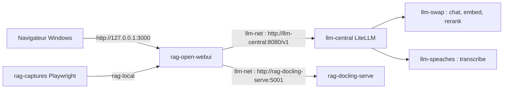

# A5. Fonctionnement interne

> **Objet** : architecture d'Open WebUI tel qu'installé ici : conteneurs, réseaux, ports, chemin d'une question, découpage des documents, budget de contexte.
> **Prérequis** : chapitre 02 (installation).
> **Version décrite** : Open WebUI 0.13.3 (`ghcr.io/open-webui/open-webui:v0.13.3@sha256:46b59158…2f14`), docling-serve 1.38.2, service LLM central (LiteLLM v1.109.0, llama-swap v272), essais du 13 novembre 2026.
> **Statut des informations** : [Vérifié] constaté sur la machine d'essai, avec le fichier de résultat cité ; [Source] lu dans le code au tag v0.13.3 (`outils/resultats/open-webui/cadrage-source-v0.13.3.md`) ; [Estimation] calcul indiqué ; [À tester] non essayé.
> **Précautions** : aucune ; lecture seule.

## Sommaire

1. [Architecture](#1-architecture)
2. [Chemin d'un document](#2-chemin-dun-document)
3. [Chemin d'une question](#3-chemin-dune-question)
4. [Budget de contexte](#4-budget-de-contexte)
5. [Réglages : environnement et base](#5-réglages--environnement-et-base)
6. [Stockage](#6-stockage)

## 1. Architecture

| Service | Conteneur | Image | Rôle | Port publié |
|---|---|---|---|---|
| Open WebUI | `rag-open-webui` | `ghcr.io/open-webui/open-webui:v0.13.3` | interface web, API, comptes, lecture et découpage des documents, base vectorielle Chroma intégrée, base SQLite | `127.0.0.1:3000 -> 8080` [Vérifié] `installation-2026-11-13.log` |
| Docling (facultatif) | `rag-docling-serve` | `quay.io/docling-project/docling-serve-cpu:v1.38.2` | lecture des PDF scannés et des mises en page complexes | aucun [Vérifié] `docling-demarrage-2026-11-13.log` |
| Service LLM central (géré à part) | `llm-central`, `llm-swap`, `llm-speaches` | LiteLLM, llama-swap, speaches | `chat`, `embed`, `rerank`, `transcribe` | `127.0.0.1:8080` (porte d'entrée) |

Réseaux : `llm-net` (externe, créé par LLM-Service) relie Open WebUI au service central et à Docling ; `rag-local` relie Open WebUI au conteneur de captures. [Vérifié] `outils/open-webui/compose.yml`.

## 2. Chemin d'un document

1. Téléversement (`POST /api/v1/files/`) : fichier rangé dans `data/uploads/`. [Source]
2. Lecture : moteur d'extraction choisi dans Réglages › Administrateur › Documents. Par défaut, chargeurs intégrés (PDF page par page, Word, PowerPoint, Excel, HTML, Markdown) ; audio transcrit par `transcribe`. Un PDF sans couche texte (scan) donne un contenu vide et l'ajout à une base est refusé (« The content provided is empty ») [Vérifié] ([capture 05/08](../../../outils/resultats/open-webui/captures/05-bases-de-connaissances/08-scan-refuse.txt)) ; base du banc par défaut réduite à 8 documents sur 9 (champ `indexation` de `banc-2026-11-13-defaut-sans-rerank.json`). Avec Docling, le scan est lu par reconnaissance de caractères.
3. Découpage : 1 024 caractères par passage, 100 de recouvrement, découpage par titres Markdown actif. [Vérifié] `retrieval-config-defaut-2026-11-13.json`
4. Embeddings : `embed` (bge-m3, 1 024 dimensions) par lots de 4 (réglage de l'installation ; 1 par défaut). [Vérifié] `outils/open-webui/compose.yml` (`RAG_EMBEDDING_BATCH_SIZE: "4"`) et valeur relue par l'instance, `embedding.RAG_EMBEDDING_BATCH_SIZE` : 4 dans le champ `config` des six `banc-2026-11-13-*.json` ; valeur par défaut 1 [Source] ([cadrage-source-v0.13.3.md](../../../outils/resultats/open-webui/cadrage-source-v0.13.3.md), `config.py:1028-1030`)
5. Stockage des vecteurs : Chroma, dans `data/vector_db/`, une collection par fichier et une par base. [Source]

## 3. Chemin d'une question

Question posée avec une base attachée (« # » dans le chat, ou modèle personnalisé lié à la base) :

1. **Réécriture de la requête** : le modèle de tâche (`chat` par défaut) reçoit la question et produit plusieurs requêtes de recherche (« Génération de requête de RAG », active par défaut). Avec la réflexion de `chat`, cet appel prend une grande part du temps d'attente. [Vérifié] libellé : [capture 08/08](../../../outils/resultats/open-webui/captures/08-regler-la-lecture-des-documents/08-requetes.txt) ; 2 ou 3 requêtes par question dans le journal du conteneur (« Starting hybrid search for 2 queries », « … for 3 queries », [preuve-reranker-externe](../../../outils/resultats/open-webui/preuve-reranker-externe-2026-11-13.log)) ; [Source] `ENABLE_RETRIEVAL_QUERY_GENERATION` ([cadrage-source-v0.13.3.md](../../../outils/resultats/open-webui/cadrage-source-v0.13.3.md))
2. **Recherche** : chaque requête est convertie par `embed` et comparée aux passages ; 10 passages retenus par défaut (« Top K »). Avec « Recherche hybride », une recherche par mots (BM25) est combinée à la recherche par le sens, puis `rerank` reclasse les passages (« Top K Reranker »). [Vérifié] `retrieval-config-defaut-2026-11-13.json` ; [Source] reranker externe
3. **Réponse** : les passages sont insérés dans la consigne RAG (« Modèle RAG ») et envoyés à `chat`, qui répond avec des renvois `[1]`, `[2]`… La liste des sources (document, page, extrait, score) est jointe à la réponse. [Vérifié] `essai-minimal-api-2026-11-13.json`
4. **Tâches de fond** dans l'interface : génération du titre, des étiquettes et des questions de suite, chacune par un appel au modèle de tâche. [Source]

Dans l'interface, le modèle peut aussi consulter les bases par l'appel d'outils natif (le modèle décide de chercher) ; par l'API sans session, la recherche classique ci-dessus s'applique. [Source] `CHANGELOG.md` 0.13.1

## 4. Budget de contexte

Le service central accorde 16 384 jetons par requête à `chat` (consigne, passages, historique, réflexion et réponse compris).

| Poste | Valeur par défaut | Jetons [Estimation] |
|---|---|---|
| Passages | 10 × 1 024 caractères | environ 2 600 (1 jeton ≈ 4 caractères en français) |
| Consigne RAG et question | — | environ 500 |
| Historique | conversation entière | variable |
| Réflexion et réponse | — | 1 458 mesurés à Q01 [Vérifié] ; 4 000 réservés dans le calcul de l'annexe [A2](A2-choisir-son-materiel-et-ses-modeles.md) [Estimation] (marge pour une réflexion plus longue que celle de Q01) |

Mesure : question Q01, 2 093 jetons envoyés, 1 458 jetons produits (réflexion comprise). [Vérifié] `essai-minimal-api-2026-11-13.json` (`usage`). Le budget est donc large pour une question isolée ; il se remplit avec un long historique ou le mode « texte intégral ».

## 5. Réglages : environnement et base

En 0.13.3 [Source], les réglages de l'instance sont gardés dans la base (table `config`) : les variables d'environnement du fichier compose ne sont lues qu'au premier démarrage, pour les clés absentes. Les changements faits ensuite dans l'interface sont conservés aux redémarrages. [Source] ; [Vérifié] valeur du compose retrouvée par l'instance après le premier démarrage : `embedding.RAG_EMBEDDING_BATCH_SIZE` : 4 dans le champ `config` des `banc-2026-11-13-*.json`, alors que la valeur par défaut est 1.

## 6. Stockage

| Dossier (`donnees/open-webui/data/`) | Contenu |
|---|---|
| `webui.db` | base SQLite : comptes, conversations, réglages, bases de connaissances |
| `uploads/` | fichiers téléversés |
| `vector_db/` | vecteurs Chroma |
| `cache/` | modèles locaux éventuels (non utilisés ici) |

[Source] ; taille mesurée dans l'annexe A4 (26 Mo en fin d'essais, [disque-donnees](../../../outils/resultats/open-webui/disque-donnees-2026-11-13.log)) [Vérifié].

## Dépannage

| Symptôme | Cause probable | Action |
|---|---|---|
| Un réglage du compose n'a pas d'effet | la valeur est déjà en base depuis le premier démarrage | changer le réglage dans l'interface |
| Réponses lentes avec une base | réécriture de la requête par le modèle avec réflexion | voir A1, réglage des tâches |

## Sources

- Code au tag v0.13.3 : synthèse `outils/resultats/open-webui/cadrage-source-v0.13.3.md`.
- Relecture : `outils/resultats/open-webui/relecture.md`.
- Essais : `outils/resultats/open-webui/`.
