# 03. Premiers pas

> Ce chapitre apprend à créer le compte administrateur, à se connecter, à se repérer dans l'écran principal, à régler la langue, à vérifier la connexion au service de modèles et à ne garder dans la liste que les modèles qui servent à converser.
> **Point de départ** : la page d'accueil d'Open WebUI, ouverte à l'adresse `http://127.0.0.1:3000` à la fin du chapitre 02.
> **Durée** : environ 15 minutes. **Avant** : chapitre 02.

## Ce qu'il faut savoir

Open WebUI fonctionne avec des **comptes** : chaque personne a son adresse e-mail, son mot de passe, ses conversations et ses documents. Le **premier compte créé devient administrateur** : il règle l'instance pour tout le monde (connexions aux modèles, lecture des documents, comptes des autres personnes). Après lui, les nouvelles inscriptions sont fermées par défaut ; l'administrateur crée lui-même les autres comptes (chapitre 14).

Tous les réglages sont dans **une seule fenêtre, « Réglages »**, ouverte depuis le menu du compte. Sa colonne de gauche a deux groupes : « Personnel » (réglages du compte : langue, thème, voix…) et, pour un administrateur, « Administrateur » (réglages de l'instance : connexions, modèles, documents…).

L'installation du chapitre 02 a déjà déclaré le service de modèles. Le service propose plusieurs modèles ; seuls `chat` (le modèle de réponse) et `gemma-4-e4b` (un second modèle de conversation) servent à converser. Les autres (`embed`, `rerank`, `transcribe` et leurs noms techniques) sont utilisés en coulisse : on les masque de la liste pour éviter de les choisir par erreur.

## Créer le compte administrateur

**Étape 1. Ouvrir le formulaire de création**
*Où* : page d'accueil d'une instance neuve.
Cliquer sur « Démarrer » (pastille 1).

*Écran : accueil, « Bienvenue dans votre espace IA. ».*

| N° | Élément | Rôle |
|---|---|---|
| 1 | « Démarrer » | ouvre le formulaire « Démarrez avec Open WebUI » |

*Résultat* : le formulaire « Démarrez avec Open WebUI » s'affiche.

**Étape 2. Remplir et valider**
*Où* : formulaire « Démarrez avec Open WebUI ».
Saisir le nom affiché (pastille 1), l'adresse e-mail qui servira d'identifiant (pastille 2) et un mot de passe (pastille 3), puis cliquer sur « Créer un compte administrateur » (pastille 4). L'adresse n'a pas besoin d'exister : aucun message n'est envoyé.

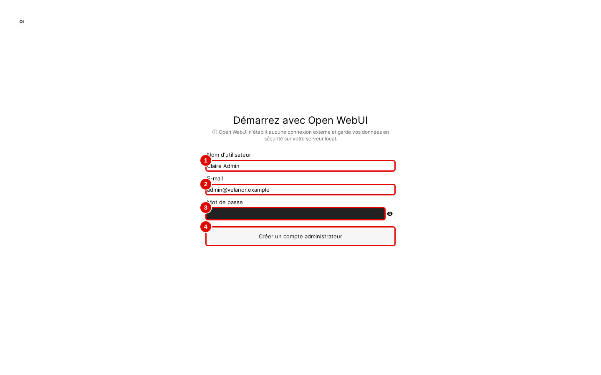
*Écran : « Démarrez avec Open WebUI » (le mot de passe est masqué sur la capture).*

| N° | Élément | Rôle |
|---|---|---|
| 1 | « Nom d'utilisateur » | nom affiché en bas de la barre latérale et dans les conversations partagées |
| 2 | « E-mail » | identifiant de connexion |
| 3 | « Mot de passe » | mot de passe du compte ; l'œil à droite l'affiche en clair |
| 4 | « Créer un compte administrateur » | crée le compte et ouvre la session |

*Résultat* : l'écran principal s'ouvre, recouvert d'une fenêtre « Quoi de neuf dans Open WebUI » qui liste les nouveautés de la version (en anglais). Cliquer sur « D'accord, allons-y ! » en bas à droite pour la fermer ; elle ne revient qu'après une mise à jour.

## Se connecter

**Étape 3. Ouvrir une session**
*Où* : `http://127.0.0.1:3000`, quand aucune session n'est ouverte (après « Déconnexion » ou sur un autre navigateur).
Saisir l'adresse e-mail (pastille 1) et le mot de passe (pastille 2), puis cliquer sur « Connexion » (pastille 3).

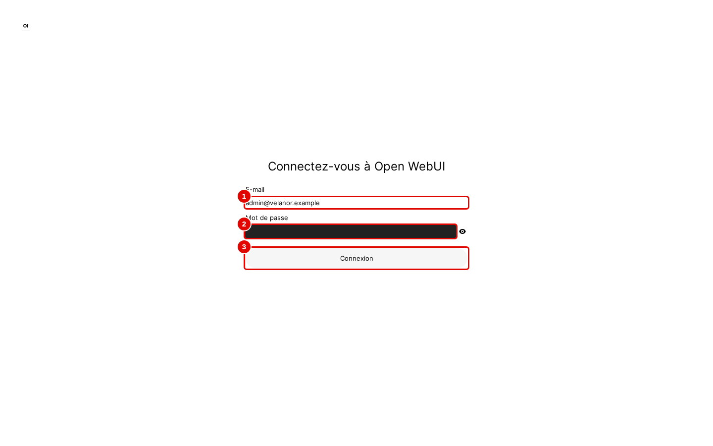
*Écran : « Connectez-vous à Open WebUI ».*

| N° | Élément | Rôle |
|---|---|---|
| 1 | « E-mail » | adresse du compte |
| 2 | « Mot de passe » | mot de passe du compte |
| 3 | « Connexion » | ouvre la session |

*Résultat* : l'écran principal s'affiche. La session reste ouverte sur ce navigateur jusqu'à la déconnexion.

## Se repérer dans l'écran principal

**Étape 4. Ouvrir la barre latérale et repérer les zones**
*Où* : écran principal. Au premier affichage, la barre latérale est repliée en une colonne d'icônes à gauche ; cliquer sur l'icône du haut (bulle « Ouvrir la barre latérale ») pour la déplier.

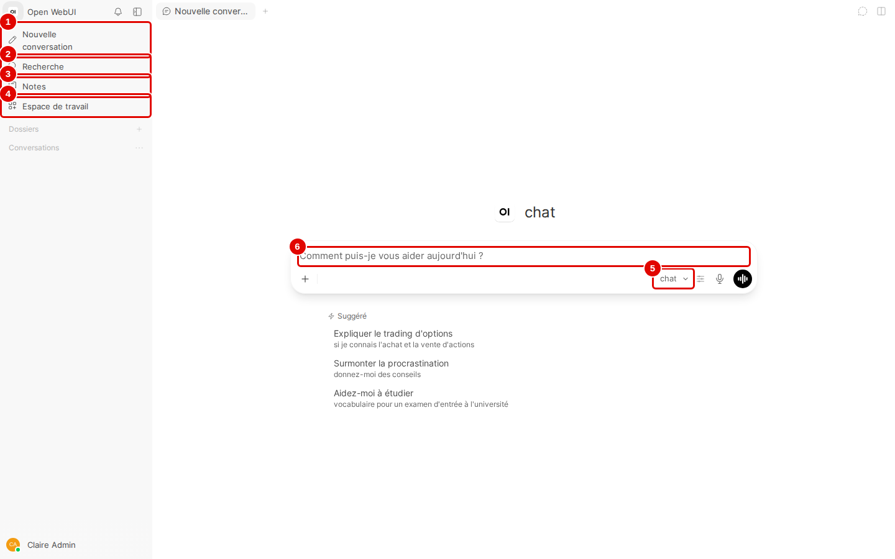
*Écran : écran principal, barre latérale ouverte, nouvelle conversation.*

| N° | Élément | Rôle |
|---|---|---|
| 1 | « Nouvelle conversation » | ouvre une conversation vide |
| 2 | « Recherche » | cherche un mot dans toutes les conversations (raccourci Ctrl+K) |
| 3 | « Notes » | ouvre les notes (chapitre 10) |
| 4 | « Espace de travail » | ouvre les modèles personnalisés, les bases de connaissances, les prompts, les outils et les skills (chapitres 05, 07 et 11) |
| 5 | « chat » (sélecteur de modèle) | choisit le modèle qui répond ; `chat` par défaut |
| 6 | « Comment puis-je vous aider aujourd'hui ? » | zone de saisie de la question ; Entrée envoie, Maj+Entrée va à la ligne |

Sous ces entrées, « Dossiers » et « Conversations » listent les conversations enregistrées (chapitre 09). En haut de l'écran, l'onglet « Nouvelle conversation » montre que plusieurs conversations peuvent être ouvertes côte à côte en onglets (le « + » en ajoute un). Sous la zone de saisie, « Suggéré » propose des exemples de questions.

*Résultat* : les zones de l'écran sont repérées.

**Étape 5. Ouvrir le menu du compte**
*Où* : barre latérale, en bas, nom du compte (« Claire Admin » sur la capture).
Cliquer sur le nom du compte.

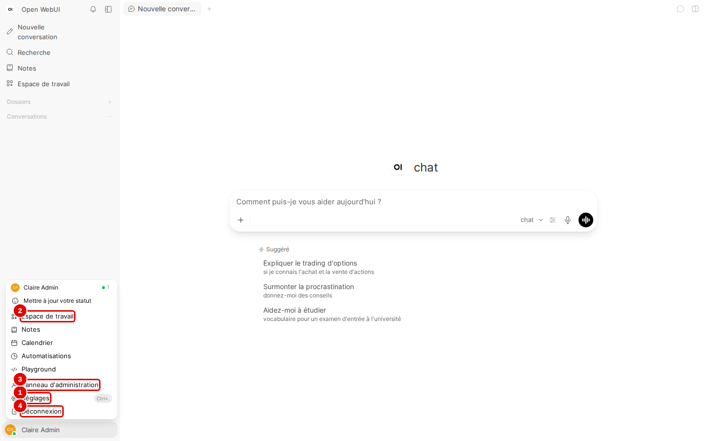
*Écran : menu du compte ouvert.*

| N° | Élément | Rôle |
|---|---|---|
| 1 | « Réglages » | ouvre la fenêtre Réglages |
| 2 | « Espace de travail » | même page que l'entrée de la barre latérale |
| 3 | « Panneau d'administration » | ouvre la gestion des utilisateurs, des évaluations et des fonctions (administrateur seulement, chapitres 14 et 15) |
| 4 | « Déconnexion » | ferme la session |

Le menu donne aussi accès à « Mettre à jour votre statut », « Notes », « Calendrier », « Automatisations » (chapitre 13) et « Playground » (chapitre 15).

*Résultat* : le menu est ouvert ; Échap le ferme.

## Régler la langue

**Étape 6. Choisir la langue de l'interface**
*Où* : menu du compte › « Réglages » › groupe « Personnel » › « Général » (avec une interface encore en anglais : menu du compte › « Settings » › « General »).
Dans la liste « Langue » (« Language » en anglais) (pastille 2), choisir « French (France) », puis cliquer sur « Enregistrer » (pastille 3).

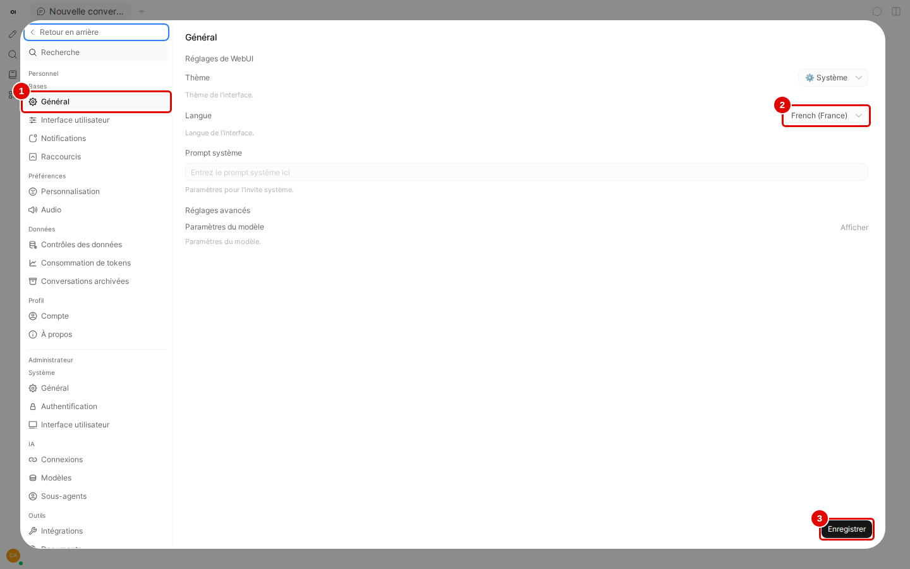
*Écran : fenêtre Réglages, onglet « Général » du groupe « Personnel ».*

| N° | Élément | Rôle |
|---|---|---|
| 1 | « Général » | onglet des réglages généraux du compte |
| 2 | « Langue » | langue de l'interface pour ce compte |
| 3 | « Enregistrer » | garde les réglages de l'onglet |

L'onglet règle aussi le « Thème » (clair, sombre, selon le système) et un « Prompt système » personnel, consigne ajoutée à toutes les conversations du compte. L'interface suit la langue du navigateur au premier affichage : sur un navigateur en français, elle est déjà en français. Une partie des libellés n'est pas traduite et reste en anglais (par exemple « Available », « Chat Completions ») : ce manuel les cite tels quels.

*Résultat* : l'interface est en français.

## Vérifier la connexion aux modèles

**Étape 7. Ouvrir la liste des connexions**
*Où* : menu du compte › « Réglages » › groupe « Administrateur » › « Connexions ».

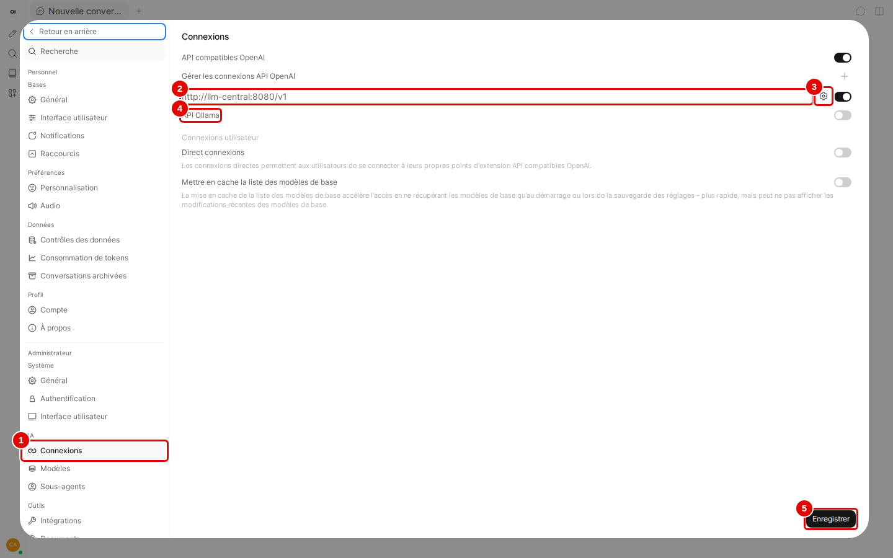
*Écran : fenêtre Réglages, onglet « Connexions » du groupe « Administrateur ».*

| N° | Élément | Rôle |
|---|---|---|
| 1 | « Connexions » | onglet des services de modèles déclarés |
| 2 | `http://llm-central:8080/v1` | connexion au service de modèles, créée par l'installation ; l'interrupteur à droite l'active |
| 3 | « Configurer » (roue dentée) | ouvre la fenêtre « Modifier la connexion » |
| 4 | « API Ollama » | autre type de service de modèles ; désactivé, il n'est pas utilisé ici |
| 5 | « Enregistrer » | garde les changements de l'onglet |

Le « + » à droite de « Gérer les connexions API OpenAI » ajoute une autre connexion compatible OpenAI. « Direct connexions » permettrait à chaque utilisateur de brancher son propre service ; laissé désactivé.

*Résultat* : la connexion au service de modèles est présente et active.

**Étape 8. Vérifier la connexion**
*Où* : onglet « Connexions », roue dentée de la ligne `http://llm-central:8080/v1`.
Cliquer sur la roue dentée, puis sur l'icône à deux flèches à droite de l'adresse, « Vérifier la connexion » (pastille 3).

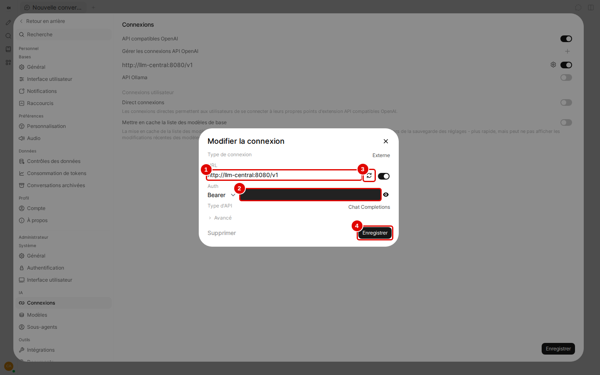
*Écran : fenêtre « Modifier la connexion » (la clé est masquée sur la capture).*

| N° | Élément | Rôle |
|---|---|---|
| 1 | « URL » | adresse du service de modèles vue depuis le conteneur : `http://llm-central:8080/v1` |
| 2 | Clé (champ à droite de « Bearer ») | clé du service de modèles (valeur de `LLM_CENTRAL_KEY` du fichier `.env`) |
| 3 | « Vérifier la connexion » | interroge le service et affiche le résultat |
| 4 | « Enregistrer » | garde l'adresse et la clé |

Pour déclarer le service à la main (si l'installation n'a pas pu le faire), cliquer sur le « + » de l'étape 7 et remplir les mêmes champs. Sous « Avancé », un champ « ID de modèle » limite la liste aux modèles nommés ; laissé vide, tous les modèles du service sont proposés.

*Résultat* : un message vert « Connexion au serveur vérifiée » s'affiche en haut à droite.

*Où* : fenêtre « Modifier la connexion », juste après le clic sur « Vérifier la connexion ».

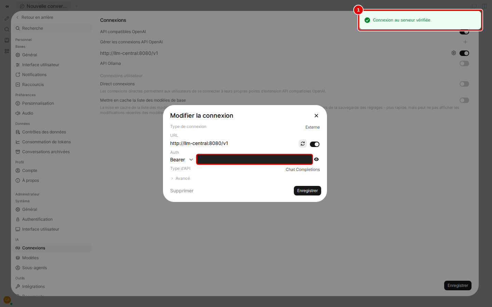
*Écran : fenêtre « Modifier la connexion », message de confirmation.*

| N° | Élément | Rôle |
|---|---|---|
| 1 | « Connexion au serveur vérifiée » | le service répond avec cette adresse et cette clé |

Fermer la fenêtre par la croix.

## Ne garder que les modèles de conversation

**Étape 9. Ouvrir la liste des modèles**
*Où* : menu du compte › « Réglages » › groupe « Administrateur » › « Modèles ».

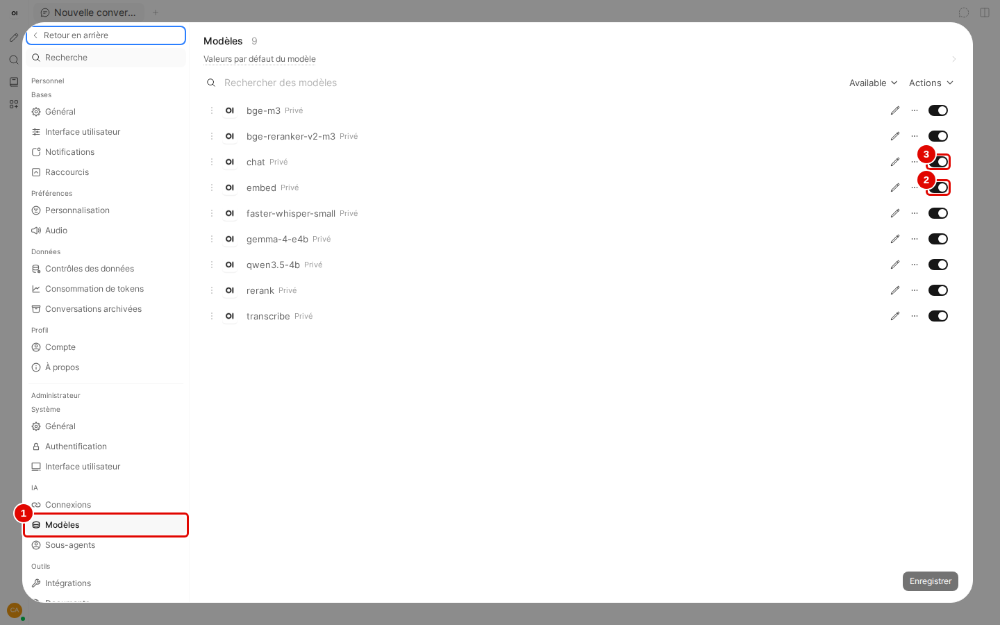
*Écran : onglet « Modèles », tous les modèles actifs.*

| N° | Élément | Rôle |
|---|---|---|
| 1 | « Modèles » | onglet de la liste des modèles proposés par les connexions |
| 2 | interrupteur de la ligne `embed` | rend le modèle disponible ou non dans les conversations |
| 3 | interrupteur de la ligne `chat` | idem pour le modèle de réponse |

Le crayon d'une ligne ouvre la fiche du modèle (nom affiché, description, consigne, paramètres, droits d'accès) ; « Privé » signifie que seul l'administrateur le voit tant qu'il n'est pas partagé (chapitre 14).

*Résultat* : neuf modèles sont listés, tous actifs.

**Étape 10. Désactiver les modèles techniques**
*Où* : onglet « Modèles ».
Cliquer sur l'interrupteur des lignes `bge-m3`, `bge-reranker-v2-m3`, `embed`, `faster-whisper-small`, `qwen3.5-4b`, `rerank` et `transcribe`. Chaque clic est enregistré tout de suite. Garder actifs `chat` et `gemma-4-e4b`.

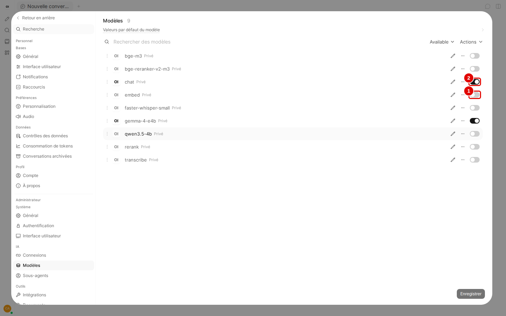
*Écran : onglet « Modèles », seuls `chat` et `gemma-4-e4b` restent actifs.*

| N° | Élément | Rôle |
|---|---|---|
| 1 | interrupteur de la ligne `embed` | désactivé : `embed` ne figure plus dans le sélecteur, mais reste utilisé pour lire les documents |
| 2 | interrupteur de la ligne `chat` | actif : modèle de réponse |

`qwen3.5-4b` est le nom technique du même modèle que `chat` : le garder ferait un doublon. Désactiver un modèle ne l'empêche pas de servir en coulisse (lecture des documents, transcription, tri).

*Résultat* : seuls `chat` et `gemma-4-e4b` restent actifs.

**Étape 11. Contrôler le sélecteur de modèle**
*Où* : barre latérale › « Nouvelle conversation », puis sélecteur « chat » sous la zone de saisie.
Cliquer sur « chat » (pastille 1).

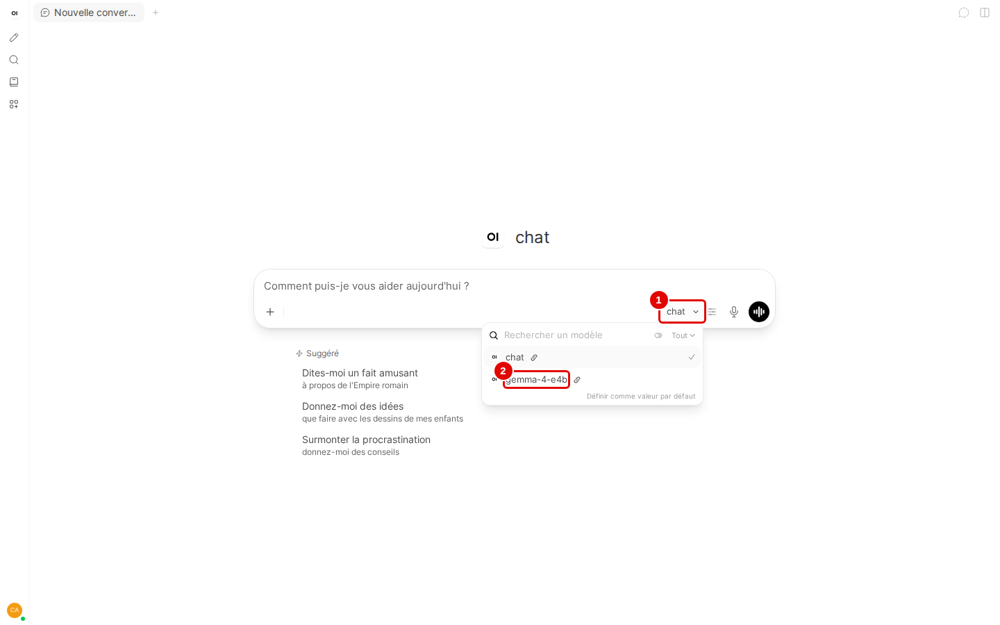
*Écran : nouvelle conversation, sélecteur de modèle ouvert.*

| N° | Élément | Rôle |
|---|---|---|
| 1 | « chat » | modèle choisi pour la conversation ; la coche le rappelle dans la liste |
| 2 | « gemma-4-e4b » | second modèle de conversation, chargé à la demande par le service (première réponse plus lente) |

« Définir comme valeur par défaut » garde le modèle choisi pour les nouvelles conversations.

*Résultat* : la liste ne propose plus que `chat` et `gemma-4-e4b`. Open WebUI est prêt pour une première question (chapitre 04).

## Bon à savoir

- Les réglages de l'administrateur valent pour tous les comptes ; ceux du groupe « Personnel » ne valent que pour le compte connecté.
- Le service de modèles reste maître de ses modèles : ajouter ou retirer un modèle se fait dans LLM-Service, pas dans Open WebUI. Après un tel changement, la liste de l'onglet « Modèles » se met à jour seule.
- `gemma-4-e4b` n'est pas chargé en permanence par le service : sa première réponse peut prendre une minute de plus.

## En cas de problème

| Symptôme | Cause | Que faire |
|---|---|---|
| Le sélecteur affiche « Sélectionnez un modèle » et la liste est vide | la connexion est désactivée, ou le service de modèles est arrêté | vérifier la connexion (étape 8) ; démarrer LLM-Service ; voir le [chapitre 17](17-en-cas-de-probleme.md) |
| La vérification de la connexion échoue | mauvaise adresse (par exemple `127.0.0.1` au lieu de `llm-central`) ou mauvaise clé | reprendre l'adresse `http://llm-central:8080/v1` et la clé du fichier `.env` |
| Mot de passe administrateur oublié | aucun envoi d'e-mail dans cette installation | prévenir ce cas en créant un second compte administrateur (chapitre 14) ; une réinitialisation sans administrateur n'a pas été essayée |

---
*Version décrite : Open WebUI 0.13.3, essais du 13 novembre 2026. Détails et preuves : [rapport d'essais](../annexes/A6-rapport-d-essais.md).*
