# 05. Créer et alimenter une base de connaissances

> Ce chapitre apprend à créer une base de connaissances, à y déposer des fichiers, à vérifier ce qu'Open WebUI en a lu, et à gérer fichiers et bases (télécharger, renommer, retirer, exporter, supprimer).
> **Point de départ** : écran principal, connecté avec le compte administrateur (chapitre 03).
> **Durée** : environ 15 minutes. **Avant** : chapitre 04.

**Attention** : « Supprimer » une base efface la base et ses fichiers pour tous les comptes qui y ont accès. Exporter la base avant, si elle doit être gardée.

## Ce qu'il faut savoir

Une **base de connaissances** (« Connaissances » dans l'interface) est un ensemble de documents rangés sous un nom, par exemple « Procédures qualité » ou « Contrats fournisseurs ». Une fois créée, elle s'appelle dans n'importe quelle conversation (chapitre 06) ou se rattache à un assistant (chapitre 07), sans renvoyer les fichiers à chaque fois.

À l'ajout d'un fichier, Open WebUI le lit, le découpe en passages d'environ 1 000 caractères et calcule la représentation de chaque passage avec le modèle `embed` du service de modèles. Le traitement prend deux à trois secondes par document (huit secondes pour un message vocal, qui est d'abord transcrit). Une base est **privée** par défaut : seul son créateur la voit, jusqu'à ce qu'il la partage (chapitre 14).

Ce chapitre crée la base « Démo Vélanor » avec les documents du jeu d'essai (`corpus/documents/` du dépôt) : rapport annuel, procédure, présentation, classeur, page web, note, audit en anglais et message vocal. Le contrat scanné, lui, est refusé par la lecture par défaut : le chapitre 08 montre comment le faire lire.

## Créer la base

**Étape 1. Ouvrir la liste des bases**
*Où* : barre latérale › « Espace de travail » › onglet « Connaissances ».
Cliquer sur « Créer » (pastille 2).

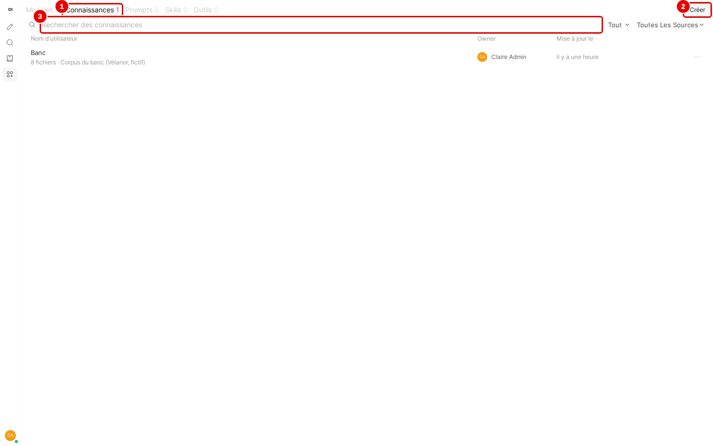
*Écran : Espace de travail, onglet « Connaissances ».*

| N° | Élément | Rôle |
|---|---|---|
| 1 | « Connaissances » | onglet des bases ; le chiffre indique leur nombre |
| 2 | « Créer » | ouvre la fenêtre « Créer une base de connaissances » |
| 3 | « Rechercher des connaissances » | filtre la liste par nom |

Les filtres « Tout » et « Toutes Les Sources » à droite trient la liste (bases personnelles ou partagées, origine). La base « Banc » visible sur la capture a servi aux mesures de l'annexe A1.

*Résultat* : la fenêtre « Créer une base de connaissances » s'ouvre.

**Étape 2. Nommer et décrire la base**
*Où* : fenêtre « Créer une base de connaissances ».
Saisir le nom `Démo Vélanor` (pastille 1) et une description, obligatoire (pastille 2), laisser « Privé » (pastille 3), puis cliquer sur « Créer une connaissance » (pastille 4).

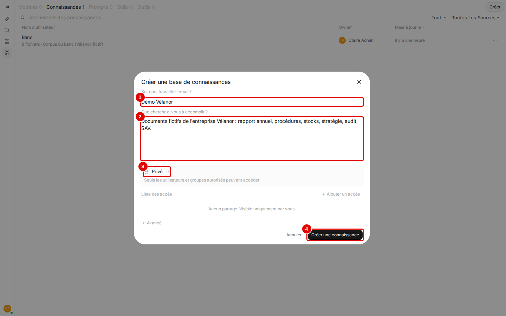
*Écran : fenêtre « Créer une base de connaissances ».*

| N° | Élément | Rôle |
|---|---|---|
| 1 | « Sur quoi travaillez-vous ? » | nom de la base, affiché dans les listes et après « # » dans le chat |
| 2 | « Que cherchez-vous à accomplir ? » | description ; le modèle la lit pour savoir quand utiliser la base |
| 3 | « Privé » (Visibilité) | qui voit la base : « Privé » (le créateur et les accès ajoutés) ou « Public » (tous les comptes) |
| 4 | « Créer une connaissance » | crée la base et l'ouvre |

« Ajouter un accès » partage la base avec un compte ou un groupe dès sa création (chapitre 14) ; « Avancé » fixe un nombre maximal de fichiers (« File count limit ») et une taille maximale par fichier (« File size limit (MB) ») pour cette base. Sans description, la création est refusée avec le message « Please fill out this field. ».

*Résultat* : la page de la base « Démo Vélanor » s'ouvre, vide.

**Étape 3. Repérer la page de la base**
*Où* : page de la base « Démo Vélanor ».

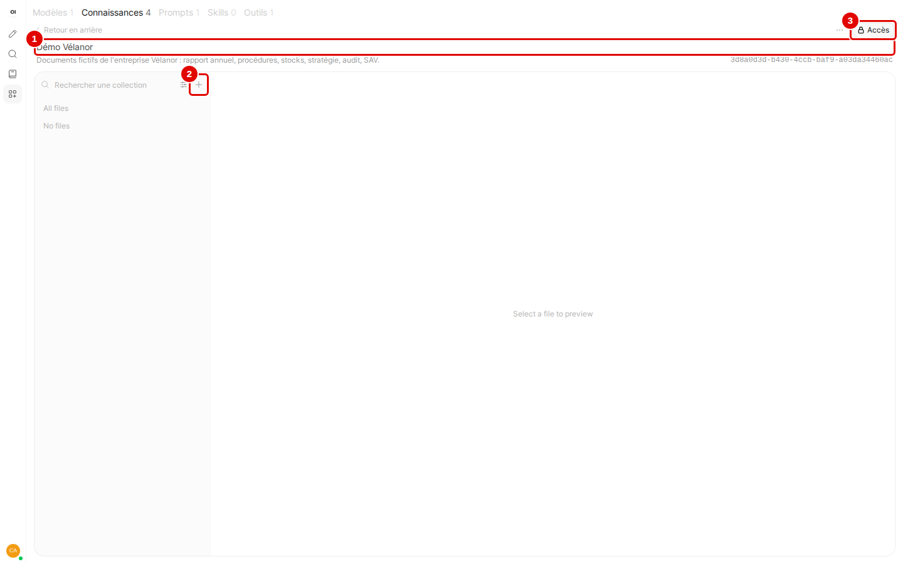
*Écran : page de la base « Démo Vélanor », sans fichier.*

| N° | Élément | Rôle |
|---|---|---|
| 1 | nom de la base, avec sa description juste en dessous | modifiables directement en cliquant dessus |
| 2 | « Ajouter du contenu » (« + ») | ouvre le menu d'ajout |
| 3 | « Accès » | qui peut lire ou modifier la base (chapitre 14) |

*Résultat* : la base existe ; il reste à la remplir.

## Ajouter des fichiers

**Étape 4. Ouvrir le menu d'ajout**
*Où* : page de la base, colonne de gauche, « + » à droite de « Rechercher une collection ».
Cliquer sur « + » (pastille 1), puis sur « Téléverser des fichiers » (pastille 2).

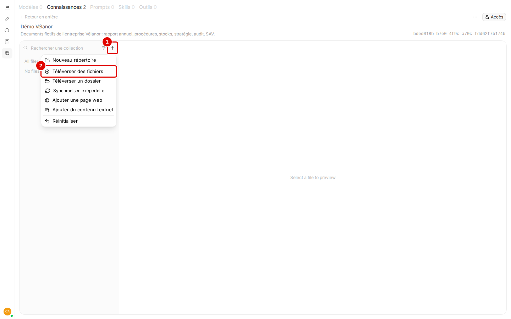
*Écran : page de la base, menu « Ajouter du contenu » ouvert.*

| N° | Élément | Rôle |
|---|---|---|
| 1 | « Ajouter du contenu » | ouvre le menu |
| 2 | « Téléverser des fichiers » | ouvre la fenêtre de choix de fichiers de Windows (plusieurs fichiers à la fois avec Ctrl ou Maj) |

Autres entrées : « Nouveau répertoire » (ranger les fichiers en dossiers dans la base), « Téléverser un dossier » (tout un dossier du poste), « Synchroniser le répertoire » (remettre la base à l'image d'un dossier du poste), « Ajouter une page web » (lire une adresse web), « Ajouter du contenu textuel » (coller un texte) et « Réinitialiser » (vider la base).

*Résultat* : la fenêtre « Ouvrir » de Windows s'affiche.

**Étape 5. Choisir les fichiers**
*Où* : fenêtre « Ouvrir » de Windows, dossier `corpus/documents` du dépôt.
Sélectionner les huit fichiers autres que `contrat-batterix-scan.pdf` et cliquer sur « Ouvrir ».

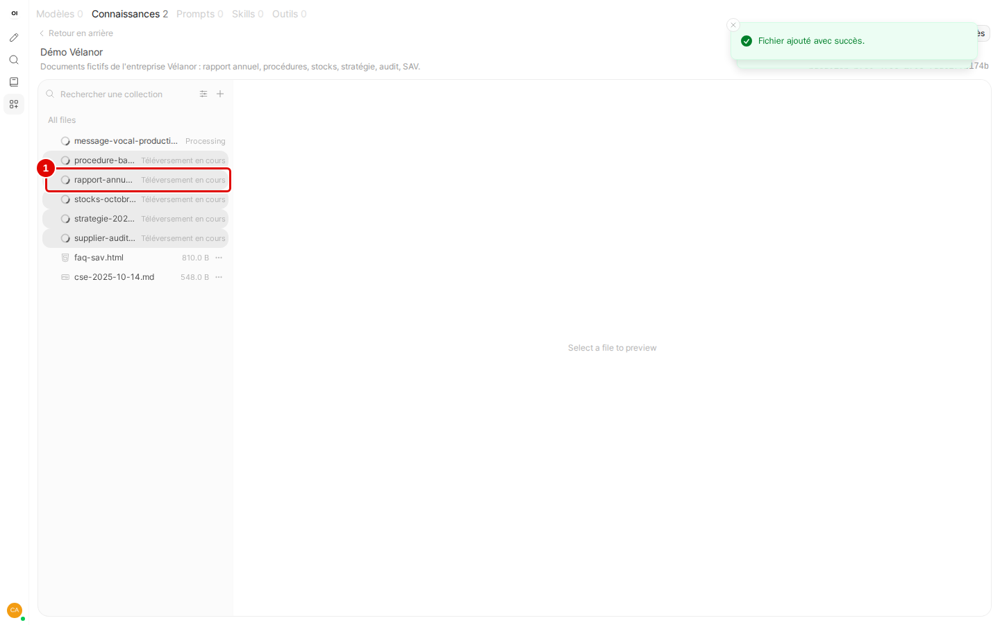
*Écran : page de la base, fichiers en cours de traitement.*

| N° | Élément | Rôle |
|---|---|---|
| 1 | ligne d'un fichier | le fichier apparaît dès l'envoi ; une icône animée indique qu'il est en cours de lecture |

*Résultat* : après une vingtaine de secondes, un message « Fichier ajouté avec succès. » s'affiche pour chaque fichier.

**Étape 6. Contrôler la liste**
*Où* : page de la base.

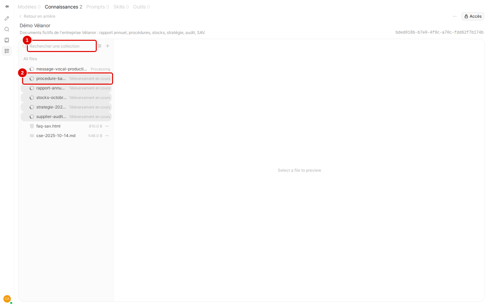
*Écran : page de la base « Démo Vélanor », huit fichiers, dont certains encore en traitement.*

| N° | Élément | Rôle |
|---|---|---|
| 1 | « Rechercher une collection » | filtre les fichiers par nom (« collection » est le nom technique d'une base de connaissances) ; l'icône à côté trie la liste |
| 2 | « procedure-batteries.docx » | un fichier de la base, avec sa taille ; un clic ouvre son aperçu |

*Résultat* : les huit fichiers sont listés sous « All files ». Tant qu'un fichier est en traitement, la mention « Téléversement en cours » s'affiche à sa place ; elle disparaît au bout de quelques secondes.

**Étape 7. Vérifier ce qui a été lu**
*Où* : page de la base, liste des fichiers.
Cliquer sur `procedure-batteries.docx` (pastille 1).

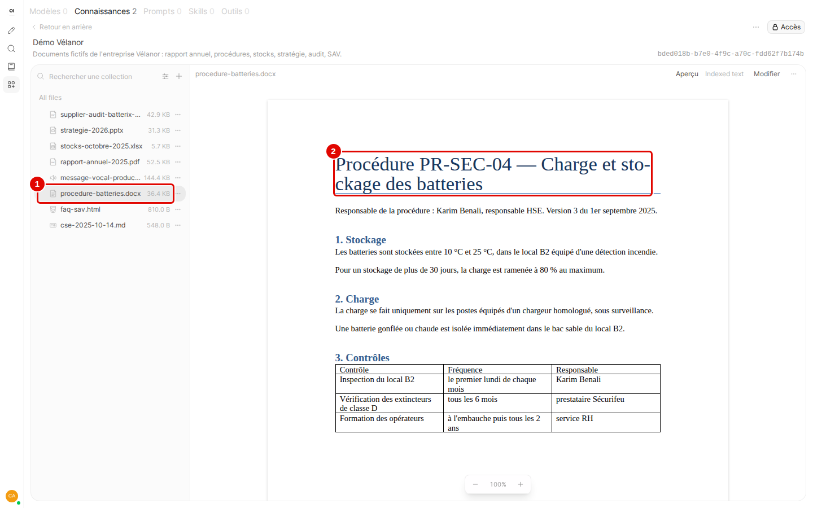
*Écran : page de la base, aperçu de « procedure-batteries.docx ».*

| N° | Élément | Rôle |
|---|---|---|
| 1 | fichier choisi | fichier affiché à droite |
| 2 | titre du document | aperçu du document tel qu'il a été déposé |

En haut à droite de l'aperçu, « Aperçu » montre le document, « Indexed text » le texte réellement extrait et découpé (celui que le modèle lira), et « Modifier » permet de corriger ce texte.

*Résultat* : le contenu du fichier est lisible ; s'il était vide dans « Indexed text », le modèle ne pourrait rien en tirer.

## Constater le refus d'un scan

**Étape 8. Essayer d'ajouter le contrat scanné**
*Où* : page de la base › « + » › « Téléverser des fichiers ».
Choisir `contrat-batterix-scan.pdf`.

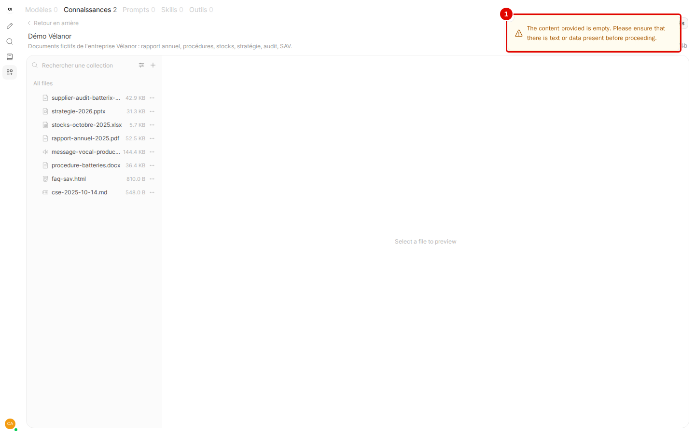
*Écran : page de la base, message d'erreur en haut à droite.*

| N° | Élément | Rôle |
|---|---|---|
| 1 | « The content provided is empty… » | le fichier ne contient aucun texte lisible : c'est une image de page |

*Résultat* : le fichier n'est pas ajouté. Le chapitre 08 branche le lecteur Docling, qui reconnaît le texte des pages scannées, puis ajoute ce fichier.

## Gérer les fichiers et la base

**Étape 9. Ouvrir le menu d'un fichier**
*Où* : page de la base, « … » au bout de la ligne d'un fichier.
Cliquer sur « … » (pastille 1).

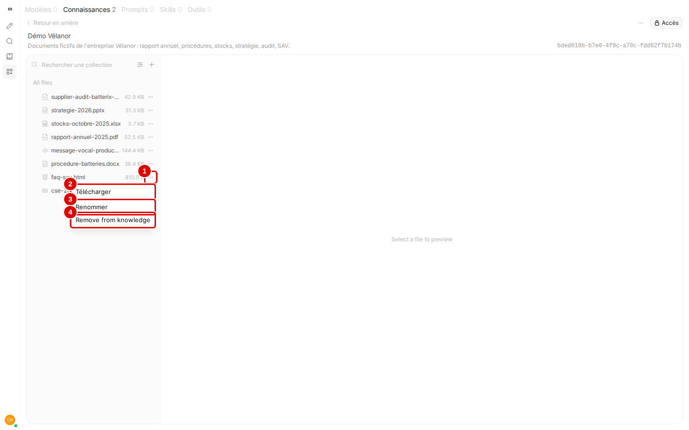
*Écran : page de la base, menu du fichier « faq-sav.html ».*

| N° | Élément | Rôle |
|---|---|---|
| 1 | « … » | ouvre le menu du fichier |
| 2 | « Télécharger » | récupère le fichier d'origine |
| 3 | « Renommer » | change le nom affiché |
| 4 | « Remove from knowledge » | retire le fichier de la base, après confirmation |

*Résultat* : le menu est ouvert ; Échap le ferme sans rien faire.

**Étape 10. Ouvrir le menu d'une base**
*Où* : Espace de travail › « Connaissances », « … » au bout de la ligne « Démo Vélanor ».
Cliquer sur « … » (pastille 1).

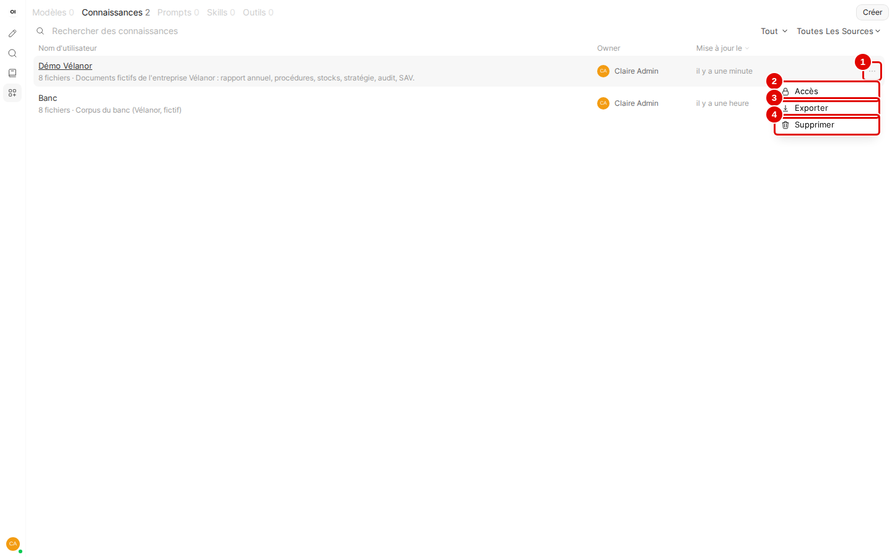
*Écran : liste des bases, menu de « Démo Vélanor ».*

| N° | Élément | Rôle |
|---|---|---|
| 1 | « Plus d'options » (« … ») | ouvre le menu de la base |
| 2 | « Accès » | règle qui voit et modifie la base (chapitre 14) |
| 3 | « Exporter » | télécharge un fichier `.zip` qui contient le texte extrait de chaque fichier (pas les fichiers d'origine) |
| 4 | « Supprimer » | efface la base, après confirmation (étape 11) |

*Résultat* : le menu est ouvert ; Échap le ferme sans rien faire.

**Étape 11. Confirmer une suppression**
*Où* : menu de la base › « Supprimer ».
Pour essayer sans risque, créer d'abord une base jetable (étapes 1 et 2), par exemple « Essai à supprimer », et ouvrir son menu : sur « Démo Vélanor », cliquer sur « Annuler ». Cliquer sur « Confirmer » (pastille 1) pour effacer, ou sur « Annuler » (pastille 2).

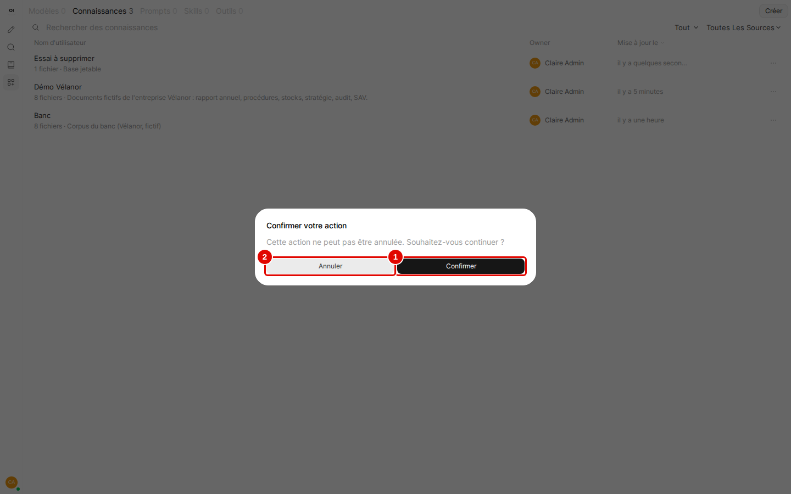
*Écran : fenêtre « Confirmer votre action ».*

| N° | Élément | Rôle |
|---|---|---|
| 1 | « Confirmer » | efface la base ; « Cette action ne peut pas être annulée. » |
| 2 | « Annuler » | ferme la fenêtre sans rien effacer |

Le retrait d'un fichier (« Remove from knowledge », étape 9) passe par la même fenêtre de confirmation.

*Résultat* : la base « Démo Vélanor » est prête à être interrogée (chapitre 06).

## Bon à savoir

- Un même fichier peut figurer dans plusieurs bases.
- Les fichiers joints directement à une conversation (chapitre 04) ne figurent dans aucune base ; ils se retrouvent dans Réglages › « Contrôles des données » › « Gérer les fichiers ».
- Après un changement de la lecture des documents (chapitre 08), les fichiers déjà présents ne sont pas relus automatiquement : utiliser « Réindexer » (chapitre 08) ou retirer puis remettre le fichier.

## En cas de problème

| Symptôme | Cause | Que faire |
|---|---|---|
| « The content provided is empty… » | PDF scanné ou image sans texte | brancher le lecteur Docling (chapitre 08) |
| Un fichier reste en cours de traitement | service de modèles arrêté (le calcul des embeddings échoue) | vérifier le service (chapitre 03, étape 8) ; voir le [chapitre 17](17-en-cas-de-probleme.md) |
| La base n'apparaît pas pour un autre compte | base privée | la partager (chapitre 14) |

---
*Version décrite : Open WebUI 0.13.3, essais du 13 novembre 2026. Détails et preuves : [rapport d'essais](../annexes/A6-rapport-d-essais.md).*
