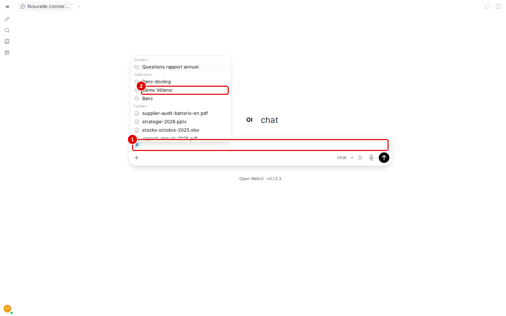
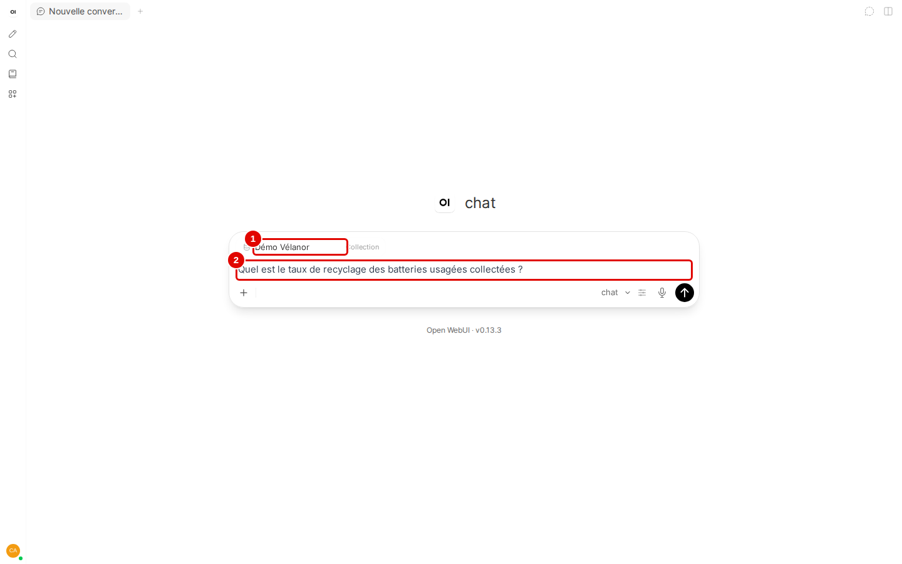
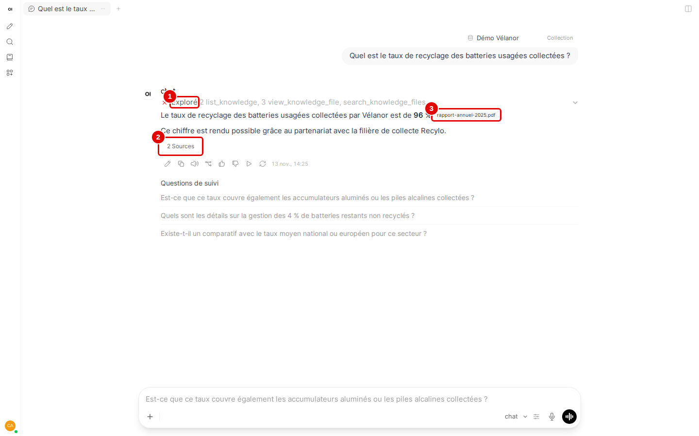
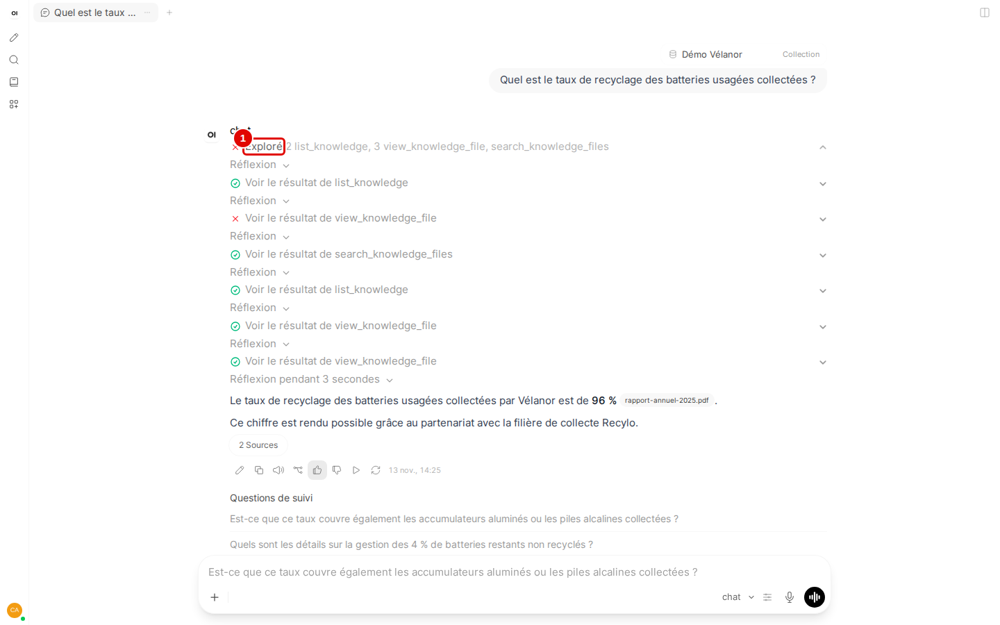
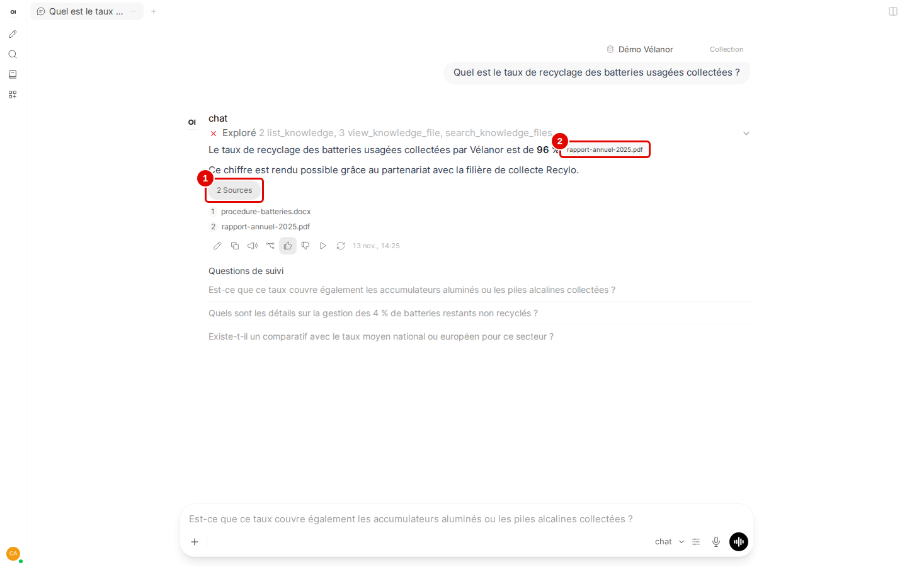
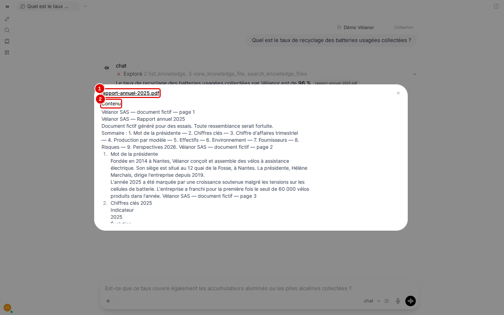
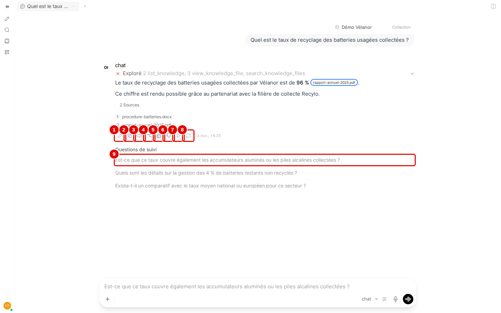
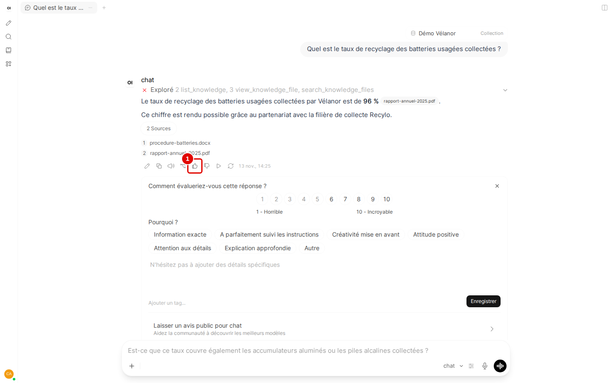

# 06. Interroger ses documents et lire les sources

> Ce chapitre apprend à poser une question sur une base de connaissances, à vérifier d'où vient la réponse (étapes de recherche, sources, passage cité), et à utiliser les actions sous une réponse : copier, régénérer, noter, poursuivre.
> **Point de départ** : écran principal, connecté avec le compte administrateur ; base « Démo Vélanor » remplie (chapitre 05).
> **Durée** : environ 15 minutes. **Avant** : chapitre 05.

## Ce qu'il faut savoir

Dans une conversation, le caractère **« # »** appelle une base de connaissances : Open WebUI la joint à la question, et le modèle y cherche la réponse. Dans cette version, le modèle **explore** la base avec des outils internes : il liste les fichiers, cherche les passages proches de la question, ouvre un fichier entier si besoin, puis répond en citant ses sources. Ces étapes s'affichent au-dessus de la réponse (« Exploré … »).

Une réponse de qualité se vérifie toujours : le nom du document cité est un lien, et un clic montre le texte qui a servi. Sur le jeu d'essai, avec les réglages du chapitre 08, les 34 questions qui avaient une réponse dans les documents ont reçu une réponse juste, et les 4 questions sans réponse ont été refusées.

Le modèle de réponse **réfléchit** avant d'écrire ; avec les réglages par défaut, une réponse demande souvent une minute. Le chapitre 08 (étape 9) et le chapitre 07 (fin) montrent comment la ramener à quelques secondes.

## Poser une question sur une base

**Étape 1. Appeler la base avec « # »**
*Où* : écran principal, zone de saisie.
Taper `#` (pastille 1) : la liste des bases accessibles s'ouvre. Cliquer sur « Démo Vélanor » (pastille 2).

*Écran : zone de saisie, liste des connaissances ouverte par « # ».*

| N° | Élément | Rôle |
|---|---|---|
| 1 | « # » | ouvre la liste à joindre, par rubriques : « Dossiers » (dossiers de conversations), « Collections » (les bases de connaissances), puis les notes et les fichiers quand il y en a |
| 2 | « Démo Vélanor » | base à interroger |

*Résultat* : la base est jointe à la question.

**Étape 2. Écrire la question et l'envoyer**
*Où* : zone de saisie.
Taper `Quel est le taux de recyclage des batteries usagées collectées ?` (pastille 2), puis appuyer sur Entrée.

*Écran : zone de saisie, base jointe au-dessus de la question.*

| N° | Élément | Rôle |
|---|---|---|
| 1 | « Démo Vélanor » (jointe) | base consultée pour cette question |
| 2 | question | texte envoyé au modèle |

*Résultat* : la question s'affiche à droite, la réponse se construit en dessous.

**Étape 3. Lire la réponse**
*Où* : conversation, sous la question.

*Écran : réponse du modèle `chat`, avec citation et sources.*

| N° | Élément | Rôle |
|---|---|---|
| 1 | « Exploré » | étapes de recherche dans la base ; un clic les déplie (étape 4) |
| 2 | « 2 Sources » | liste des documents consultés (étape 5) |
| 3 | `rapport-annuel-2025.pdf` | citation : document d'où vient l'information, juste après la phrase concernée |

La réponse obtenue : « Le taux de recyclage des batteries usagées collectées par Vélanor est de 96 % », avec la citation du rapport annuel. Sous la réponse, « Questions de suivi » propose trois questions possibles pour continuer la conversation.

*Résultat* : la réponse est lisible et datée ; il reste à la vérifier.

## Vérifier d'où vient la réponse

**Étape 4. Déplier les étapes de recherche**
*Où* : réponse, ligne « Exploré ».
Cliquer sur « Exploré » (pastille 1).

*Écran : étapes de recherche dépliées au-dessus de la réponse.*

| N° | Élément | Rôle |
|---|---|---|
| 1 | « Exploré » | replie ou déplie le détail des étapes |

Chaque ligne « Voir le résultat de … » montre ce qu'un outil a renvoyé au modèle (liste des fichiers, passages trouvés, texte d'un fichier) ; chaque ligne « Réflexion » montre le raisonnement du modèle entre deux étapes. Une croix rouge signale une étape qui a échoué : ici, une lecture de fichier, que le modèle a refaite juste après.

*Résultat* : le chemin suivi par le modèle est visible.

**Étape 5. Afficher la liste des sources**
*Où* : sous la réponse.
Cliquer sur « 2 Sources » (pastille 1).

*Écran : liste des sources dépliée sous la réponse.*

| N° | Élément | Rôle |
|---|---|---|
| 1 | « 2 Sources » | déplie ou replie la liste |
| 2 | document cité | un clic ouvre le texte utilisé (étape 6) |

*Résultat* : les documents consultés sont listés, numérotés.

**Étape 6. Lire le texte utilisé**
*Où* : sous la réponse, liste des sources, ou citation dans la réponse.
Cliquer sur `rapport-annuel-2025.pdf`.

*Écran : fenêtre de la source `rapport-annuel-2025.pdf`.*

| N° | Élément | Rôle |
|---|---|---|
| 1 | `rapport-annuel-2025.pdf` | nom du document consulté |
| 2 | « Contenu » | texte que le modèle a lu ; ici le fichier entier, car le modèle l'a ouvert en totalité |

Chercher dans ce texte la phrase qui justifie la réponse (ici, la partie « 6. Environnement » du rapport, page 7 : « Le taux de recyclage des batteries usagées collectées atteint 96 % »). Si elle n'y est pas, la réponse n'est pas fiable.

*Résultat* : la réponse est vérifiée sur le document. Échap ferme la fenêtre.

## Agir sur une réponse

**Étape 7. Connaître les actions sous la réponse**
*Où* : barre d'icônes sous la réponse (visible au survol).

*Écran : actions sous la réponse et questions de suivi.*

| N° | Élément | Rôle |
|---|---|---|
| 1 | « Modifier » (crayon) | corrige le texte de la réponse enregistrée |
| 2 | « Copier » | copie la réponse dans le presse-papiers |
| 3 | « Lire à haute voix » | fait lire la réponse par la voix du navigateur (chapitre 12) |
| 4 | « Dupliquer la conversation » | crée une copie de la conversation |
| 5 | « Bonne réponse » (pouce levé) | note la réponse (étape 8) |
| 6 | « Mauvaise réponse » (pouce baissé) | signale une mauvaise réponse |
| 7 | « Continuer la réponse » | demande au modèle de poursuivre une réponse coupée |
| 8 | « Regénérer » | redemande une réponse à la même question |
| 9 | question de suivi | question proposée pour poursuivre |

*Résultat* : chaque action est repérée.

**Étape 8. Noter une réponse**
*Où* : sous la réponse.
Cliquer sur « Bonne réponse » (pastille 1).

*Écran : réponse notée.*

| N° | Élément | Rôle |
|---|---|---|
| 1 | « Bonne réponse » | enregistre une note positive et ouvre un panneau de précisions |

Le panneau qui s'ouvre sous la réponse demande « Comment évalueriez-vous cette réponse ? » (note de 1 à 10) et « Pourquoi ? » ; ces précisions sont facultatives, « Enregistrer » les garde. Le bouton « Laisser un avis public » n'a pas été essayé : ne pas s'en servir pour des documents internes. Les notes sont visibles par l'administrateur dans Panneau d'administration › « Évaluations » (chapitre 15) : elles aident à repérer les questions mal traitées.

*Résultat* : la réponse est notée.

## Bon à savoir

- Sans « # », le modèle répond de mémoire, sans document : une réponse sans citation n'est pas tirée de la base.
- La liste ouverte par « # » propose aussi des **notes** (chapitre 10) et des fichiers isolés.
- Pour ne pas joindre la base à chaque fois, créer un assistant lié à la base (chapitre 07).

## En cas de problème

| Symptôme | Cause | Que faire |
|---|---|---|
| La base n'apparaît pas après « # » | base d'un autre compte non partagée | la faire partager (chapitre 14) |
| Réponse sans citation | base non jointe, ou rien de pertinent trouvé | vérifier la base jointe (étape 2), reformuler |
| Réponse longue à venir (une minute ou plus) | réflexion du modèle et réécriture de la question | chapitre 08, étape 9, et chapitre 07, fin |
| Réponse fausse alors que le document est dans la base | passage mal lu (scan) ou mal trouvé | régler la lecture (chapitre 08) ; voir le [chapitre 17](17-en-cas-de-probleme.md) |

---
*Version décrite : Open WebUI 0.13.3, essais du 13 novembre 2026. Détails et preuves : [rapport d'essais](../annexes/A6-rapport-d-essais.md).*
