# 07. Créer un assistant lié à une base

> Ce chapitre apprend à créer un assistant : un modèle personnalisé qui a sa propre consigne et qui consulte toujours la même base de connaissances, sans avoir à l'appeler avec « # ». Il montre aussi comment le partager avec une équipe.
> **Point de départ** : écran principal, connecté avec le compte administrateur ; base « Démo Vélanor » remplie (chapitre 05) ; groupe « Équipe production » créé (chapitre 14) pour la partie partage.
> **Durée** : environ 15 minutes. **Avant** : chapitres 05 et 06. Les étapes 6, 7, 10 et 11 demandent en plus le groupe « Équipe production » et le compte « Julien Moreau » (chapitre 14), et l'étape 11 le contrat scanné lu par Docling (chapitre 08) : à une première lecture, les sauter et y revenir après ces chapitres.

## Ce qu'il faut savoir

Open WebUI appelle « modèle » aussi bien un modèle du service (`chat`) qu'un **modèle personnalisé** construit par-dessus : même moteur de réponse, mais avec un nom, une description, une consigne permanente (« Prompt système ») et des ressources attachées (bases de connaissances, outils, filtres). Ce manuel l'appelle **assistant**.

Un assistant lié à une base sert à donner à une équipe un point d'entrée unique : la personne choisit « Assistant qualité Vélanor » dans la liste des modèles et pose sa question, sans savoir quelle base interroger. Comme une base, un assistant est **privé** par défaut : seul son créateur le voit jusqu'à ce qu'il le partage.

## Créer l'assistant

**Étape 1. Ouvrir la liste des modèles personnalisés**
*Où* : barre latérale › « Espace de travail » › onglet « Modèles ».
Cliquer sur « Créer » (pastille 2).

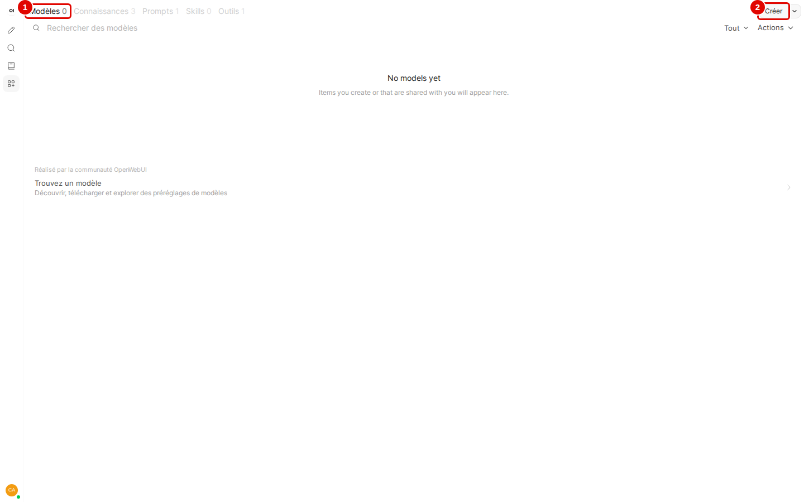
*Écran : Espace de travail, onglet « Modèles », vide.*

| N° | Élément | Rôle |
|---|---|---|
| 1 | « Modèles » | onglet des modèles personnalisés ; le chiffre indique leur nombre |
| 2 | « Créer » | ouvre l'éditeur d'un nouveau modèle |

*Résultat* : l'éditeur de modèle s'ouvre, vide.

**Étape 2. Donner une identité et une consigne**
*Où* : éditeur de modèle, haut de la page.
Saisir le nom `Assistant qualité Vélanor` (pastille 1) et une description (pastille 3). Dans « Modèle de base (à partir de) », cliquer sur « Chosir un modèle de base » (libellé tel quel dans l'interface) et choisir `chat` (pastille 4). Dans « Prompt système », écrire la consigne (pastille 5) :

```text
Tu es l'assistant qualité de Vélanor. Réponds en français, en trois phrases au plus, uniquement à partir des documents de la base. Si l'information n'y figure pas, dis-le.
```

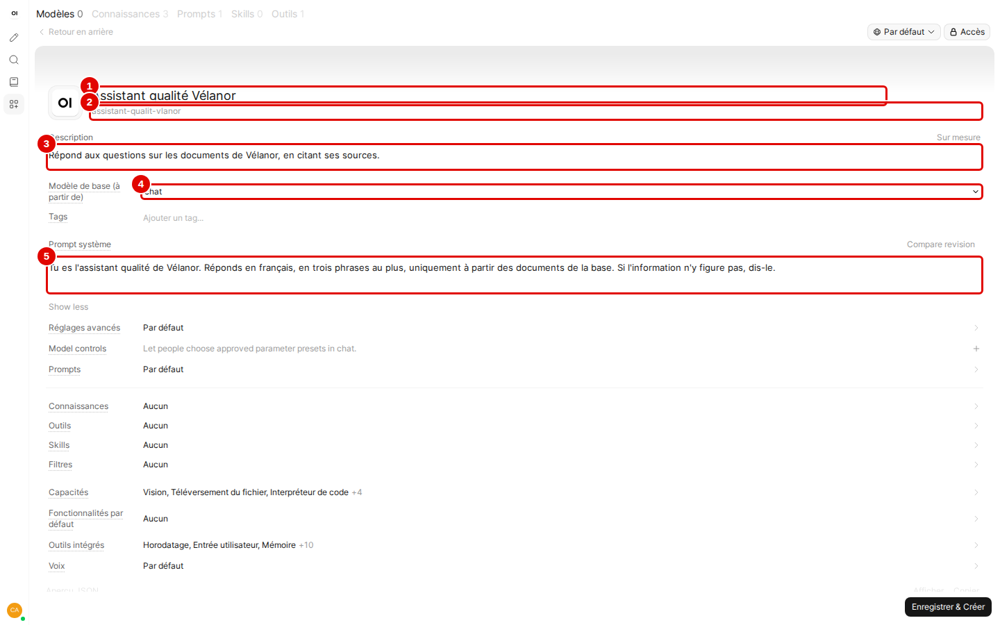
*Écran : éditeur de modèle, nom, description, modèle de base et prompt système remplis.*

| N° | Élément | Rôle |
|---|---|---|
| 1 | « Nom du modèle » | nom affiché dans la liste des modèles des conversations |
| 2 | « ID du modèle » | identifiant technique, proposé à partir du nom (les lettres accentuées sont supprimées : `assistant-qualit-vlanor`) ; il sert dans l'API (annexe A3) |
| 3 | « Description » | phrase affichée sous le nom |
| 4 | « Modèle de base (à partir de) » | modèle du service qui répond réellement |
| 5 | « Prompt système » | consigne envoyée au modèle avant chaque question |

*Résultat* : l'assistant a un nom, un moteur et une consigne.

**Étape 3. Attacher la base de connaissances**
*Où* : éditeur de modèle, ligne « Connaissances ».
Cliquer sur « Connaissances », puis choisir « Démo Vélanor » (pastille 2) sous « Collections » et cliquer sur « Terminé » (pastille 3).

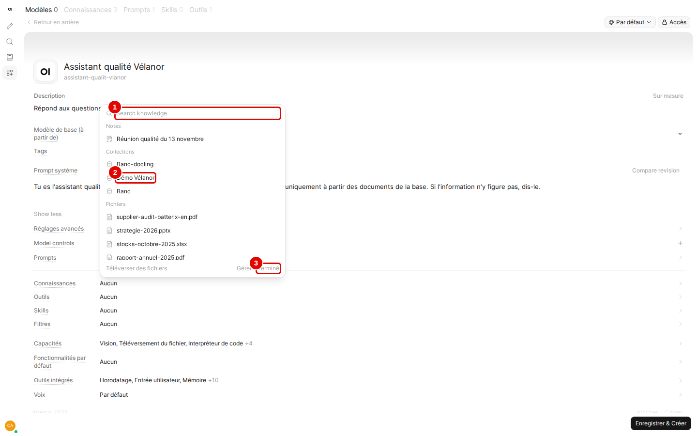
*Écran : liste de choix des connaissances.*

| N° | Élément | Rôle |
|---|---|---|
| 1 | « Search knowledge » | filtre la liste |
| 2 | « Démo Vélanor » | base attachée à l'assistant |
| 3 | « Terminé » | ferme la liste |

La liste propose aussi des **notes** (chapitre 10) et des **fichiers** isolés : un assistant peut s'appuyer sur un seul document.

*Résultat* : la ligne « Connaissances » affiche « Démo Vélanor ».

**Étape 4. Enregistrer l'assistant**
*Où* : éditeur de modèle, bas de la page.
Vérifier les lignes, puis cliquer sur « Enregistrer & Créer » (pastille 4).

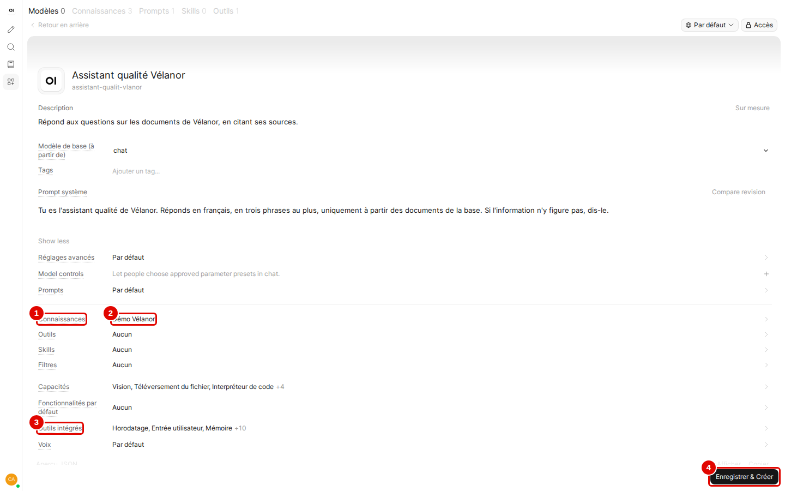
*Écran : éditeur de modèle complet.*

| N° | Élément | Rôle |
|---|---|---|
| 1 | « Connaissances » | bases, notes ou fichiers consultés par l'assistant |
| 2 | « Démo Vélanor » | base attachée |
| 3 | « Outils intégrés » | capacités internes laissées par défaut (horodatage, mémoire, recherche dans les connaissances…) |
| 4 | « Enregistrer & Créer » | crée l'assistant |

Les autres lignes ajoutent des « Outils », des « Skills » ou des « Filtres » (chapitre 11), règlent les « Capacités » (vision, téléversement de fichiers…) et les « Réglages avancés » (température, longueur de réponse) ; les valeurs par défaut conviennent.

*Résultat* : la liste des modèles s'ouvre.

**Étape 5. Retrouver l'assistant**
*Où* : Espace de travail › onglet « Modèles ».

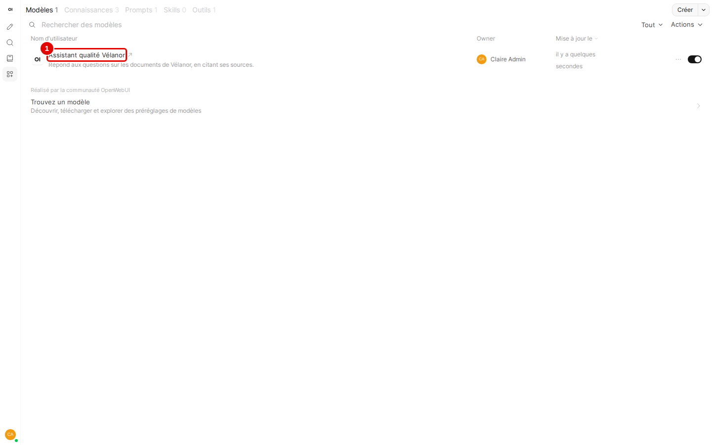
*Écran : onglet « Modèles », un modèle personnalisé.*

| N° | Élément | Rôle |
|---|---|---|
| 1 | « Assistant qualité Vélanor » | ouvre l'éditeur pour modifier l'assistant ; l'interrupteur à droite le masque ou le réaffiche dans les conversations |

*Résultat* : l'assistant existe et apparaît dans la liste des modèles des conversations du compte administrateur.

## Partager l'assistant

**Étape 6. Donner l'accès à un groupe**
*Où* : éditeur de l'assistant › « Accès » (en haut à droite) › « Ajouter un accès ».
Cocher « Équipe production » (pastille 1), puis cliquer sur « Ajouter » (pastille 2).

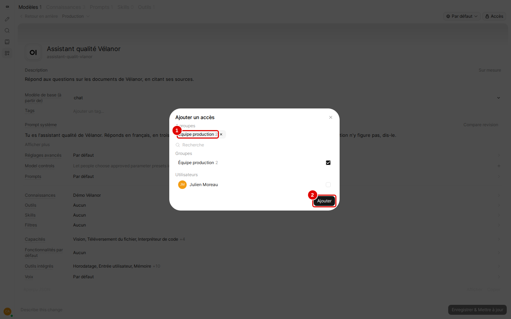
*Écran : fenêtre « Ajouter un accès ».*

| N° | Élément | Rôle |
|---|---|---|
| 1 | « Équipe production » | groupe sélectionné ; la liste « Utilisateurs » permet de choisir des comptes un par un |
| 2 | « Ajouter » | ajoute l'accès |

*Résultat* : la fenêtre « Contrôle d'accès » revient au premier plan.

**Étape 7. Contrôler l'accès**
*Où* : fenêtre « Contrôle d'accès » de l'assistant.

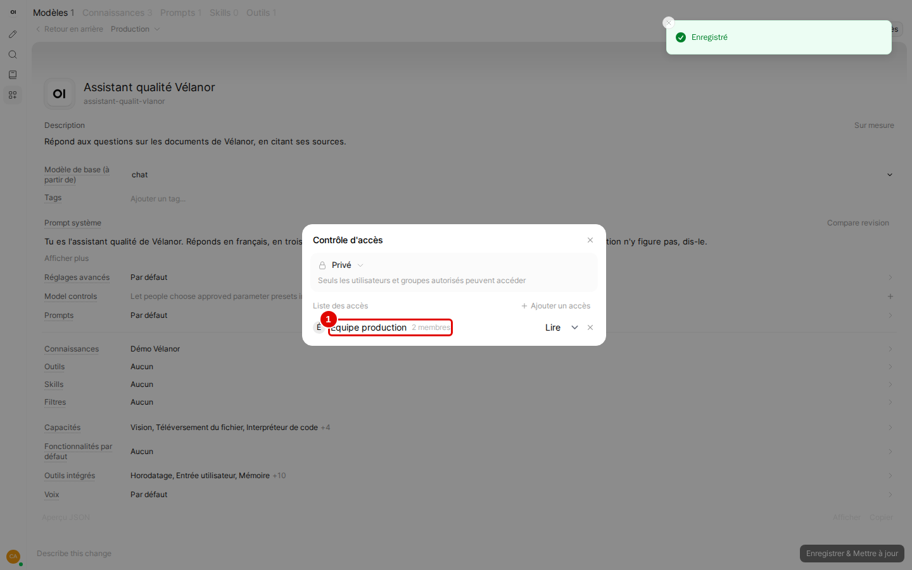
*Écran : fenêtre « Contrôle d'accès », groupe ajouté, message « Enregistré ».*

| N° | Élément | Rôle |
|---|---|---|
| 1 | « Équipe production » | accès accordé, en lecture (« Lire ») : les membres utilisent l'assistant sans pouvoir le modifier ; la croix retire l'accès |

Le partage est enregistré tout de suite (message « Enregistré »).

*Résultat* : les membres d'« Équipe production » voient l'assistant dans leur liste de modèles.

## Utiliser l'assistant

**Étape 8. Choisir l'assistant**
*Où* : écran principal, sélecteur de modèle (en bas à droite de la zone de saisie).
Cliquer sur le nom du modèle affiché (pastille 1), puis sur « Assistant qualité Vélanor » (pastille 2).

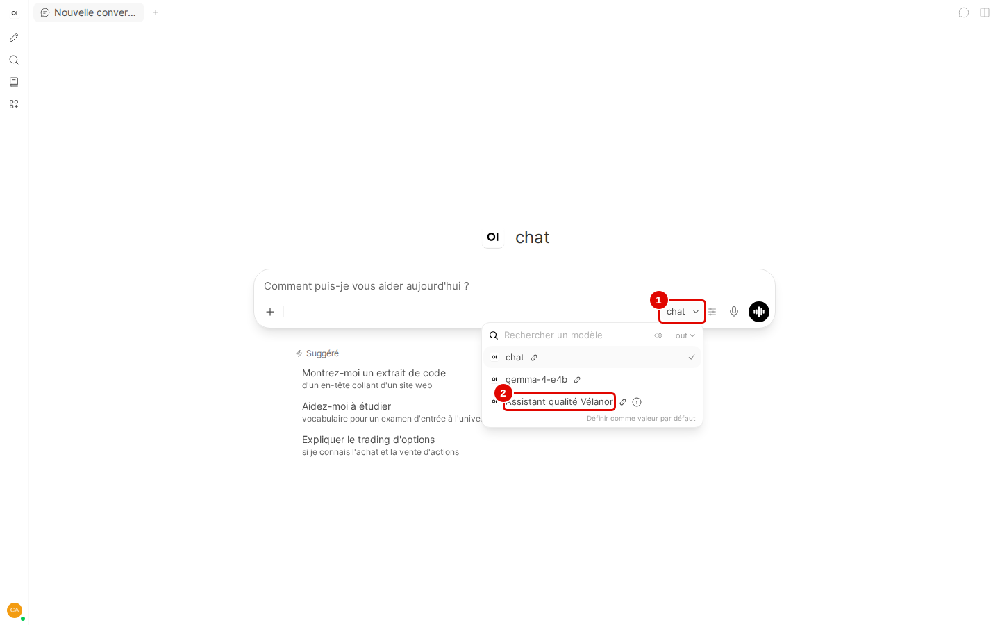
*Écran : liste des modèles ouverte depuis la zone de saisie.*

| N° | Élément | Rôle |
|---|---|---|
| 1 | sélecteur de modèle | modèle qui répondra aux prochaines questions |
| 2 | « Assistant qualité Vélanor » | assistant créé à l'étape 4 |

*Résultat* : l'assistant est choisi pour la conversation.

**Étape 9. Poser une question, sans « # »**
*Où* : zone de saisie.
Taper `Quelle est la température de stockage des batteries ?` et appuyer sur Entrée.

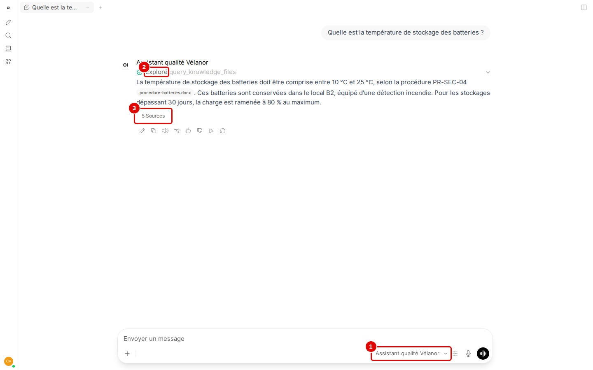
*Écran : réponse de l'assistant, avec ses étapes de recherche et ses sources.*

| N° | Élément | Rôle |
|---|---|---|
| 1 | « Assistant qualité Vélanor » | modèle qui a répondu |
| 2 | étapes | recherche faite d'office dans la base attachée |
| 3 | sources | documents cités |

Réponse obtenue : « La température de stockage des batteries doit être comprise entre 10 °C et 25 °C, selon la procédure PR-SEC-04 », avec la citation de `procedure-batteries.docx`. La base n'a pas eu besoin d'être jointe : l'assistant la consulte de lui-même.

*Résultat* : l'assistant répond à partir de sa base, en suivant sa consigne.

**Étape 10. Vérifier ce que voit un membre de l'équipe**
*Où* : session du compte « Julien Moreau » (membre d'« Équipe production »), sélecteur de modèle.

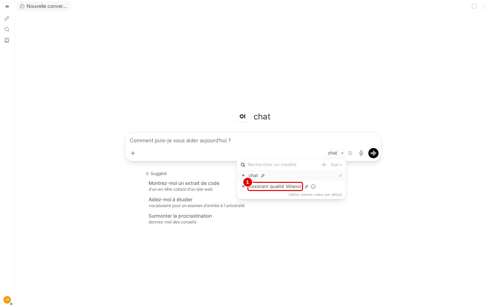
*Écran : liste des modèles du compte « Julien Moreau ».*

| N° | Élément | Rôle |
|---|---|---|
| 1 | « Assistant qualité Vélanor » | assistant partagé, disponible pour ce compte |

Le compte « Julien Moreau » voit seulement `chat` (partagé au chapitre 14) et l'assistant.

*Résultat* : l'assistant est disponible pour le groupe.

**Étape 11. Obtenir une réponse depuis ce compte**
*Où* : session du compte « Julien Moreau », zone de saisie.
Choisir l'assistant, taper `Quel est le délai de livraison prévu par le contrat avec Batterix ?` et appuyer sur Entrée.

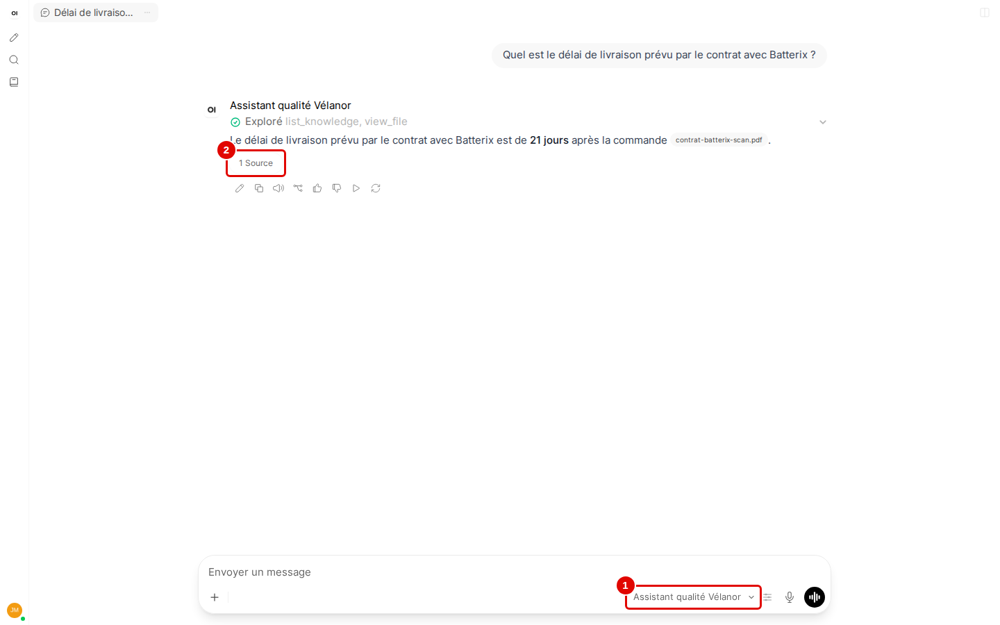
*Écran : réponse de l'assistant dans la session de « Julien Moreau ».*

| N° | Élément | Rôle |
|---|---|---|
| 1 | « Assistant qualité Vélanor » | modèle utilisé |
| 2 | sources | document cité : le contrat scanné, lu par Docling (chapitre 08) |

Réponse obtenue : « Le délai de livraison prévu par le contrat avec Batterix est de 21 jours après la commande », citée depuis `contrat-batterix-scan.pdf`.

*Résultat* : un membre de l'équipe interroge la base à travers l'assistant, sans avoir à la connaître.

## Accélérer l'assistant

**Étape 12. Couper la réflexion du modèle**
*Où* : Espace de travail › « Modèles » › « Assistant qualité Vélanor » › « Réglages avancés ».
Si la ligne « Réglages avancés » n'est pas visible, cliquer d'abord sur « Afficher plus » sous le prompt système. Cliquer sur « Réglages avancés » (pastille 1) : la liste des paramètres se déplie ; tout en bas de cette liste, cliquer sur le lien « Ajoutez votre réglage personnalisé » (hors de la capture) : deux champs apparaissent. Saisir `chat_template_kwargs` dans « Nom du réglage personnalisé » (pastille 2) et `{"enable_thinking": false}` dans « Valeur du réglage personnalisé » (pastille 3). Cliquer sur « Enregistrer & Mettre à jour » (pastille 4).

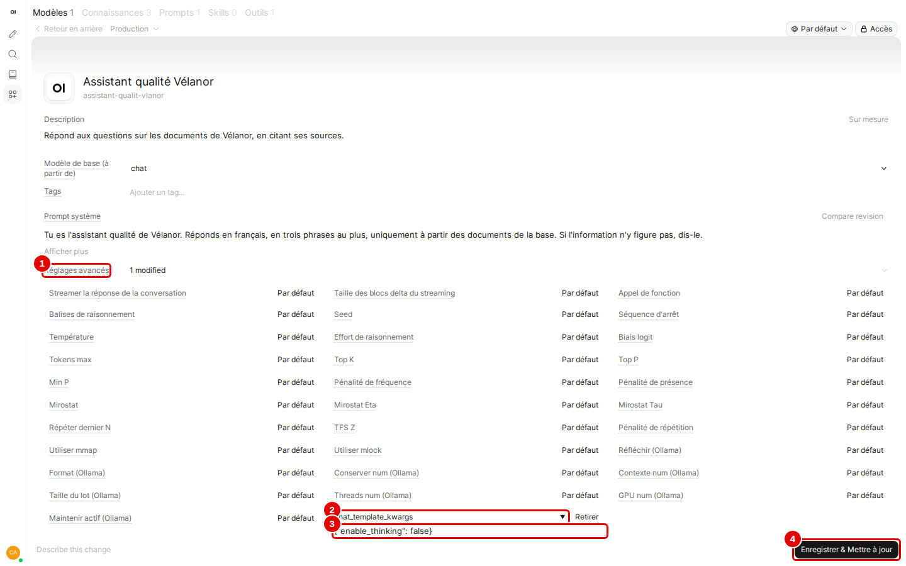
*Écran : éditeur de l'assistant, réglage personnalisé ajouté.*

| N° | Élément | Rôle |
|---|---|---|
| 1 | « Réglages avancés » | paramètres envoyés au modèle avec chaque question |
| 2 | « Nom du réglage personnalisé » | nom du paramètre : `chat_template_kwargs` |
| 3 | « Valeur du réglage personnalisé » | `{"enable_thinking": false}` : le modèle répond sans réfléchir d'abord |
| 4 | « Enregistrer & Mettre à jour » | enregistre l'assistant |

Le modèle `chat` réfléchit longuement avant chaque réponse. Ce réglage, propre au service de modèles utilisé ici, coupe cette réflexion. Le réglage « Effort de raisonnement » de la même liste ne la coupe pas avec ce service. Sur le jeu d'essai complet, les réponses sans réflexion sont restées justes (34 sur 34) et sont arrivées en 1,3 seconde en médiane, contre 24 secondes avec réflexion (annexe A1).

*Résultat* : le message « Modèle mis à jour avec succès » s'affiche.

**Étape 13. Constater la différence**
*Où* : nouvelle conversation avec l'assistant.
Poser une question, par exemple `Quelle est la durée de garantie des batteries prévue par le contrat Batterix ?`.

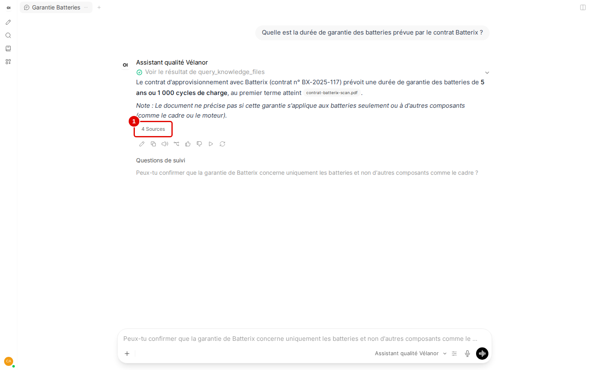
*Écran : réponse de l'assistant sans étape « Réflexion ».*

| N° | Élément | Rôle |
|---|---|---|
| 1 | sources | documents cités, comme avant |

La réponse (« 5 ans ou 1 000 cycles de charge, au premier terme atteint ») arrive en quelques secondes, sans ligne « Réflexion ».

*Résultat* : l'assistant répond vite, toujours à partir de la base.

## Bon à savoir

- L'interrupteur de la liste des modèles (étape 5) masque l'assistant sans le supprimer.
- Pour une question qui demande un raisonnement (calcul, comparaison de plusieurs documents), garder un second assistant avec réflexion.

## En cas de problème

| Symptôme | Cause | Que faire |
|---|---|---|
| Un membre du groupe ne voit pas l'assistant | assistant privé, ou compte hors du groupe | étapes 6 et 7 ; vérifier les membres du groupe (chapitre 14) |
| L'assistant répond sans citer de document | base non attachée | étape 3 |
| Réponses toujours lentes | réflexion active | étape 12 ; vérifier l'orthographe exacte du nom et de la valeur |

---
*Version décrite : Open WebUI 0.13.3, essais du 13 novembre 2026. Détails et preuves : [rapport d'essais](../annexes/A6-rapport-d-essais.md).*
