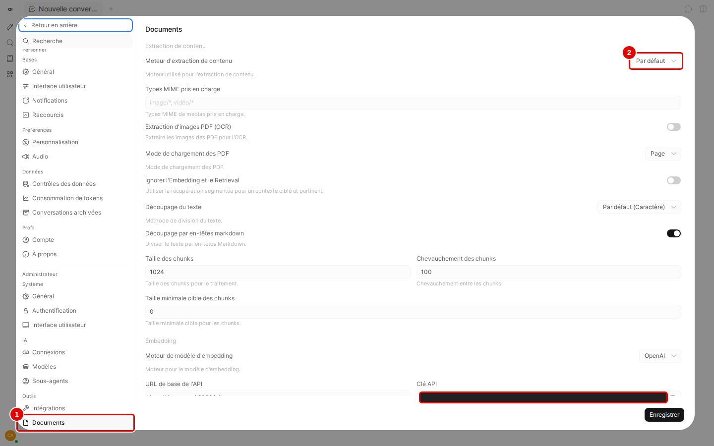
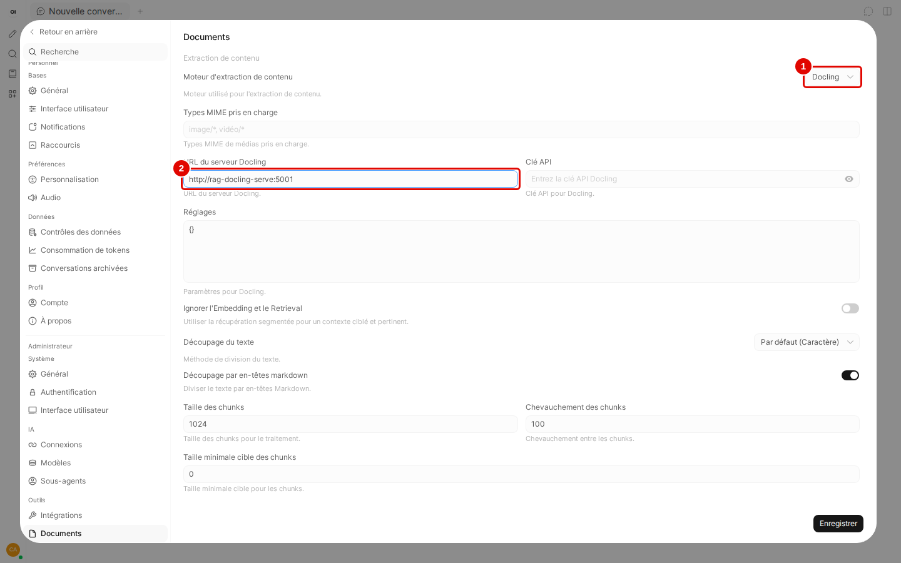
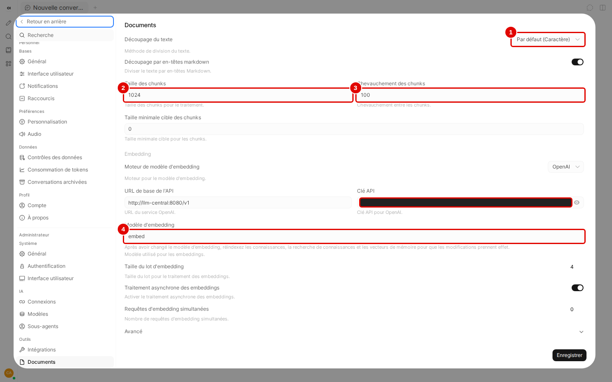
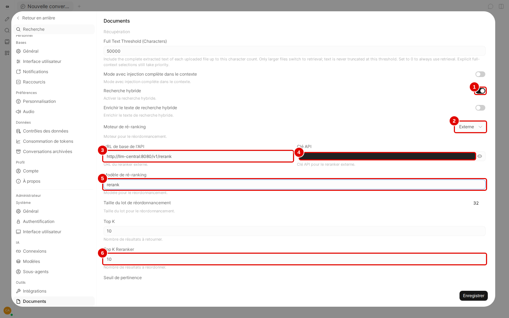
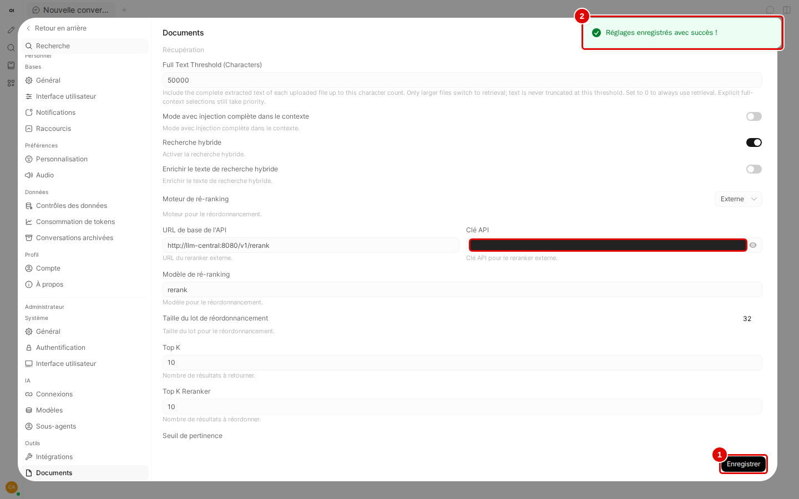
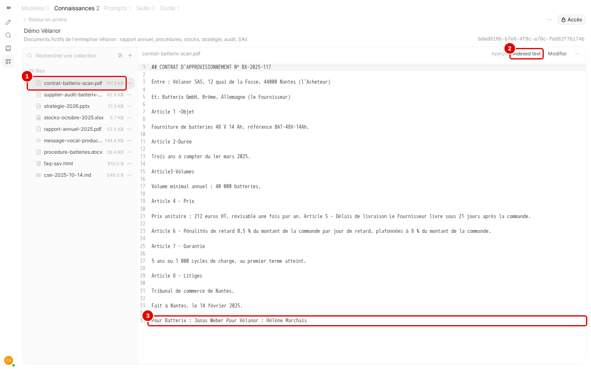
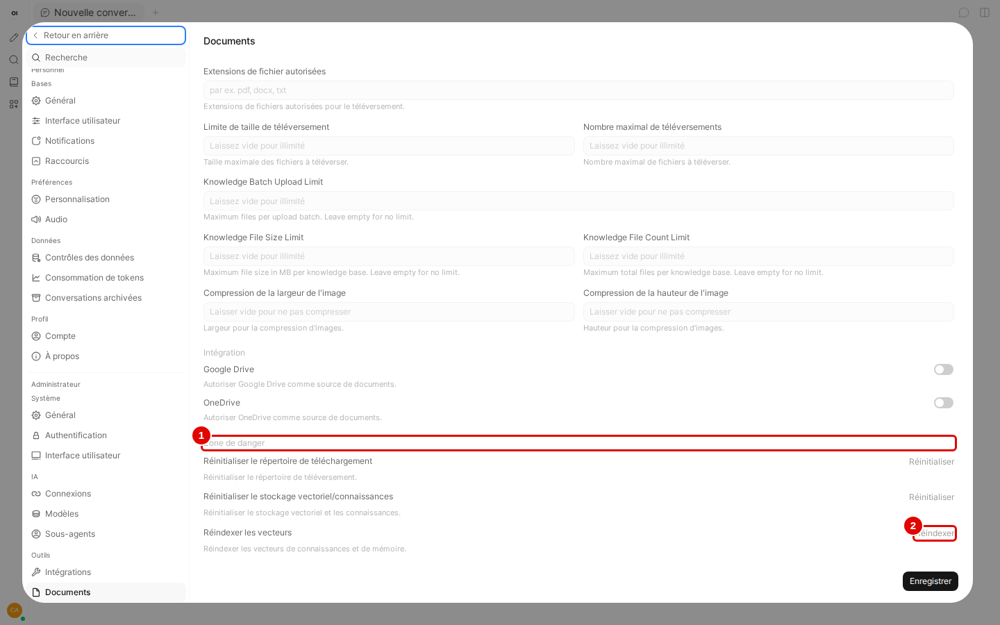
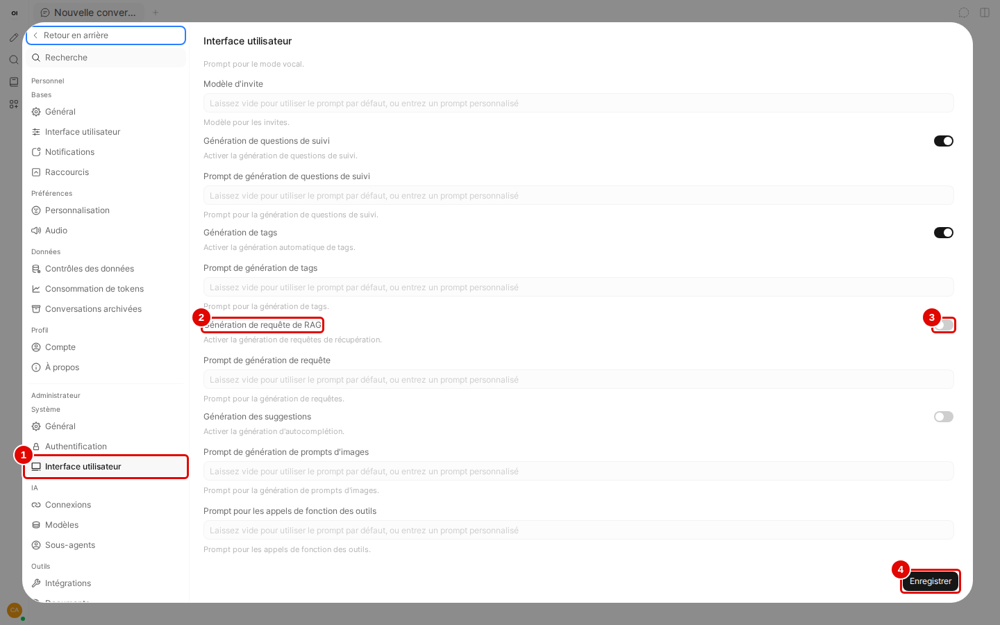

# 08. Régler la lecture des documents

> Ce chapitre apprend à faire lire les documents scannés, à régler le découpage des documents, à activer la recherche hybride avec le tri des passages par le modèle `rerank`, à faire relire les documents déjà déposés et à accélérer les réponses.
> **Point de départ** : écran principal, connecté avec le compte administrateur (chapitre 03) ; base « Démo Vélanor » créée (chapitre 05).
> **Durée** : environ 20 minutes. **Avant** : chapitres 05 et 06.

## Ce qu'il faut savoir

Avant de répondre, Open WebUI cherche dans une base les passages les plus proches de la question, puis les donne au modèle. Trois réglages décident de la qualité de ces passages :

- **la lecture** (« Moteur d'extraction de contenu ») : le programme qui transforme un fichier en texte. La lecture « Par défaut » lit les PDF qui contiennent du texte, les documents Word, PowerPoint, Excel, HTML et Markdown, mais pas un PDF scanné (une image de page) : le chapitre 05 a montré le refus du contrat scanné. **Docling** est un lecteur à part, qui reconnaît le texte des images (OCR) et garde la structure des tableaux ;
- **le découpage** : chaque document est coupé en passages (« chunks ») d'environ 1 000 caractères, qui se chevauchent un peu pour ne pas couper une phrase importante en deux ;
- **la recherche** : par défaut, Open WebUI cherche les passages par le sens (recherche sémantique, modèle `embed`). La **recherche hybride** y ajoute une recherche par mots exacts (utile pour une référence comme `BAT-48V-14Ah`), et permet de faire **trier** les passages trouvés par le modèle `rerank`, qui relit chaque passage face à la question.

Sur le jeu d'essai (38 questions), la lecture par défaut a donné 28 bonnes réponses sur 34 : les six échecs portaient tous sur le contrat scanné. Avec Docling, la recherche hybride et le tri par `rerank`, les 34 réponses étaient justes, et les 4 questions sans réponse dans les documents ont été refusées. Le détail est dans l'[annexe A1](../annexes/A1-evaluation-qualite-et-performances.md).

Ces réglages valent pour toute l'instance. Un document déjà déposé n'est pas relu automatiquement après un changement : l'étape 8 explique comment le faire relire.

## Préparer le lecteur Docling

**Étape 1. Démarrer Docling**
*Où* : terminal Ubuntu, dossier du dépôt.

```bash
outils/open-webui/docling.sh start
```

Le premier lancement télécharge l'image de Docling, qui occupe 5 Go une fois installée. Docling n'est pas joignable depuis le navigateur : seul Open WebUI lui parle, à l'adresse `http://rag-docling-serve:5001`.

*Résultat* : le terminal affiche `Docling prêt : http://rag-docling-serve:5001`. Docling occupe environ 1 Go de mémoire au repos, plus de 2 Go pendant la lecture d'un document. `outils/open-webui/docling.sh stop` l'arrête.

## Choisir le lecteur

**Étape 2. Ouvrir les réglages des documents**
*Où* : menu du compte › « Réglages » › groupe « Administrateur » › « Documents ».


*Écran : onglet « Documents » du groupe « Administrateur », section « Extraction de contenu ».*

| N° | Élément | Rôle |
|---|---|---|
| 1 | « Documents » | réglages de lecture, de découpage et de recherche des documents |
| 2 | « Moteur d'extraction de contenu » | lecteur des fichiers : « Par défaut », « Externe », « Tika », « Docling » et d'autres services |

*Résultat* : l'onglet « Documents » s'affiche, avec la lecture « Par défaut ».

**Étape 3. Choisir Docling**
*Où* : onglet « Documents », section « Extraction de contenu ».
Choisir « Docling » dans la liste (pastille 1), puis saisir `http://rag-docling-serve:5001` dans « URL du serveur Docling » (pastille 2). Laisser « Clé API » vide et « Réglages » à `{}`.


*Écran : « Moteur d'extraction de contenu » sur « Docling ».*

| N° | Élément | Rôle |
|---|---|---|
| 1 | « Docling » | lecteur choisi |
| 2 | « URL du serveur Docling » | adresse de Docling, vue depuis Open WebUI |

*Résultat* : les champs propres à Docling sont remplis. Rien n'est encore enregistré (étape 6).

## Vérifier le découpage

**Étape 4. Lire les réglages de découpage**
*Où* : onglet « Documents », sous « Extraction de contenu ».
Garder les valeurs proposées.


*Écran : réglages « Découpage du texte » et « Embedding ».*

| N° | Élément | Rôle |
|---|---|---|
| 1 | « Découpage du texte » | méthode de découpage ; « Par défaut (Caractère) » coupe selon le nombre de caractères |
| 2 | « Taille des chunks » | longueur d'un passage, en caractères (1024) |
| 3 | « Chevauchement des chunks » | caractères repris d'un passage au suivant (100) |
| 4 | « Modèle d'embedding » | modèle qui calcule la représentation des passages (`embed`) |

Changer la taille, le chevauchement ou le modèle d'embedding oblige à faire relire les documents (étape 8). La clé du service de modèles est masquée sur la capture.

*Résultat* : le découpage est connu ; aucun changement n'est nécessaire pour le jeu d'essai.

## Activer la recherche hybride et le tri

**Étape 5. Brancher le modèle rerank**
*Où* : onglet « Documents », section « Récupération ».
Activer « Recherche hybride » (pastille 1). Dans « Moteur de ré-ranking », choisir « Externe » (pastille 2). Saisir `http://llm-central:8080/v1/rerank` dans « URL de base de l'API » (pastille 3), la clé du service de modèles dans « Clé API » (pastille 4, la même que `LLM_CENTRAL_KEY` du fichier `.env`), et `rerank` dans « Modèle de ré-ranking » (pastille 5).


*Écran : section « Récupération », recherche hybride activée, moteur « Externe ».*

| N° | Élément | Rôle |
|---|---|---|
| 1 | « Recherche hybride » | ajoute la recherche par mots exacts et active le tri des passages |
| 2 | « Moteur de ré-ranking » | « Externe » : le tri est fait par un service de modèles ; « Par défaut (Sentence Transformers) » utilise un modèle chargé dans Open WebUI lui-même |
| 3 | « URL de base de l'API » | adresse du tri dans le service de modèles |
| 4 | « Clé API » | clé du service de modèles (masquée sur la capture) |
| 5 | « Modèle de ré-ranking » | nom du modèle de tri (`rerank`) |
| 6 | « Top K Reranker » | nombre de passages gardés après le tri (10) |

Juste au-dessus, « Top K » fixe le nombre de passages cherchés (10), et « Seuil de pertinence », plus bas, écarte les passages jugés trop éloignés de la question (0, aucun écart, par défaut). « Mode avec injection complète dans le contexte » donne au modèle le texte entier des documents au lieu des passages : à réserver aux petites bases, car le texte doit tenir dans les 16 384 jetons du modèle. « Full Text Threshold (Characters) » (50 000) concerne les fichiers joints directement à une conversation : en dessous de cette taille, ils sont donnés en entier ; il ne s'applique pas aux bases.

*Résultat* : les champs du tri sont remplis.

**Étape 6. Enregistrer**
*Où* : bas de l'onglet « Documents ».
Cliquer sur « Enregistrer » (pastille 1).


*Écran : message de confirmation en haut à droite.*

| N° | Élément | Rôle |
|---|---|---|
| 1 | « Enregistrer » | garde les réglages de tout l'onglet |
| 2 | « Réglages enregistrés avec succès ! » | confirmation |

*Résultat* : la lecture par Docling et le tri par `rerank` sont actifs pour les prochains documents et les prochaines questions.

## Faire relire les documents

**Étape 7. Ajouter le contrat scanné**
*Où* : Espace de travail › « Connaissances » › « Démo Vélanor » › « Ajouter du contenu » › « Téléverser des fichiers ».
Choisir `corpus/documents/contrat-batterix-scan.pdf`. Une fois le traitement fini (une dizaine de secondes), cliquer sur le nom du fichier dans la liste (pastille 1), puis sur « Indexed text » (pastille 2).


*Écran : base « Démo Vélanor », texte indexé du contrat scanné.*

| N° | Élément | Rôle |
|---|---|---|
| 1 | « contrat-batterix-scan.pdf » | le contrat scanné, cette fois accepté |
| 2 | « Indexed text » | affiche le texte qu'Open WebUI a tiré du fichier ; « Aperçu » montre le fichier d'origine |
| 3 | texte reconnu | dernière ligne du contrat, lue dans l'image par Docling |

La reconnaissance n'est pas parfaite (« ler mars » pour « 1er mars », « Article3-Volumes ») mais les montants, les délais et les noms sont justes. Contrôler ainsi chaque document scanné important.

*Résultat* : le contrat scanné fait partie de la base ; les questions sur le prix, les délais ou les pénalités du contrat trouvent maintenant leur réponse.

**Étape 8. Relire les documents déjà déposés**
*Où* : onglet « Documents » du groupe « Administrateur », tout en bas, section « Zone de danger ».
« Réindexer » (pastille 2) ne sert qu'après un changement du découpage ou du modèle d'embedding : pour ce manuel, qui ne les change pas, ne pas cliquer ici.


*Écran : bas de l'onglet « Documents », section « Zone de danger ».*

| N° | Élément | Rôle |
|---|---|---|
| 1 | « Zone de danger » | actions qui touchent à toutes les bases à la fois |
| 2 | « Réindexer » | recalcule les représentations des passages de toutes les bases et de la mémoire |

Les deux boutons « Réinitialiser » au-dessus effacent les fichiers téléversés ou le contenu de toutes les bases : ne pas les utiliser sans sauvegarde (chapitre 15). Pour faire relire un seul document par Docling (par exemple un PDF déjà déposé avec la lecture par défaut), le plus simple est de le retirer de la base puis de le remettre (chapitre 05).

*Résultat* : après réindexation, toutes les bases utilisent les nouveaux réglages.

## Accélérer les réponses

**Étape 9. Couper la génération des requêtes de recherche**
*Où* : menu du compte › « Réglages » › groupe « Administrateur » › « Interface utilisateur », section « Tâches » (faire défiler l'onglet vers le bas).
Désactiver « Génération de requête de RAG » (pastille 3), puis cliquer sur « Enregistrer » (pastille 4).


*Écran : onglet « Interface utilisateur » du groupe « Administrateur », « Génération de requête de RAG » désactivée.*

| N° | Élément | Rôle |
|---|---|---|
| 1 | « Interface utilisateur » | réglages de l'interface et des tâches de fond (titres, tags, suggestions) |
| 2 | « Génération de requête de RAG » | avant chaque recherche dans les documents, fait réécrire la question par le modèle en plusieurs requêtes |
| 3 | interrupteur | désactivé : la question est cherchée telle quelle |
| 4 | « Enregistrer » | garde le réglage |

Par défaut, chaque question déclenche d'abord une réécriture par le modèle de réponse, qui réfléchit avant d'écrire : une étape de plus, qui prend souvent plusieurs dizaines de secondes. Sur le jeu d'essai, la couper a ramené le temps de réponse médian de 58 à 24 secondes, avec les mêmes 34 bonnes réponses sur 34. La réécriture peut aider pour des questions vagues ou très longues ; la réactiver si les réponses manquent des documents pourtant présents.

*Résultat* : les réponses arrivent environ deux fois plus vite.

## Bon à savoir

- Le tri par `rerank` n'agit que si « Recherche hybride » est activée.
- Docling allonge la lecture d'un document : sur le jeu d'essai, environ 3 secondes pour une page web, un document Word ou un classeur, 11 secondes pour le rapport annuel de 10 pages, 14 secondes pour le contrat scanné, 51 secondes pour les 9 documents. Il ne ralentit pas les réponses.
- Docling doit tourner pour tout ajout de fichier : le démarrer (étape 1) avant d'alimenter une base, ou revenir à la lecture « Par défaut ».
- Le temps de réponse vient surtout du modèle de réponse, qui réfléchit avant de répondre : environ une minute par question avec les réglages par défaut, 24 secondes en médiane après l'étape 9.

## En cas de problème

| Symptôme | Cause | Que faire |
|---|---|---|
| « The content provided is empty… » à l'ajout d'un PDF | PDF scanné lu par la lecture « Par défaut » | étapes 1 à 6, puis remettre le fichier |
| L'ajout d'un fichier échoue après le choix de Docling | Docling arrêté ou URL mal saisie | `outils/open-webui/docling.sh start` ; vérifier `http://rag-docling-serve:5001` |
| Les réponses ignorent un document récent | réglages changés sans relecture | étape 8, ou retirer puis remettre le fichier |
| Les réponses citent des passages hors sujet | tri désactivé | vérifier « Recherche hybride » et « Modèle de ré-ranking » (étape 5) ; voir le [chapitre 17](17-en-cas-de-probleme.md) |

---
*Version décrite : Open WebUI 0.13.3, essais du 13 novembre 2026. Détails et preuves : [rapport d'essais](../annexes/A6-rapport-d-essais.md).*
