# 09. Converser au quotidien

> Ce chapitre apprend à retrouver et ranger les conversations (renommer, épingler, dossiers, recherche), à les partager, à les télécharger, à les archiver, et à comparer deux modèles sur la même question.
> **Point de départ** : écran principal, connecté avec le compte administrateur ; au moins une conversation existe (chapitre 04 ou 06).
> **Durée** : environ 15 minutes. **Avant** : chapitre 06.

## Ce qu'il faut savoir

Chaque conversation est enregistrée dans l'instance et listée dans la **barre latérale**, du plus récent au plus ancien (« Aujourd'hui », puis les jours précédents). Le titre est proposé automatiquement à partir de la première question. Une conversation ne se voit que dans le compte qui l'a créée, sauf partage explicite.

Pour ouvrir la barre latérale quand elle est repliée, cliquer sur l'icône en haut à gauche (« Ouvrir la barre latérale »). Les actions sur une conversation passent par son menu « … », qui n'apparaît qu'au survol de la conversation.

## Le menu d'une conversation

**Étape 1. Ouvrir le menu d'une conversation**
*Où* : barre latérale, rubrique « Conversations ».
Survoler la conversation (pastille 1), puis cliquer sur « … » (pastille 2).

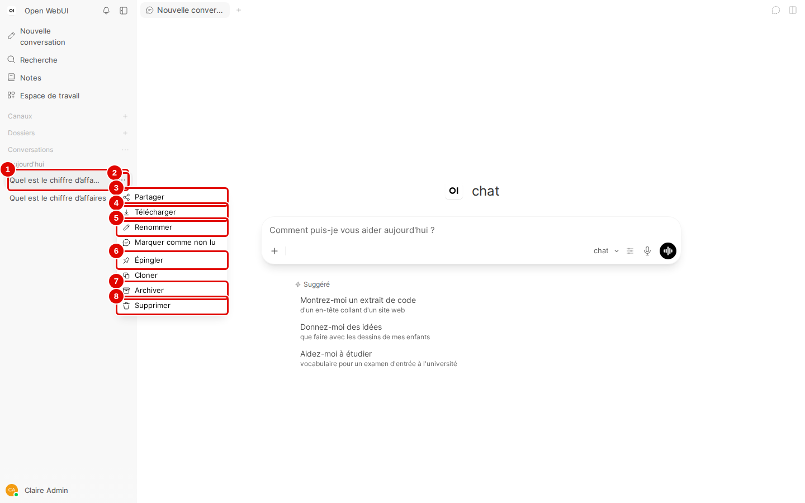
*Écran : barre latérale, menu « … » d'une conversation ouvert.*

| N° | Élément | Rôle |
|---|---|---|
| 1 | conversation | un clic l'ouvre |
| 2 | « … » (« Menu des conversations ») | ouvre le menu de la conversation |
| 3 | « Partager » | crée un lien vers la conversation (étape 6) |
| 4 | « Télécharger » | enregistre la conversation dans un fichier (étape 7) |
| 5 | « Renommer » | change le titre (étape 2) |
| 6 | « Épingler » | garde la conversation en haut de la liste (étape 3) |
| 7 | « Archiver » | retire la conversation de la liste sans l'effacer (étape 9) |
| 8 | « Supprimer » | efface la conversation |

« Marquer comme non lu » la signale comme non lue ; « Cloner » en crée une copie, utile pour repartir d'un point sans toucher à l'original. Dès qu'un dossier existe, le menu propose aussi « Déplacer ».

*Résultat* : le menu est ouvert ; Échap le referme.

## Ranger

**Étape 2. Renommer**
*Où* : menu « … » de la conversation › « Renommer ».
Saisir le nouveau titre, `Chiffre d'affaires 2025` (pastille 1), puis appuyer sur Entrée.

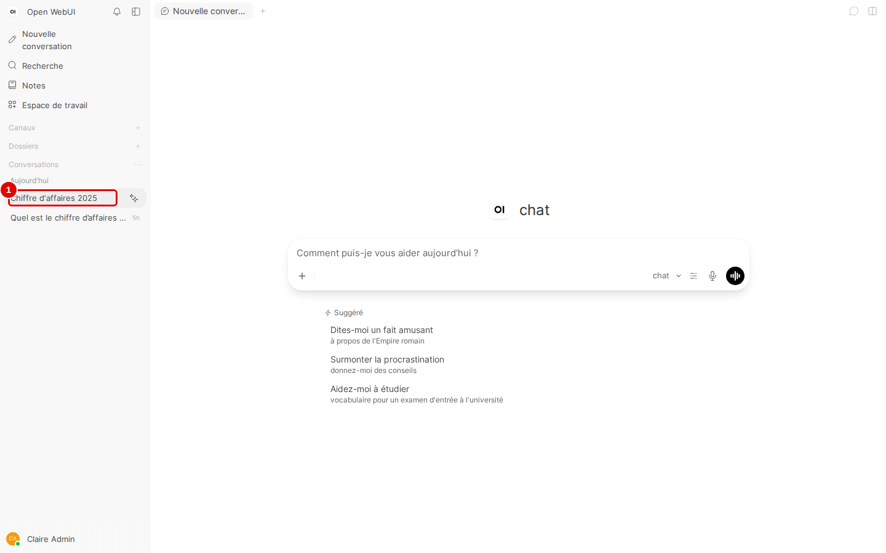
*Écran : barre latérale, titre en cours de modification.*

| N° | Élément | Rôle |
|---|---|---|
| 1 | titre | nouveau titre de la conversation |

*Résultat* : la conversation porte le nouveau titre.

**Étape 3. Épingler**
*Où* : menu « … » de la conversation › « Épingler ».

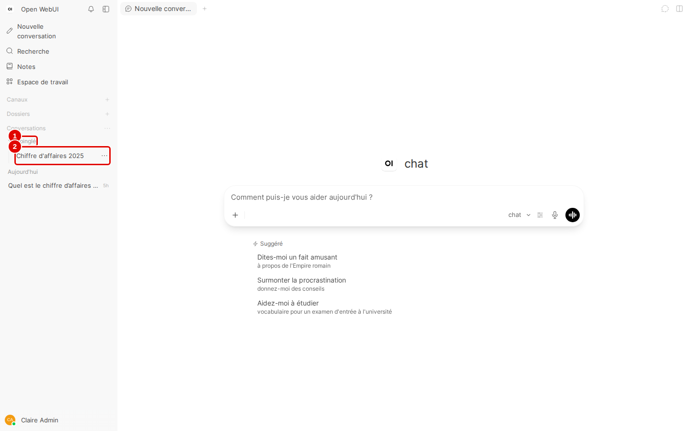
*Écran : barre latérale, rubrique « Épinglé ».*

| N° | Élément | Rôle |
|---|---|---|
| 1 | « Épinglé » | rubrique des conversations épinglées, toujours en haut |
| 2 | « Chiffre d'affaires 2025 » | conversation épinglée |

*Résultat* : la conversation reste en haut de la liste. « Désépingler », dans le même menu, la remet à sa place.

**Étape 4. Créer un dossier**
*Où* : barre latérale, rubrique « Dossiers ».
Cliquer sur le « + » de « Dossiers » (pastille 1), saisir `Questions rapport annuel` dans « Nom du dossier » (pastille 2), puis cliquer sur « Enregistrer ».

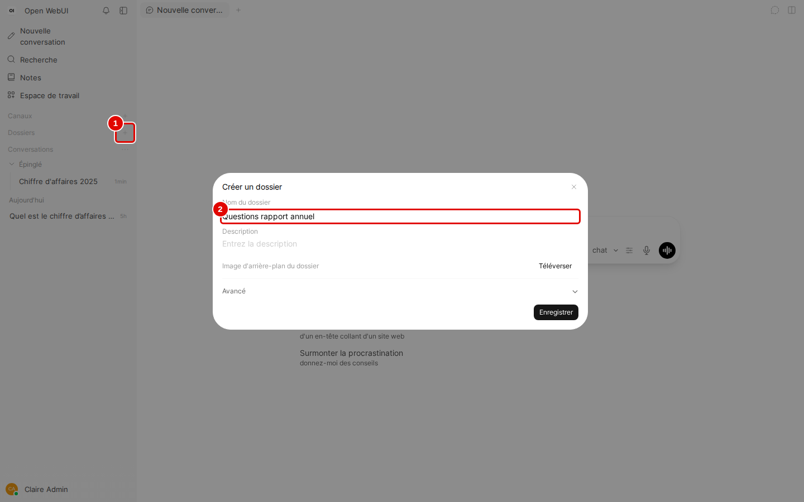
*Écran : fenêtre « Créer un dossier ».*

| N° | Élément | Rôle |
|---|---|---|
| 1 | « + » de « Dossiers » (« Nouveau dossier ») | ouvre la fenêtre « Créer un dossier » |
| 2 | « Nom du dossier » | nom affiché dans la barre latérale |

La fenêtre propose aussi une « Description » et une « Image d'arrière-plan du dossier ».

*Résultat* : le dossier apparaît sous « Dossiers ».

**Étape 5. Ranger une conversation dans le dossier**
*Où* : barre latérale.
Faire glisser la conversation sur le nom du dossier, puis relâcher. Cliquer sur le dossier pour le déplier (pastille 1).

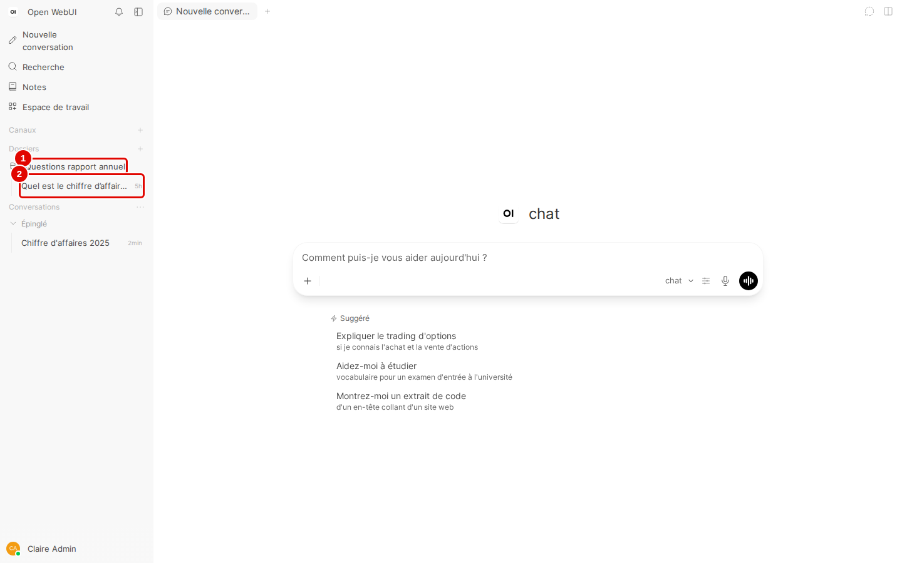
*Écran : barre latérale, dossier « Questions rapport annuel » déplié.*

| N° | Élément | Rôle |
|---|---|---|
| 1 | « Questions rapport annuel » | dossier ; un clic le déplie ou le replie |
| 2 | conversation rangée | conversation déplacée dans le dossier |

« Déplacer », dans le menu « … », fait la même chose sans glisser.

*Résultat* : la conversation est rangée ; elle ne figure plus dans la liste générale.

## Partager et télécharger

**Étape 6. Partager une conversation**
*Où* : menu « … » de la conversation › « Partager ».
Cliquer sur « Copier le lien » (pastille 1), puis envoyer ce lien.

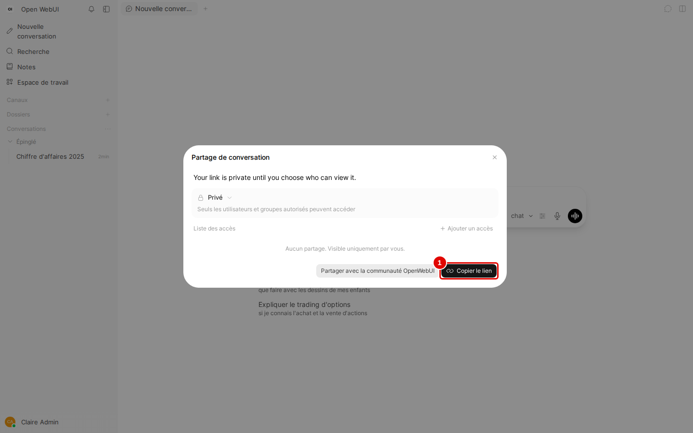
*Écran : fenêtre « Partage de conversation ».*

| N° | Élément | Rôle |
|---|---|---|
| 1 | « Copier le lien » | copie l'adresse de la conversation partagée |

Le lien reste privé tant que personne n'est ajouté : « Ajouter un accès » donne la lecture à un compte ou à un groupe, comme pour une base (chapitre 14). « Partager avec la communauté OpenWebUI » concerne le site communautaire d'Open WebUI, hors du poste : ne pas l'utiliser pour des documents internes.

*Résultat* : le lien est dans le presse-papiers.

**Étape 7. Télécharger une conversation**
*Où* : menu « … » de la conversation › « Télécharger ».
Choisir le format dans le sous-menu (pastille 2).

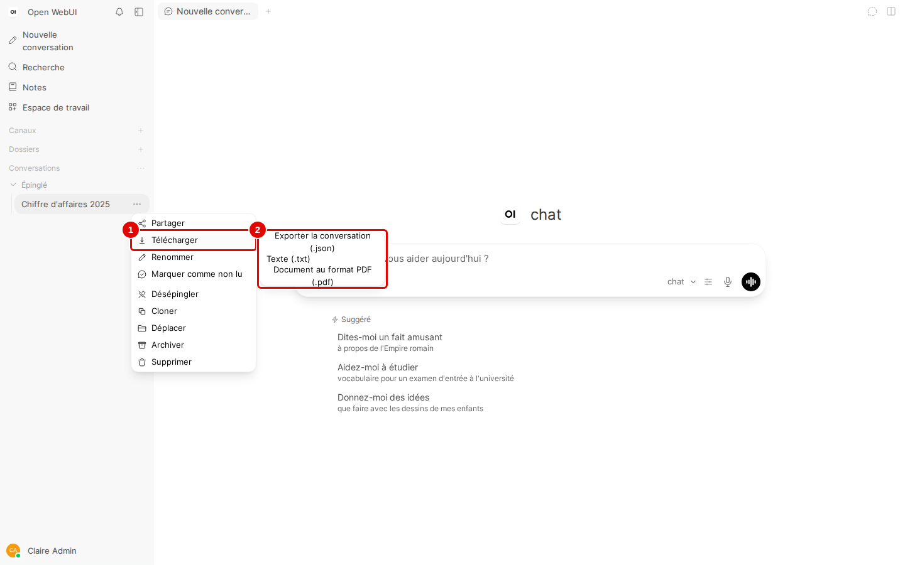
*Écran : menu « … », sous-menu « Télécharger » ouvert.*

| N° | Élément | Rôle |
|---|---|---|
| 1 | « Télécharger » | ouvre le sous-menu des formats |
| 2 | formats | « Exporter la conversation (.json) » (relisible par Réglages › « Contrôles des données » › « Importer les conversations »), « Texte (.txt) », « Document au format PDF (.pdf) » |

*Résultat* : le navigateur enregistre le fichier, par exemple `chat-Chiffre d'affaires 2025.pdf`.

## Retrouver

**Étape 8. Chercher dans les conversations**
*Où* : barre latérale › « Recherche » (ou Ctrl+K).
Saisir un mot, par exemple `chiffre` (pastille 1).

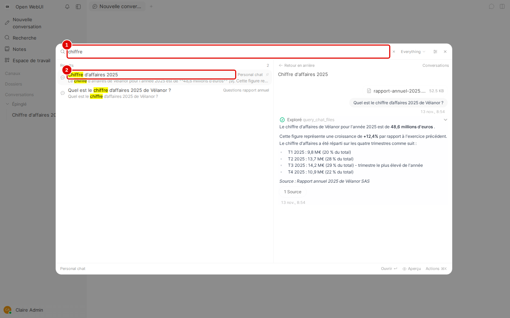
*Écran : fenêtre de recherche, résultats pour « chiffre ».*

| N° | Élément | Rôle |
|---|---|---|
| 1 | champ de recherche | mot cherché dans les titres et le contenu des conversations |
| 2 | résultat | conversation trouvée ; son contenu s'affiche à droite, Entrée l'ouvre |

La recherche couvre aussi les notes et les canaux ; la liste « Everything » en haut à droite limite le type de résultats.

*Résultat* : la conversation est retrouvée sans parcourir la liste.

**Étape 9. Archiver une conversation**
*Où* : menu « … » de la conversation › « Archiver ». Pour la retrouver : menu du compte › « Réglages » › « Conversations archivées ».

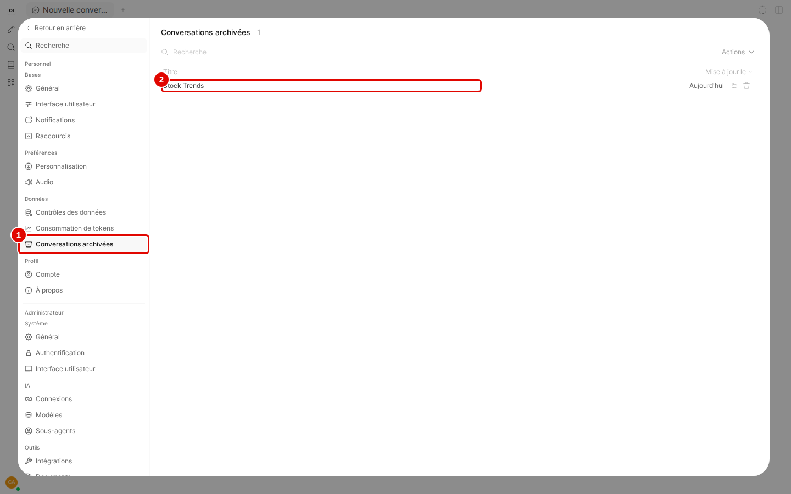
*Écran : Réglages, onglet « Conversations archivées ».*

| N° | Élément | Rôle |
|---|---|---|
| 1 | « Conversations archivées » | liste des conversations retirées de la barre latérale |
| 2 | conversation archivée | un clic l'ouvre ; les icônes à droite la désarchivent ou la suppriment |

Le menu « Actions » de cette page agit sur toutes les archives à la fois.

*Résultat* : la conversation n'encombre plus la barre latérale mais reste disponible.

## Comparer deux modèles

**Étape 10. Ouvrir un écran partagé**
*Où* : écran principal, en haut à droite.
Cliquer sur l'icône d'écran partagé (pastille 1, « Split screen »). Dans le panneau de droite, cliquer sur le sélecteur de modèle et choisir `gemma-4-e4b` (pastille 3).

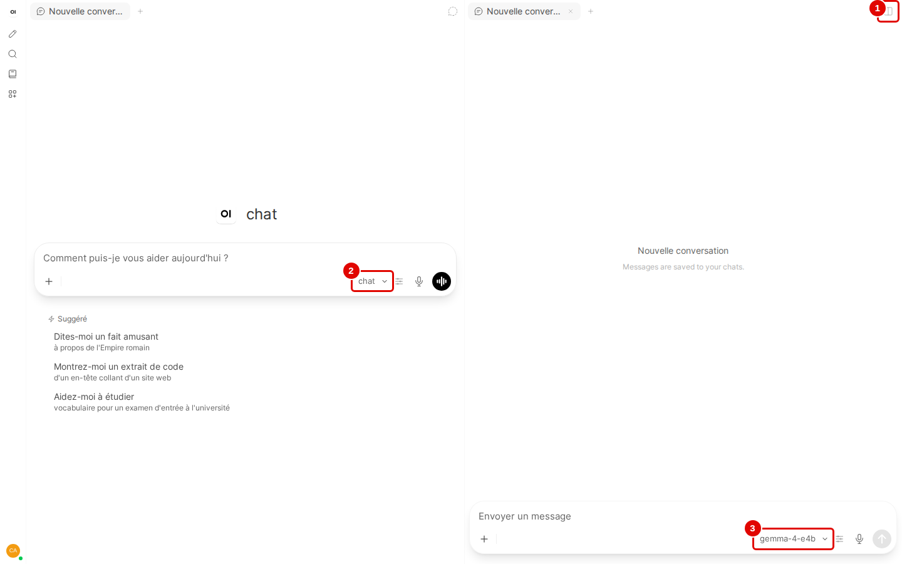
*Écran : deux conversations côte à côte.*

| N° | Élément | Rôle |
|---|---|---|
| 1 | « Split screen » | ouvre une seconde conversation à droite ; la croix de son onglet la ferme |
| 2 | `chat` | modèle de la conversation de gauche |
| 3 | `gemma-4-e4b` | modèle de la conversation de droite |

*Résultat* : deux conversations indépendantes sont ouvertes, chacune avec son modèle.

**Étape 11. Poser la même question des deux côtés**
*Où* : zone de saisie de chaque panneau.
Taper la même question dans les deux zones, par exemple `En une phrase : pourquoi stocker les batteries entre 10 et 25 °C ?`, et l'envoyer de chaque côté.

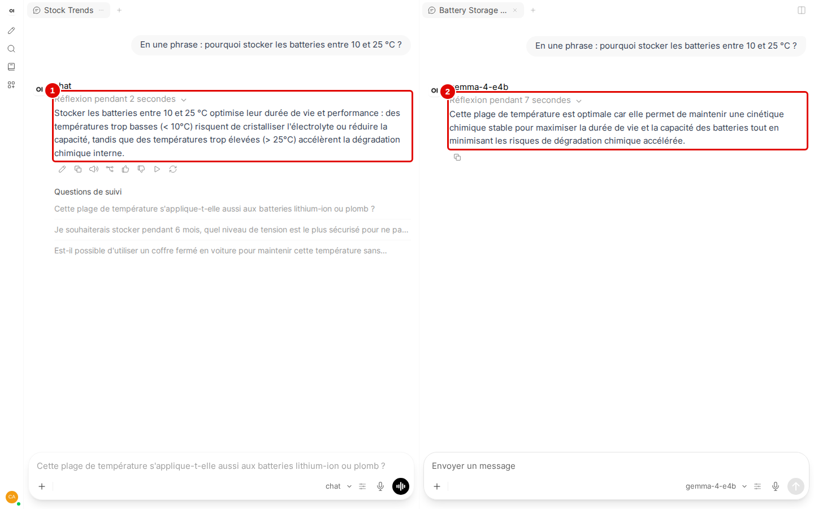
*Écran : réponses de `chat` à gauche et de `gemma-4-e4b` à droite.*

| N° | Élément | Rôle |
|---|---|---|
| 1 | réponse de `chat` | « Réflexion pendant 2 secondes », puis la réponse |
| 2 | réponse de `gemma-4-e4b` | « Réflexion pendant 7 secondes », puis la réponse |

Les deux conversations sont enregistrées séparément dans la barre latérale. Les titres proposés automatiquement sont parfois en anglais (« Stock Trends », « Battery Storage… ») : les renommer (étape 2).

*Résultat* : les deux réponses se lisent côte à côte.

## Bon à savoir

- « conversation temporaire » (icône en haut à droite de l'écran principal) sert aux échanges qu'il n'est pas utile de garder ; ce mode n'a pas été essayé pour ce manuel.
- Le titre d'une conversation est proposé par le modèle : il peut être approximatif ou dans une autre langue.

## En cas de problème

| Symptôme | Cause | Que faire |
|---|---|---|
| Le menu « … » n'apparaît pas | il ne s'affiche qu'au survol | passer la souris sur la conversation |
| Une conversation a disparu de la liste | archivée ou rangée dans un dossier | étape 9 (archives) ou rubrique « Dossiers » |

---
*Version décrite : Open WebUI 0.13.3, essais du 13 novembre 2026. Détails et preuves : [rapport d'essais](../annexes/A6-rapport-d-essais.md).*
