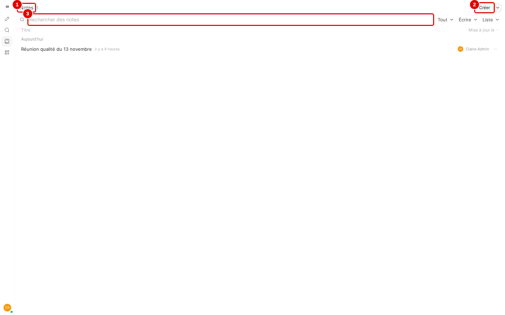
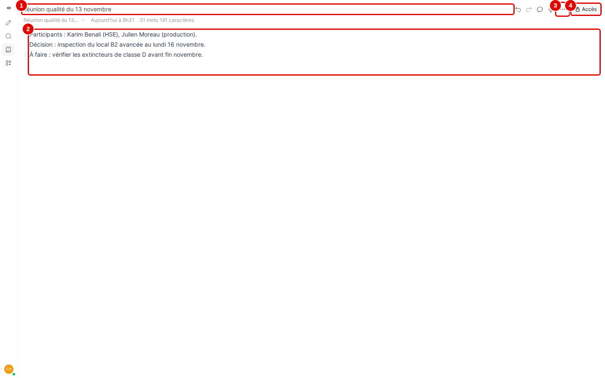
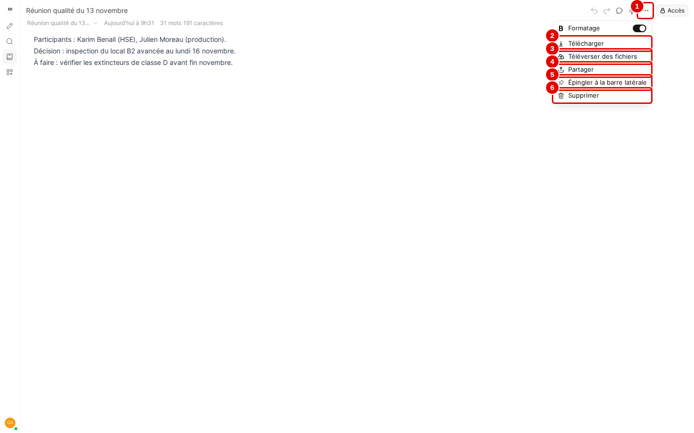
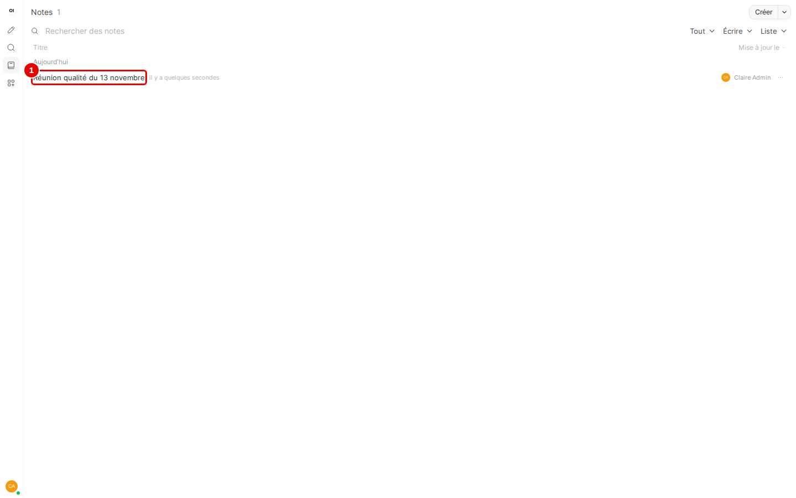
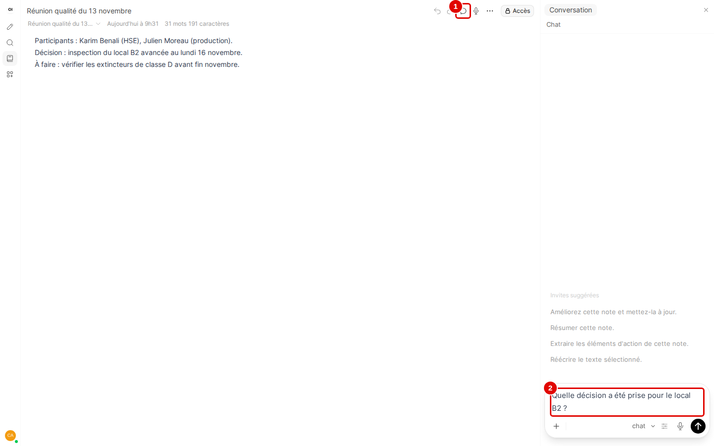
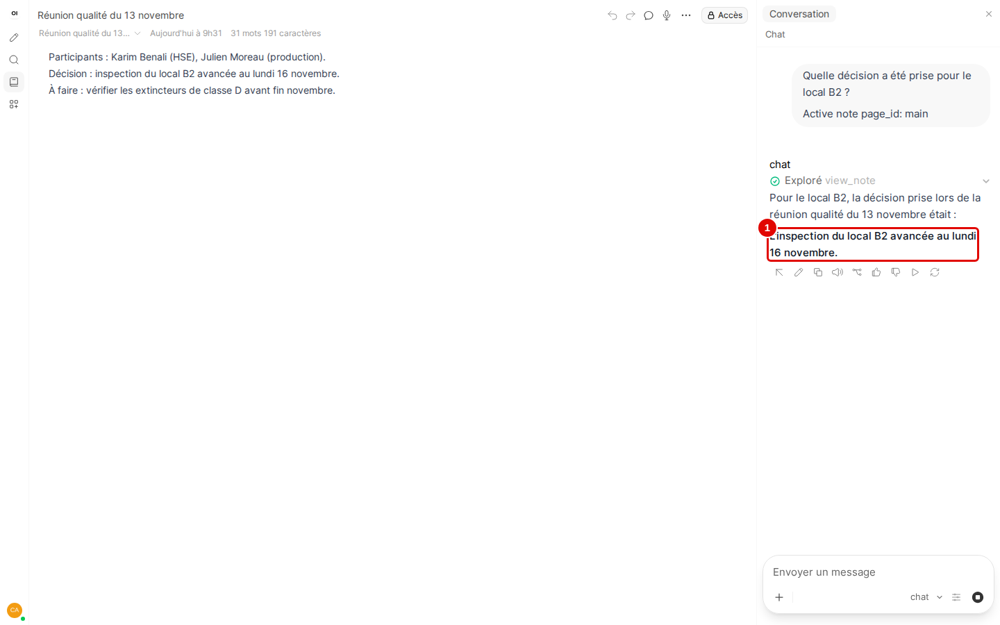
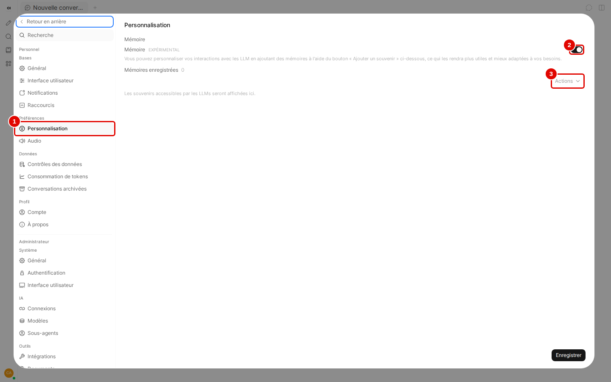
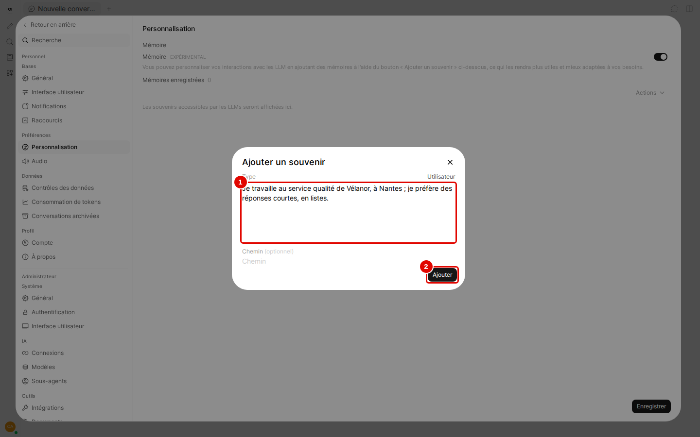
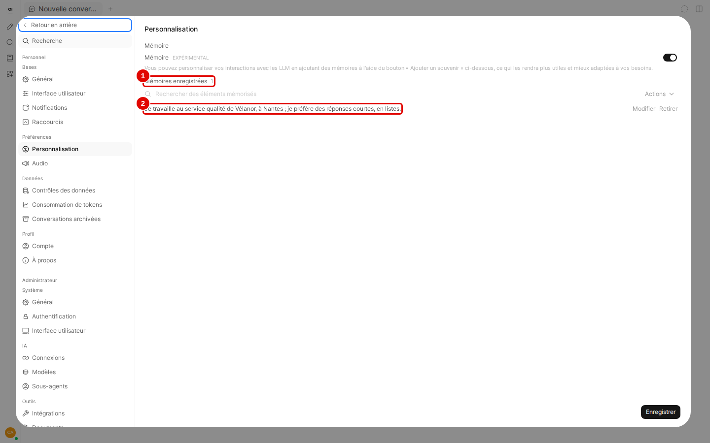
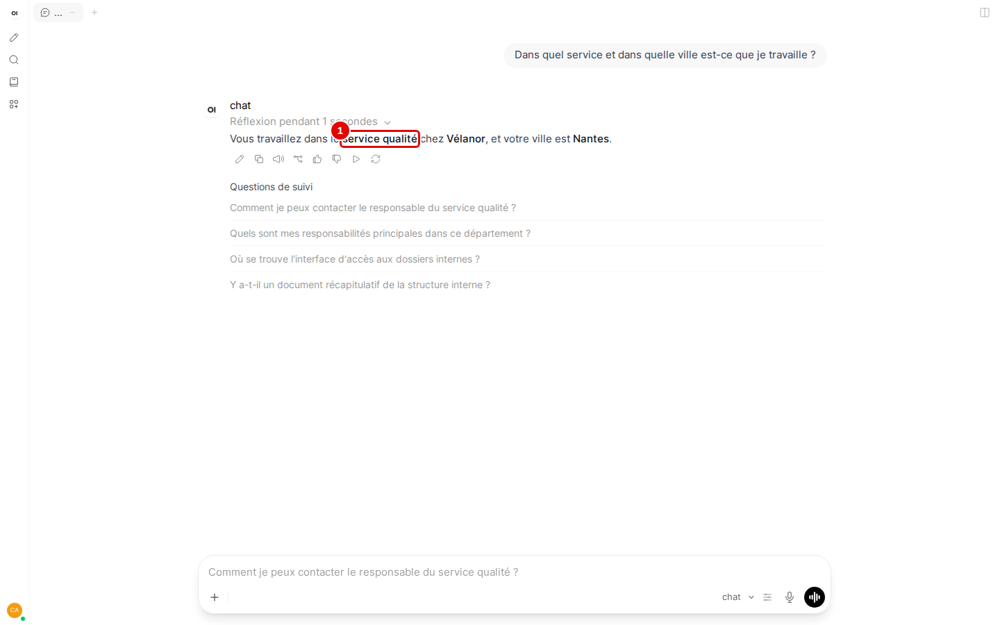

# 10. Notes et mémoire

> Ce chapitre apprend à écrire des notes dans Open WebUI, à interroger le modèle sur une note, et à lui faire retenir des informations durables sur soi (la mémoire).
> **Point de départ** : écran principal, connecté avec le compte administrateur (chapitre 03).
> **Durée** : environ 15 minutes. **Avant** : chapitre 04.

## Ce qu'il faut savoir

Une **note** est un texte libre rangé dans Open WebUI : compte rendu de réunion, liste de points à vérifier, brouillon. Elle se met en forme, se partage comme une base, et surtout se discute avec le modèle dans un panneau « Conversation » placé à côté. Une note peut aussi être jointe à une question (« # », chapitre 06) ou attachée à un assistant (chapitre 07).

La **mémoire** est une liste de **souvenirs** propres au compte : des phrases courtes que le modèle consulte avant de répondre (« Je travaille au service qualité, à Nantes »). Elle évite de répéter le même contexte à chaque conversation. Elle est marquée « EXPÉRIMENTAL » dans cette version.

## Écrire une note

**Étape 1. Ouvrir les notes**
*Où* : barre latérale › « Notes ».
Cliquer sur « Créer » (pastille 2).


*Écran : page « Notes » (capture prise après la création de la note de l'étape 2).*

| N° | Élément | Rôle |
|---|---|---|
| 1 | « Notes » | page des notes ; le chiffre indique leur nombre |
| 2 | « Créer » | crée une note vide |
| 3 | « Rechercher des notes » | filtre la liste |

*Résultat* : une note vide s'ouvre, titrée avec la date du jour.

**Étape 2. Rédiger la note**
*Où* : note ouverte.
Remplacer le titre par `Réunion qualité du 13 novembre` (pastille 1), puis écrire le texte (pastille 2) :

```text
Participants : Karim Benali (HSE), Julien Moreau (production).
Décision : inspection du local B2 avancée au lundi 16 novembre.
À faire : vérifier les extincteurs de classe D avant fin novembre.
```


*Écran : note « Réunion qualité du 13 novembre ».*

| N° | Élément | Rôle |
|---|---|---|
| 1 | titre | nom de la note dans la liste |
| 2 | texte de la note | contenu de la note |
| 3 | « … » (« Menu des notes ») | actions sur la note (étape 3) |
| 4 | « Accès » | partager la note, comme une base (chapitre 14) |

Sous le titre, la ligne grise donne la date de modification et le nombre de mots et de caractères. Les icônes en haut à droite annulent ou rétablissent une modification, ouvrent le panneau « Conversation » (étape 5) et permettent de dicter (chapitre 12).

*Résultat* : la note est enregistrée au fil de la saisie, sans bouton à cliquer.

**Étape 3. Connaître le menu d'une note**
*Où* : note ouverte › « … » (« Menu des notes »).


*Écran : menu d'une note ouvert.*

| N° | Élément | Rôle |
|---|---|---|
| 1 | « … » (« Menu des notes ») | ouvre le menu |
| 2 | « Télécharger » | enregistre la note dans un fichier |
| 3 | « Téléverser des fichiers » | joint des fichiers à la note |
| 4 | « Partager » | crée un lien vers la note |
| 5 | « Épingler à la barre latérale » | affiche la note dans la barre latérale |
| 6 | « Supprimer » | efface la note |

*Résultat* : les actions sur la note sont repérées ; Échap referme le menu.

**Étape 4. Retrouver la note**
*Où* : barre latérale › « Notes ».


*Écran : page « Notes », une note.*

| N° | Élément | Rôle |
|---|---|---|
| 1 | « Réunion qualité du 13 novembre » | ouvre la note |

*Résultat* : la note est rangée, avec son auteur et sa date.

## Interroger le modèle sur une note

**Étape 5. Ouvrir le panneau « Conversation »**
*Où* : note ouverte, icône de bulle en haut à droite.
Cliquer sur l'icône « Conversation » (pastille 1). Dans le panneau qui s'ouvre à droite, taper `Quelle décision a été prise pour le local B2 ?` (pastille 2) et appuyer sur Entrée.


*Écran : note à gauche, panneau « Conversation » à droite.*

| N° | Élément | Rôle |
|---|---|---|
| 1 | « Conversation » | ouvre le panneau de discussion sur la note |
| 2 | question | question posée au modèle sur cette note |

Le panneau propose aussi des « Invites suggérées » : « Améliorez cette note et mettez-la à jour. », « Résumer cette note. », « Extraire les éléments d'action de cette note. », « Réécrire le texte sélectionné. ».

*Résultat* : la question part au modèle, avec la note.

**Étape 6. Lire la réponse**
*Où* : panneau « Conversation ».


*Écran : réponse du modèle dans le panneau « Conversation ».*

| N° | Élément | Rôle |
|---|---|---|
| 1 | réponse | décision tirée de la note : « L'inspection du local B2 avancée au lundi 16 novembre. » |

La ligne « Exploré view_note » montre que le modèle a lu la note avant de répondre. La mention « Active note page_id: main », ajoutée sous la question, est insérée d'office par Open WebUI pour désigner la note ouverte : rien à saisir.

*Résultat* : la note se consulte en langage courant. La croix en haut du panneau le ferme.

## Faire retenir des informations

**Étape 7. Activer la mémoire**
*Où* : menu du compte › « Réglages » › groupe « Personnel » › « Personnalisation ».
Activer « Mémoire » (pastille 2) et cliquer sur « Enregistrer » en bas de la fenêtre pour garder ce réglage, puis ouvrir « Actions » (pastille 3).


*Écran : onglet « Personnalisation », section « Mémoire ».*

| N° | Élément | Rôle |
|---|---|---|
| 1 | « Personnalisation » | réglages de personnalisation du compte |
| 2 | « Mémoire » | autorise le modèle à consulter les souvenirs du compte |
| 3 | « Actions » | « Ajouter un souvenir » ou « Effacer la mémoire » |

*Résultat* : le menu « Actions » s'ouvre.

**Étape 8. Ajouter un souvenir**
*Où* : « Actions » › « Ajouter un souvenir ».
Saisir le souvenir (pastille 1), par exemple `Je travaille au service qualité de Vélanor, à Nantes ; je préfère des réponses courtes, en listes.`, puis cliquer sur « Ajouter » (pastille 2).


*Écran : fenêtre d'ajout d'un souvenir.*

| N° | Élément | Rôle |
|---|---|---|
| 1 | souvenir | phrase que le modèle gardera en mémoire |
| 2 | « Ajouter » | enregistre le souvenir |

*Résultat* : la fenêtre se ferme.

**Étape 9. Contrôler les souvenirs**
*Où* : Réglages › « Personnalisation ».


*Écran : onglet « Personnalisation », un souvenir enregistré.*

| N° | Élément | Rôle |
|---|---|---|
| 1 | « Mémoires enregistrées » | nombre de souvenirs du compte |
| 2 | souvenir enregistré | texte gardé pour le compte |

*Résultat* : le souvenir est enregistré pour le compte.

**Étape 10. Vérifier que le modèle s'en sert**
*Où* : nouvelle conversation, modèle `chat`.
Taper `Dans quel service et dans quelle ville est-ce que je travaille ?` et appuyer sur Entrée.


*Écran : réponse tirée du souvenir.*

| N° | Élément | Rôle |
|---|---|---|
| 1 | réponse tirée du souvenir | « Vous travaillez dans le service qualité chez Vélanor, et votre ville est Nantes. » |

*Résultat* : le modèle utilise le souvenir sans qu'il soit rappelé dans la question.

## Bon à savoir

- Les souvenirs s'appliquent à toutes les conversations du compte, y compris celles qui interrogent une base : un souvenir inexact ou daté fausse les réponses. Les relire de temps en temps.

## En cas de problème

| Symptôme | Cause | Que faire |
|---|---|---|
| Pas de rubrique « Notes » | notes désactivées pour l'instance ou pour le rôle | chapitre 15, étape 1, et chapitre 14 (permissions) |
| Le modèle ignore le souvenir | « Mémoire » désactivée | étape 7 |
| Les réponses suivent une préférence oubliée | ancien souvenir | « Actions » › « Effacer la mémoire », puis ajouter les souvenirs utiles |

---
*Version décrite : Open WebUI 0.13.3, essais du 13 novembre 2026. Détails et preuves : [rapport d'essais](../annexes/A6-rapport-d-essais.md).*
