# 11. Prompts, outils, fonctions et serveurs MCP

> Ce chapitre apprend à enregistrer un prompt réutilisable, à ajouter un outil (un petit programme que le modèle peut appeler), un filtre (une fonction qui transforme les questions et les réponses) et un serveur MCP (des outils fournis par un autre service), puis à s'en servir dans une conversation.
> **Point de départ** : écran principal, connecté avec le compte administrateur (chapitre 03).
> **Durée** : environ 30 minutes. **Avant** : chapitres 04 et 07.

**Attention** : un outil ou une fonction est du code Python exécuté par Open WebUI, avec ses droits. N'installer que du code relu et compris ; les exemples de ce chapitre sont fournis dans le dépôt (`outils/open-webui/extensions/`), sans accès réseau ni disque.

## Ce qu'il faut savoir

Quatre façons d'étendre Open WebUI :

- un **prompt** est un texte enregistré, appelé par une commande `/nom` dans la zone de saisie : il évite de retaper une consigne longue ;
- un **outil** donne au modèle une capacité nouvelle, par exemple lire un stock ou faire un calcul exact. Le modèle décide seul de l'appeler quand la question le demande ;
- une **fonction** agit sur Open WebUI lui-même. Le type le plus courant, le **filtre**, modifie la question avant son envoi au modèle et la réponse après ;
- un **serveur MCP** (Model Context Protocol) est un service à part qui fournit des outils ; Open WebUI s'y connecte par une adresse.

## Enregistrer un prompt

**Étape 1. Ouvrir les prompts**
*Où* : barre latérale › « Espace de travail » › onglet « Prompts ».
Cliquer sur « Créer » (pastille 2).

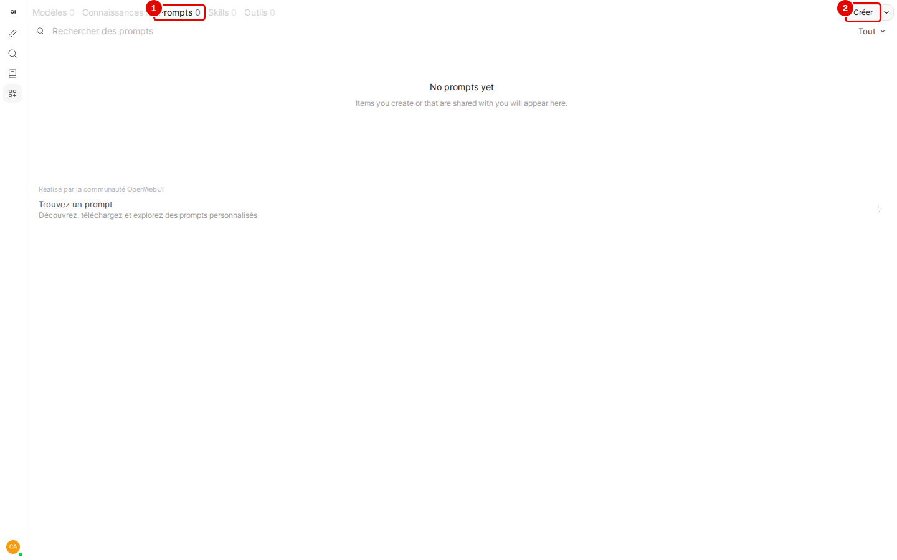
*Écran : Espace de travail, onglet « Prompts ».*

| N° | Élément | Rôle |
|---|---|---|
| 1 | « Prompts » | onglet des prompts enregistrés |
| 2 | « Créer » | ouvre l'éditeur de prompt |

*Résultat* : l'éditeur de prompt s'ouvre.

**Étape 2. Écrire le prompt**
*Où* : éditeur de prompt.
Saisir le nom `Fiche de synthèse` (pastille 1), la commande `synthese` (pastille 2) et le texte (pastille 3) :

```text
Rédige une fiche de synthèse de {{sujet}} pour un responsable d'atelier : contexte, chiffres clés, actions à mener. Cite le document source de chaque chiffre.
```

Cliquer sur « Enregistrer & Créer » (pastille 4).

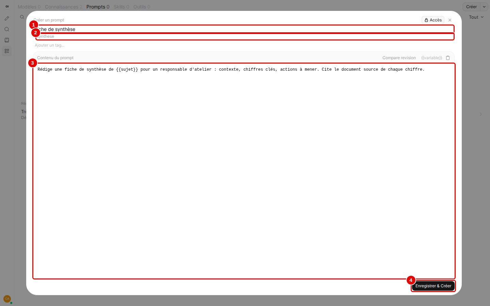
*Écran : éditeur de prompt rempli.*

| N° | Élément | Rôle |
|---|---|---|
| 1 | « Nom du prompt » | nom affiché dans la liste |
| 2 | « Commande » | mot tapé après « / » pour appeler le prompt |
| 3 | contenu du prompt | texte inséré ; `{{sujet}}` est une variable à remplir à l'usage |
| 4 | « Enregistrer & Créer » | enregistre le prompt |

*Résultat* : le prompt figure dans la liste.

**Étape 3. Appeler le prompt**
*Où* : zone de saisie d'une conversation.
Taper `/syn` (pastille 2), puis choisir « Fiche de synthèse » (pastille 1).

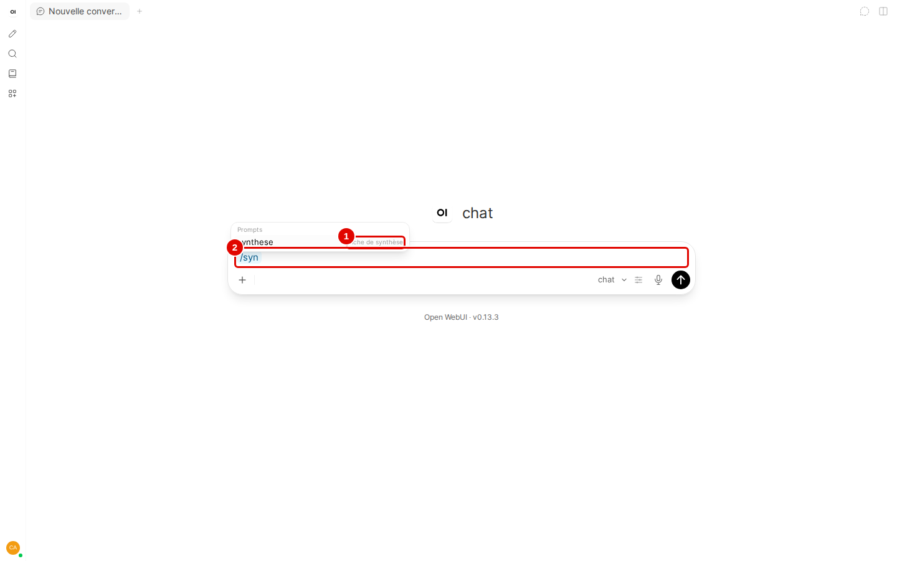
*Écran : liste des prompts ouverte par « / ».*

| N° | Élément | Rôle |
|---|---|---|
| 1 | « Fiche de synthèse » | prompt proposé |
| 2 | `/syn` | début de la commande ; la liste se filtre au fil de la saisie |

*Résultat* : le prompt est proposé dès les premières lettres de sa commande. Appuyer sur Entrée (ou cliquer sur « Fiche de synthèse ») pour le choisir.

**Étape 3 bis. Remplir la variable**
*Où* : fenêtre « Variables d'entrée », ouverte d'office quand le prompt contient une variable.
Saisir la valeur de « sujet » (pastille 2), par exemple `contrat Batterix`, puis cliquer sur « Enregistrer » (pastille 3).

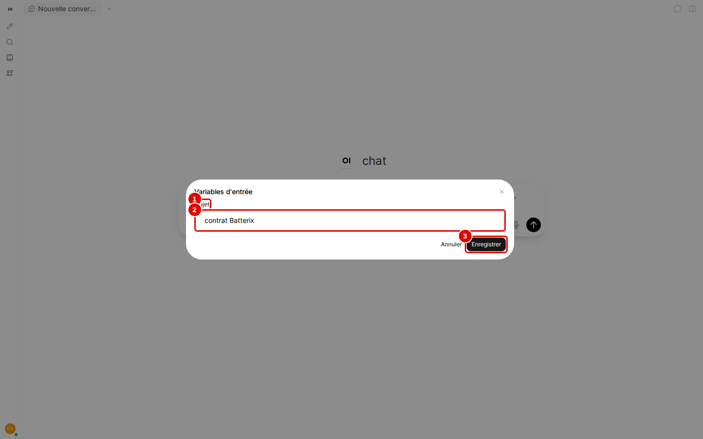
*Écran : fenêtre « Variables d'entrée ».*

| N° | Élément | Rôle |
|---|---|---|
| 1 | « sujet » | nom de la variable écrite `{{sujet}}` dans le prompt |
| 2 | valeur | texte qui remplacera la variable |
| 3 | « Enregistrer » | insère le prompt complété dans la zone de saisie |

*Où* : zone de saisie.

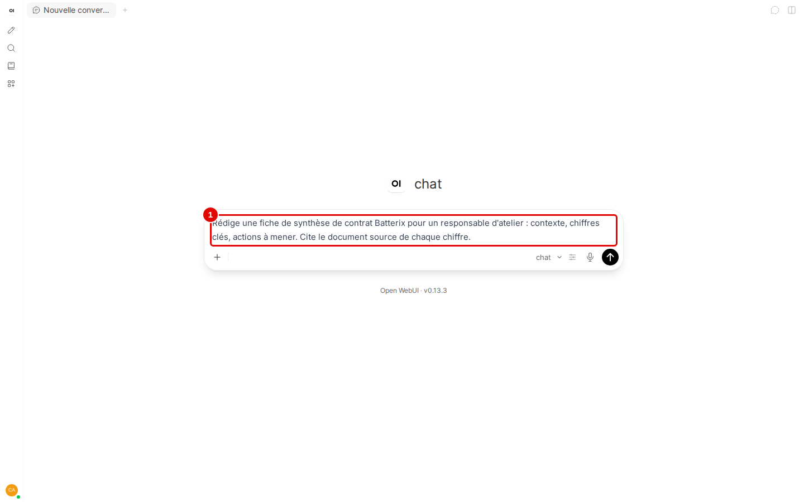
*Écran : zone de saisie remplie par le prompt complété.*

| N° | Élément | Rôle |
|---|---|---|
| 1 | texte du prompt complété | « Rédige une fiche de synthèse de contrat Batterix pour un responsable d'atelier… », modifiable avant l'envoi |

*Résultat* : la question est prête ; Entrée l'envoie.

## Ajouter un outil

**Étape 4. Créer l'outil**
*Où* : Espace de travail › onglet « Outils » › « Créer ».
Saisir le nom `Stocks Vélanor` (pastille 1), l'identifiant `stocks_velanor` (pastille 2) et une description (pastille 3). Remplacer le code proposé par tout le contenu du fichier `outils/open-webui/extensions/outil_stocks.py` du dépôt (l'ouvrir dans un éditeur de texte, ou l'afficher avec `cat` dans le terminal, puis tout copier et coller ; pastille 4), puis cliquer sur « Enregistrer & Créer » (pastille 5).

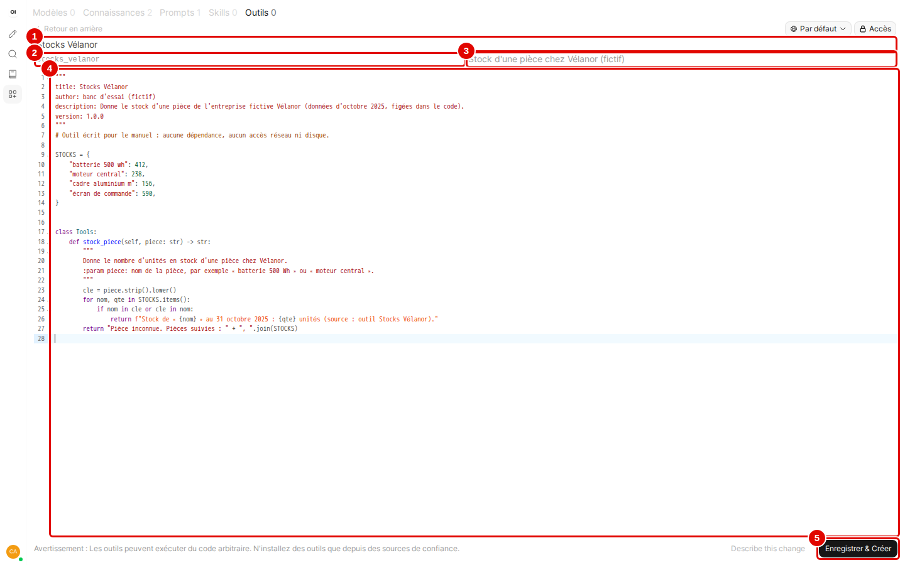
*Écran : éditeur d'outil, code de l'outil « Stocks Vélanor ».*

| N° | Élément | Rôle |
|---|---|---|
| 1 | « Nom de l'outil » | nom affiché dans les listes |
| 2 | « ID de l'outil » | identifiant technique |
| 3 | « Description » | phrase d'explication |
| 4 | code de l'outil | classe `Tools` ; chaque méthode documentée devient une fonction que le modèle peut appeler (ici `stock_piece`) |
| 5 | « Enregistrer & Créer » | enregistre l'outil |

*Résultat* : une fenêtre d'avertissement s'ouvre.

**Étape 5. Confirmer**
*Où* : fenêtre « Confirmer votre action ».
Lire l'avertissement, puis cliquer sur « Confirmer » (pastille 1).

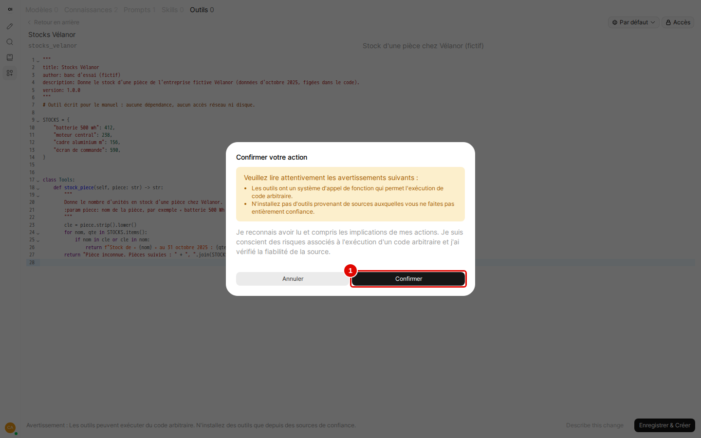
*Écran : fenêtre « Confirmer votre action ».*

| N° | Élément | Rôle |
|---|---|---|
| 1 | « Confirmer » | accepte l'installation du code |

Le texte rappelle que « Les outils ont un système d'appel de fonction qui permet l'exécution de code arbitraire » et qu'il ne faut pas installer d'outils de sources douteuses.

*Résultat* : l'outil est enregistré.

**Étape 6. Retrouver l'outil**
*Où* : Espace de travail › onglet « Outils ».

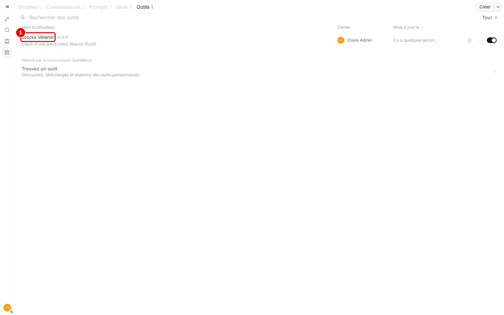
*Écran : onglet « Outils », un outil.*

| N° | Élément | Rôle |
|---|---|---|
| 1 | « Stocks Vélanor » | ouvre l'outil pour le modifier |

*Résultat* : l'outil est disponible dans les conversations (étape 14).

## Ajouter un filtre

**Étape 7. Ouvrir les fonctions**
*Où* : menu du compte › « Panneau d'administration » › « Fonctions ».
Cliquer sur « Créer » (pastille 2).

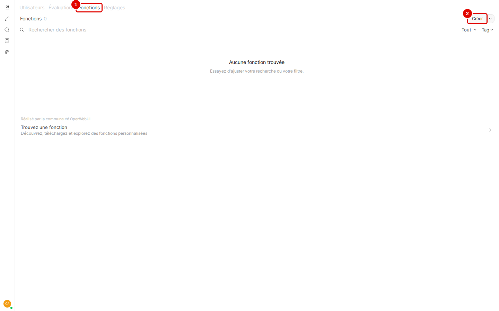
*Écran : Panneau d'administration, onglet « Fonctions ».*

| N° | Élément | Rôle |
|---|---|---|
| 1 | « Fonctions » | fonctions installées sur l'instance (réservé à l'administrateur) |
| 2 | « Créer » | ouvre l'éditeur de fonction |

*Résultat* : l'éditeur de fonction s'ouvre.

**Étape 8. Créer le filtre**
*Où* : éditeur de fonction.
Saisir le nom `Mention de source interne` (pastille 1) ; l'identifiant `mention_de_source_interne` se remplit tout seul en dessous ; saisir une description (`Réponse en français et mention en fin de réponse`). Choisir le type « Filtre » dans la liste à droite (pastille 2). Remplacer le code par tout le contenu du fichier `outils/open-webui/extensions/filtre_signature.py`, copié comme à l'étape 4 (pastille 3), puis cliquer sur « Enregistrer & Créer » (pastille 4) et confirmer l'avertissement.

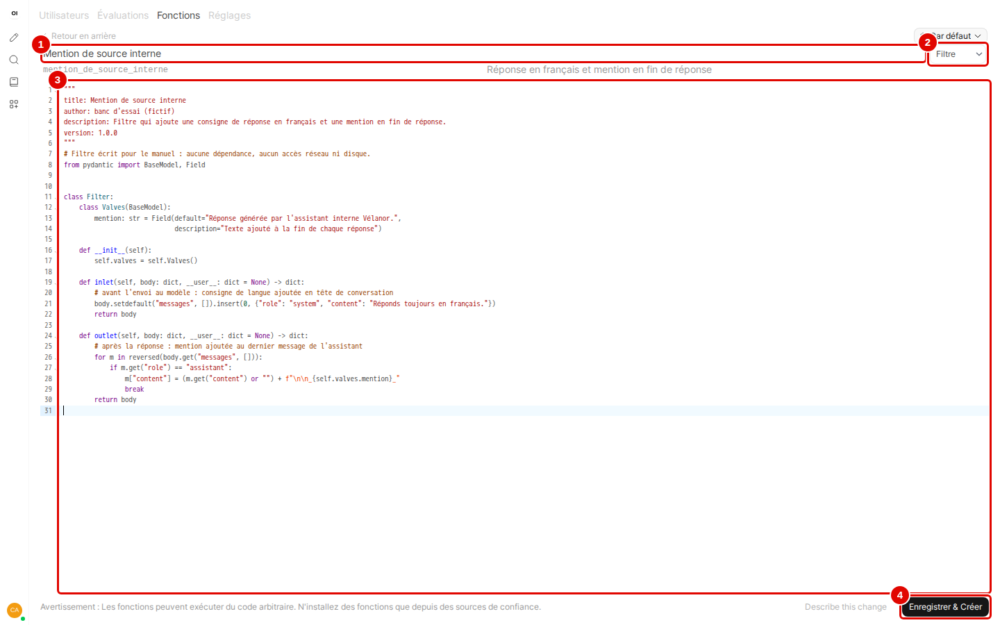
*Écran : éditeur de fonction, code du filtre.*

| N° | Élément | Rôle |
|---|---|---|
| 1 | « Nom de la fonction » | nom affiché |
| 2 | type de fonction | « Filtre » : la fonction transforme les questions et les réponses |
| 3 | code du filtre | classe `Filter` : `inlet` ajoute une consigne avant l'envoi, `outlet` ajoute une mention à la fin de la réponse |
| 4 | « Enregistrer & Créer » | enregistre la fonction |

*Résultat* : la fonction est créée, désactivée.

**Étape 9. Repérer l'interrupteur**
*Où* : Panneau d'administration › « Fonctions ».

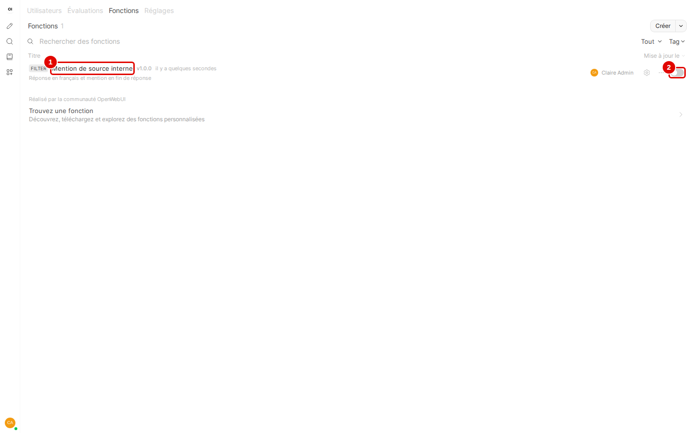
*Écran : onglet « Fonctions », filtre désactivé.*

| N° | Élément | Rôle |
|---|---|---|
| 1 | « Mention de source interne » | la fonction (type « FILTER ») |
| 2 | interrupteur (désactivé) | une fonction neuve est inactive |

*Résultat* : le filtre existe mais n'agit pas encore (étapes 17 à 19).

## Brancher un serveur MCP

**Étape 10. Démarrer le serveur MCP d'exemple**
*Où* : terminal Ubuntu, dossier du dépôt.

```bash
outils/open-webui/mcp.sh start
```

*Résultat* : le terminal affiche `Serveur MCP prêt : http://rag-mcp-velanor:8000/mcp`. Ce serveur d'essai fournit deux outils : `site_velanor` (adresse d'un site) et `jours_ouvres` (nombre de jours ouvrés entre deux dates). Il n'est joignable que par Open WebUI.

**Étape 11. Ouvrir les intégrations**
*Où* : menu du compte › « Réglages » › groupe « Administrateur » › « Intégrations ».
Cliquer sur le « + » de « Serveurs d'outils externes » (pastille 3).

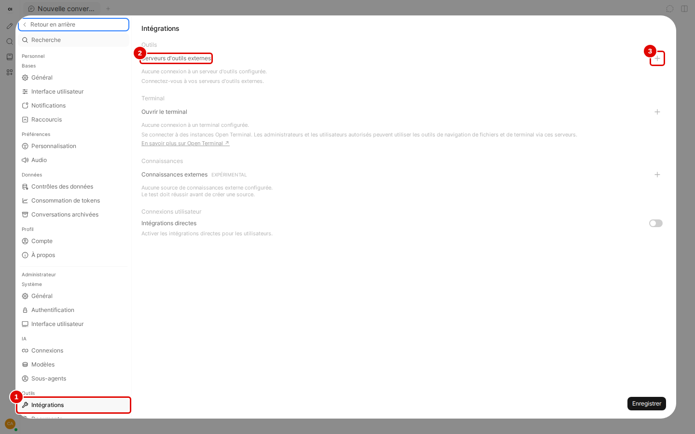
*Écran : onglet « Intégrations » du groupe « Administrateur ».*

| N° | Élément | Rôle |
|---|---|---|
| 1 | « Intégrations » | serveurs d'outils, terminal, connaissances externes |
| 2 | « Serveurs d'outils externes » | serveurs OpenAPI ou MCP déclarés |
| 3 | « + » | ouvre la fenêtre « Ajouter une connexion » |

*Résultat* : la fenêtre « Ajouter une connexion » s'ouvre.

**Étape 12. Déclarer le serveur**
*Où* : fenêtre « Ajouter une connexion ».
Cliquer sur « OpenAPI » jusqu'à afficher « MCP Streamable HTTP » (pastille 1), saisir le nom `Vélanor MCP` (pastille 2), une description (`Sites et jours ouvrés (serveur MCP d'essai)`) et l'URL `http://rag-mcp-velanor:8000/mcp` (pastille 3). Laisser « Auth » sur la valeur proposée, « Bearer », avec le champ « Clé API » vide (pastille 4) : le serveur d'essai ne demande pas de clé. Cliquer enfin sur l'icône à deux flèches à droite de l'URL, « Vérifier la connexion » (pastille 5).

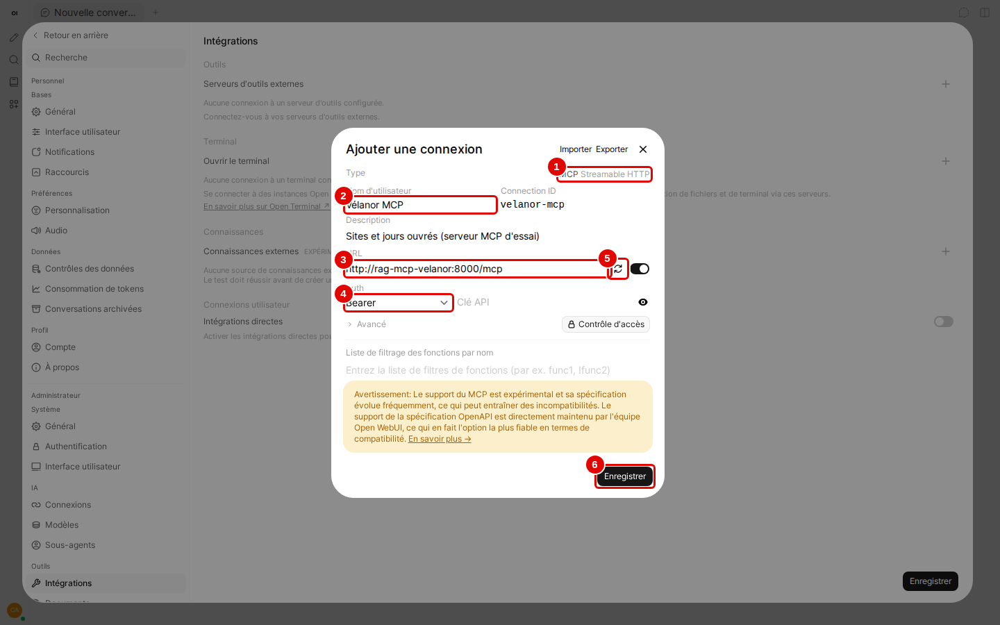
*Écran : fenêtre « Ajouter une connexion », type MCP.*

| N° | Élément | Rôle |
|---|---|---|
| 1 | « Type » | « OpenAPI » ou « MCP Streamable HTTP » ; un clic change le type |
| 2 | nom | nom affiché dans les conversations |
| 3 | « URL » | adresse du serveur, vue depuis Open WebUI |
| 4 | « Auth » | type d'authentification ; « Bearer » sans clé pour ce serveur local |
| 5 | « Vérifier la connexion » | teste l'adresse |
| 6 | « Enregistrer » | garde la connexion |

*Résultat* : un message s'affiche (étape 13).

**Étape 13. Contrôler et enregistrer**
*Où* : fenêtre « Ajouter une connexion ».

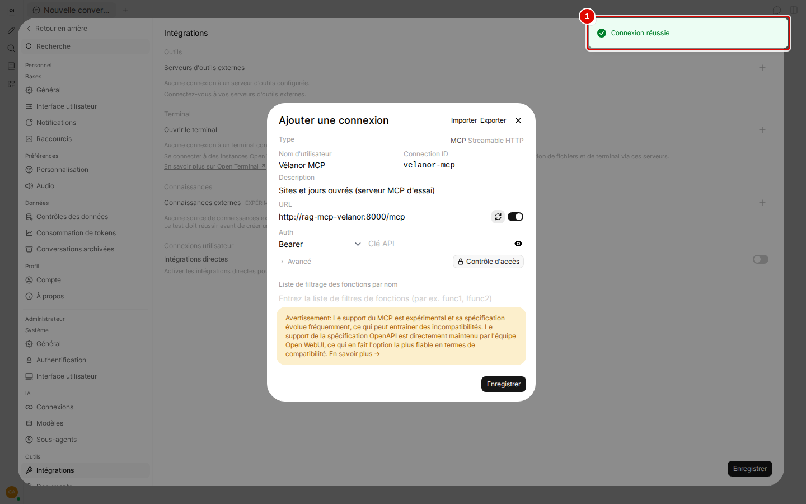
*Écran : message « Connexion réussie ».*

| N° | Élément | Rôle |
|---|---|---|
| 1 | « Connexion réussie » | le serveur répond |

Cliquer sur « Enregistrer » dans la fenêtre, puis sur « Enregistrer » en bas de l'onglet.

*Où* : onglet « Intégrations », rubrique « Serveurs d'outils externes ».

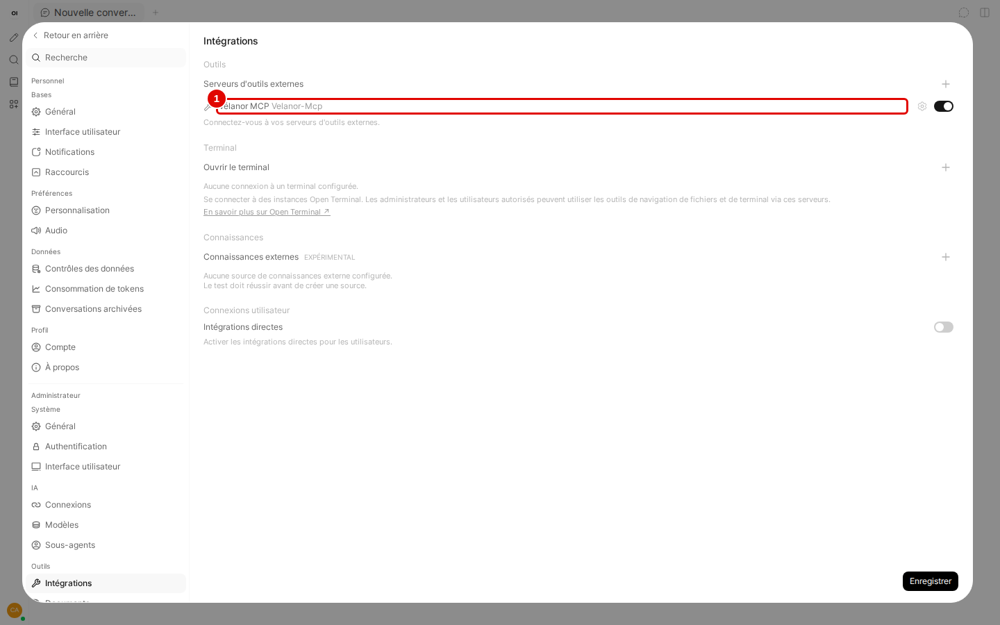
*Écran : onglet « Intégrations », serveur déclaré.*

| N° | Élément | Rôle |
|---|---|---|
| 1 | « Vélanor MCP » | serveur déclaré ; un clic rouvre ses réglages |

*Résultat* : les outils du serveur sont proposés dans les conversations.

## Utiliser les outils dans une conversation

**Étape 14. Activer les outils pour la conversation**
*Où* : nouvelle conversation › « + » (pastille 1) › « Outils » (pastille 2).
Activer « Stocks Vélanor » (pastille 3) et « Vélanor MCP » (pastille 4), puis appuyer sur Échap.

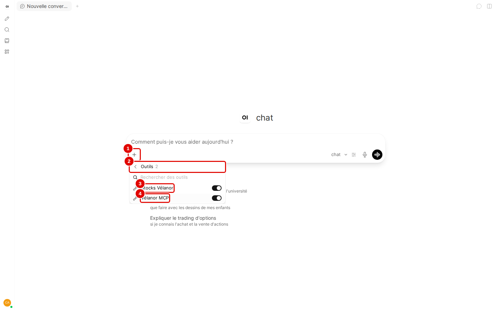
*Écran : sous-menu « Outils » du menu « + ».*

| N° | Élément | Rôle |
|---|---|---|
| 1 | « + » | menu d'ajout (fichiers, contexte, outils) |
| 2 | « Outils » | liste des outils disponibles ; le chiffre donne leur nombre |
| 3 | « Stocks Vélanor » | outil créé à l'étape 4 ; l'interrupteur l'active pour cette conversation |
| 4 | « Vélanor MCP » | serveur MCP déclaré à l'étape 12 |

*Résultat* : les outils sont actifs, sans indication visible dans la zone de saisie.

**Étape 15. Poser une question qui demande les outils**
*Où* : zone de saisie.
Taper `Combien de moteurs centraux reste-t-il en stock, et combien de jours ouvrés y a-t-il entre le 16 et le 27 novembre 2026 ?` (pastille 1) et appuyer sur Entrée.

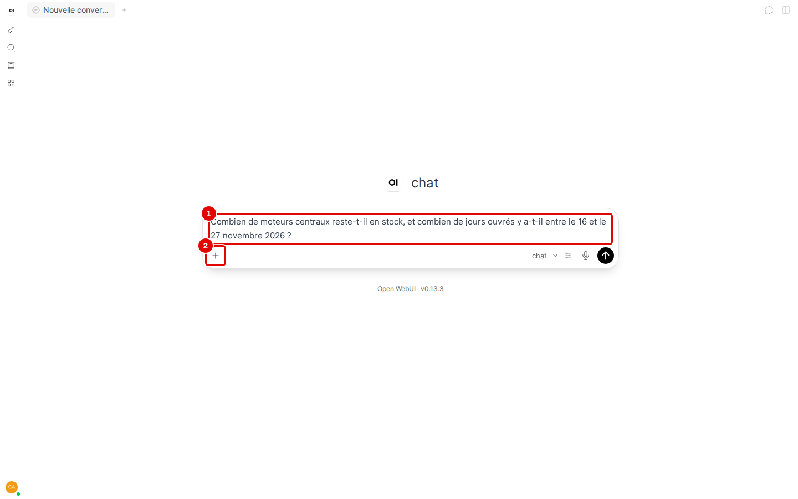
*Écran : question saisie, outils activés par le menu « + ».*

| N° | Élément | Rôle |
|---|---|---|
| 1 | question | une partie pour l'outil de stock, une partie pour le serveur MCP |
| 2 | « + » | menu par lequel les outils ont été activés ; aucun repère dans la zone de saisie ne les signale |

*Résultat* : le modèle répond (étape 16).

**Étape 16. Vérifier que les outils ont servi**
*Où* : réponse.

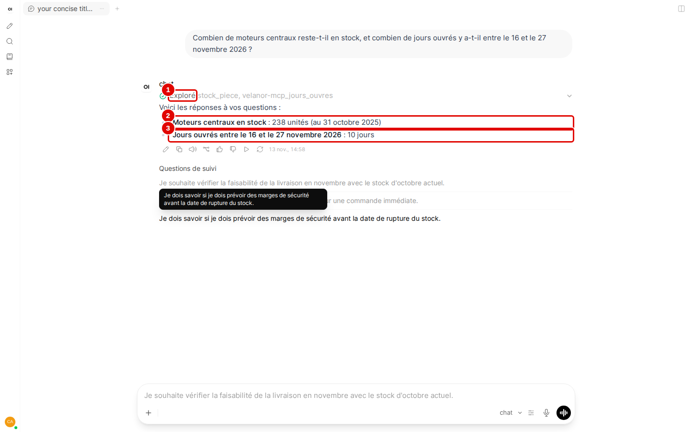
*Écran : réponse, ligne « Exploré stock_piece, velanor-mcp_jours_ouvres ».*

| N° | Élément | Rôle |
|---|---|---|
| 1 | appels d'outils | « Exploré stock_piece, velanor-mcp_jours_ouvres » : les deux outils ont été appelés |
| 2 | stock | 238 unités, valeur renvoyée par l'outil |
| 3 | jours ouvrés | 10 jours, valeur calculée par le serveur MCP |

*Où* : réponse, ligne « Exploré » dépliée d'un clic.

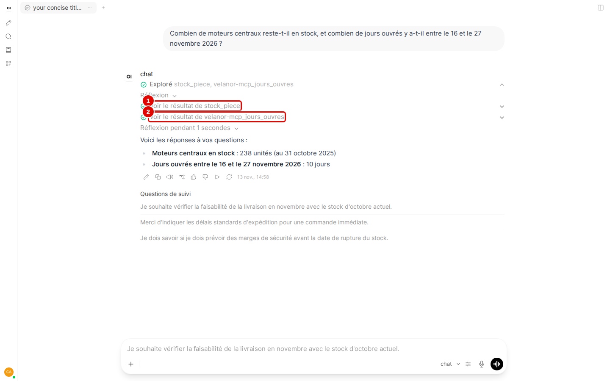
*Écran : étapes dépliées, résultats de `stock_piece` et de `velanor-mcp_jours_ouvres`.*

| N° | Élément | Rôle |
|---|---|---|
| 1 | « Voir le résultat de stock_piece » | résultat de l'outil de stock ; un clic l'affiche |
| 2 | « Voir le résultat de velanor-mcp_jours_ouvres » | résultat du serveur MCP |

**Toujours vérifier la ligne « Exploré »** : lors d'un premier essai, le modèle a prévu d'appeler les deux outils, puis a répondu sans les appeler, avec des chiffres inventés (8 unités et 12 jours). Sans ligne « Exploré » qui nomme l'outil, une réponse chiffrée ne vient pas de l'outil : la redemander (« Regénérer »).

*Résultat* : la réponse vient bien des outils.

## Activer le filtre

**Étape 17. Activer la fonction**
*Où* : Panneau d'administration › « Fonctions ».
Cliquer sur l'interrupteur de « Mention de source interne » (pastille 2).

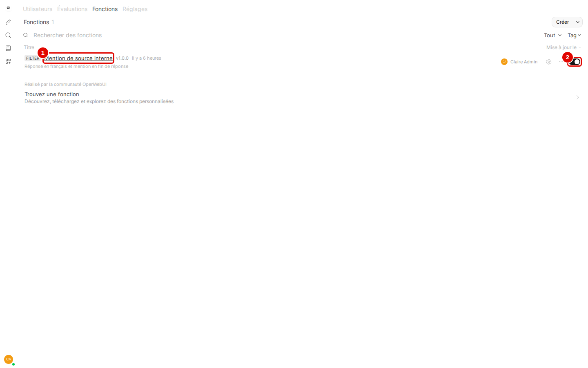
*Écran : onglet « Fonctions », filtre activé.*

| N° | Élément | Rôle |
|---|---|---|
| 1 | « Mention de source interne » | le filtre |
| 2 | interrupteur (activé) | rend la fonction utilisable |

*Résultat* : le filtre peut être rattaché à un modèle.

**Étape 18. Rattacher le filtre à l'assistant**
*Où* : Espace de travail › « Modèles » › « Assistant qualité Vélanor » (chapitre 07) › ligne « Filtres ».
Cocher « Mention de source interne » (pastille 1), cliquer sur « Terminé », puis sur « Enregistrer & Mettre à jour ».

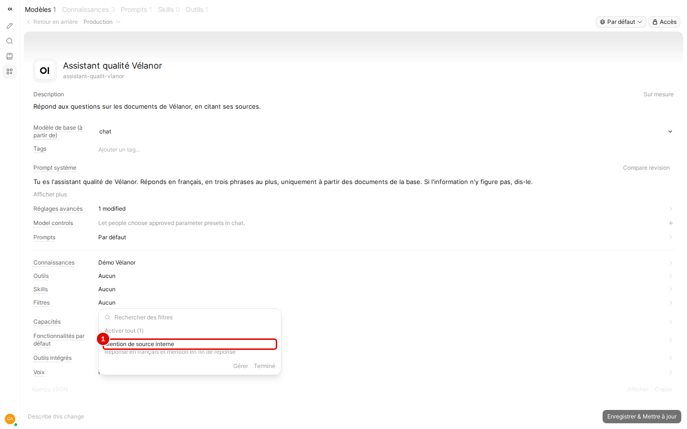
*Écran : liste des filtres de l'éditeur de modèle.*

| N° | Élément | Rôle |
|---|---|---|
| 1 | « Mention de source interne » | filtre appliqué aux conversations avec cet assistant |

*Résultat* : chaque question à l'assistant passe par le filtre.

**Étape 19. Constater l'effet du filtre**
*Où* : conversation avec « Assistant qualité Vélanor ».
Poser une question, par exemple `Quelle est la durée de garantie du cadre ?`.

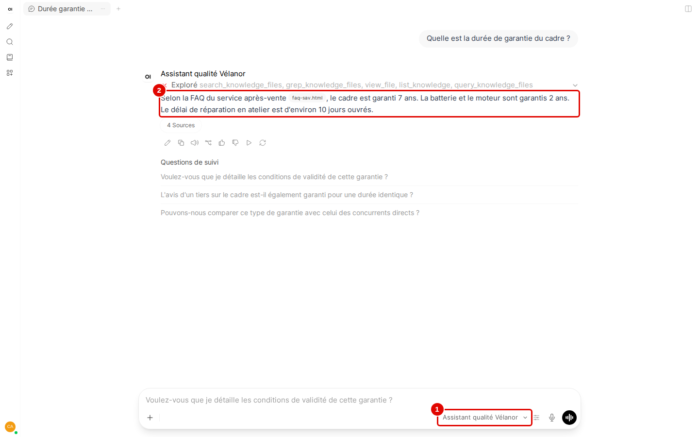
*Écran : réponse de l'assistant ; la mention ajoutée par le filtre n'est pas affichée.*

| N° | Élément | Rôle |
|---|---|---|
| 1 | « Assistant qualité Vélanor » | modèle auquel le filtre est rattaché |
| 2 | fin de la réponse | la mention « Réponse générée par l'assistant interne Vélanor. » n'apparaît pas à l'écran |

Dans cette version, la mention ajoutée par `outlet` est bien enregistrée dans la conversation (elle figure dans le texte enregistré, lu par l'API : annexe A6, section 4) mais l'interface ne l'affiche pas.

*Résultat* : le filtre agit sur les échanges ; son ajout en fin de réponse ne se voit pas dans l'interface.

## Bon à savoir

- Un outil activé par « + » l'est pour la conversation ouverte ; pour qu'un assistant dispose toujours d'un outil, le cocher dans la ligne « Outils » de l'éditeur du modèle (chapitre 07).
- Un serveur MCP arrêté ne provoque pas d'erreur visible au moment de l'activation : seule une ligne « Failed to connect to MCP server » apparaît au-dessus de la réponse (chapitre 17).
- Les fonctions se gèrent dans le Panneau d'administration ; les droits des comptes « utilisateur » sur les outils et les prompts se règlent dans les permissions (chapitre 14).

## En cas de problème

| Symptôme | Cause | Que faire |
|---|---|---|
| Réponse chiffrée sans ligne « Exploré » | le modèle n'a pas appelé l'outil | « Regénérer » ; vérifier que l'outil est activé (étape 14) |
| « Failed to connect to MCP server » | serveur MCP arrêté | `outils/open-webui/mcp.sh start` |
| Le filtre ne figure pas dans la ligne « Filtres » | fonction désactivée | étape 17 |

---
*Version décrite : Open WebUI 0.13.3, essais du 13 novembre 2026. Détails et preuves : [rapport d'essais](../annexes/A6-rapport-d-essais.md).*
