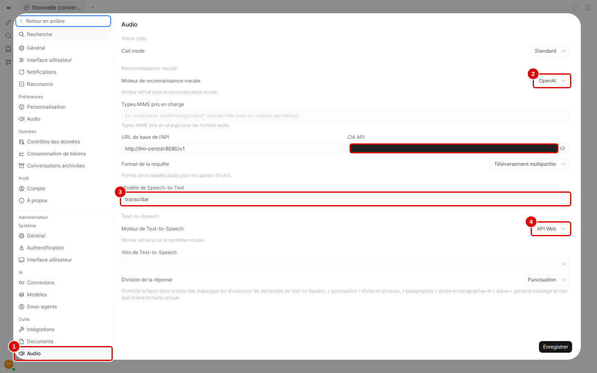
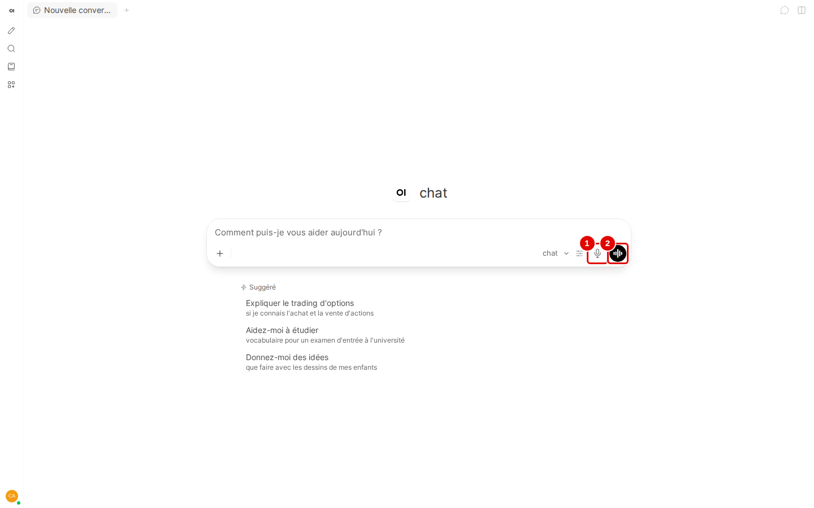
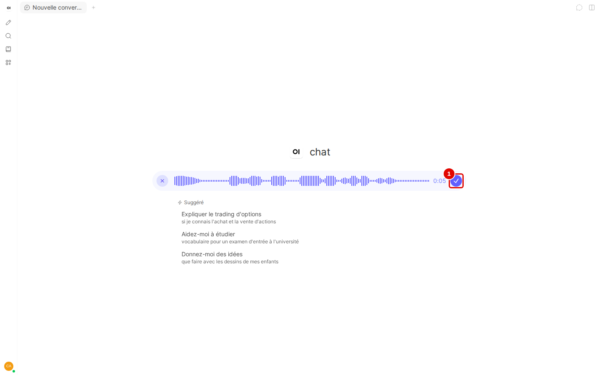
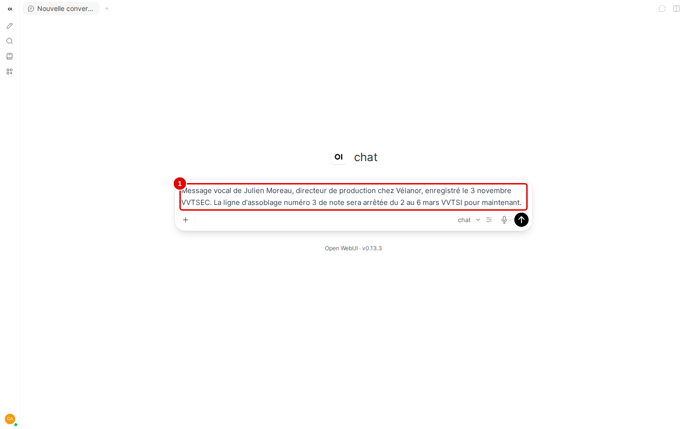
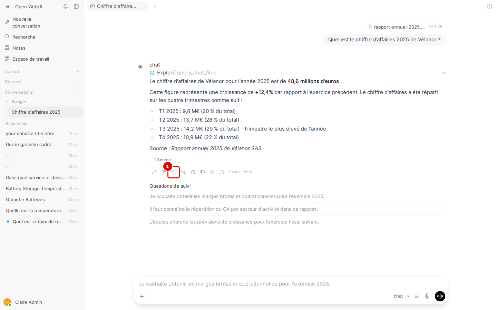
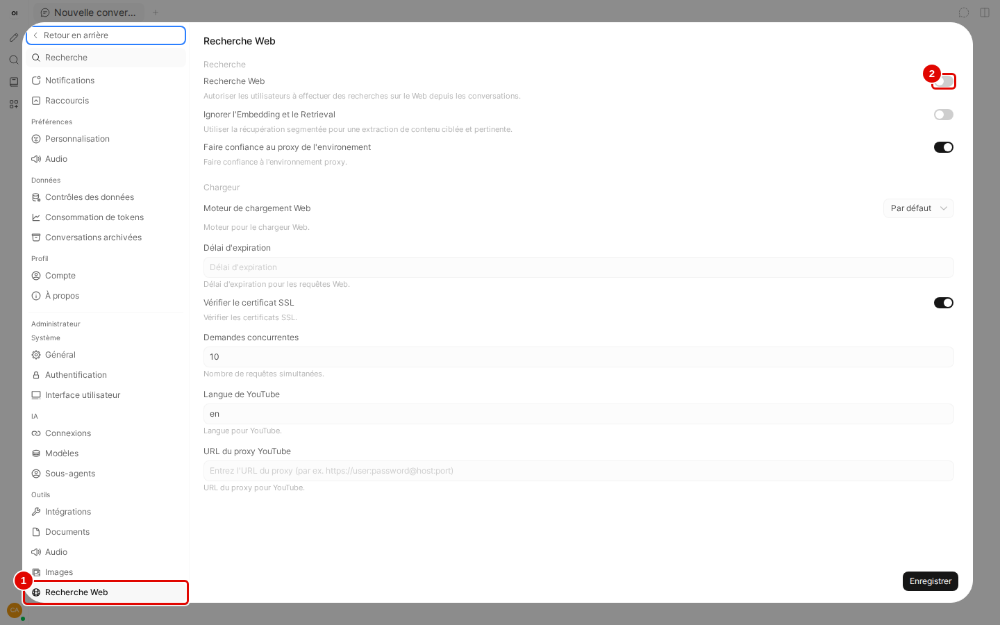

# 12. Voix et recherche web

> Ce chapitre apprend à dicter une question au micro, à faire lire une réponse à haute voix, et à situer le réglage de la recherche sur le web, laissée désactivée dans ce manuel.
> **Point de départ** : écran principal, connecté avec le compte administrateur ; un micro branché au poste.
> **Durée** : environ 10 minutes. **Avant** : chapitre 04.

## Ce qu'il faut savoir

La **dictée** enregistre la voix dans le navigateur, envoie l'enregistrement au modèle `transcribe` du service de modèles, puis place le texte obtenu dans la zone de saisie : il se relit et se corrige avant l'envoi. Rien ne part sur Internet.

La **lecture à haute voix** utilise la voix du navigateur (« API Web ») : la qualité dépend du système et du navigateur.

Le navigateur n'autorise le micro que sur une adresse sûre : `http://127.0.0.1:3000` l'est ; une adresse de réseau local en `http://` ne l'est pas, et l'interface affiche alors « Accès au microphone refusé ».

## Vérifier les réglages de la voix

**Étape 1. Ouvrir les réglages audio**
*Où* : menu du compte › « Réglages » › groupe « Administrateur » › « Audio ».

*Écran : onglet « Audio » du groupe « Administrateur ».*

| N° | Élément | Rôle |
|---|---|---|
| 1 | « Audio » | réglages de la reconnaissance et de la synthèse vocales |
| 2 | « Moteur de reconnaissance vocale » | « OpenAI » : le service de modèles, à l'adresse `http://llm-central:8080/v1` (la clé est masquée sur la capture) |
| 3 | « Modèle de Speech-to-Text » | `transcribe` |
| 4 | « Moteur de Text-to-Speech » | « API Web » : voix du navigateur |

L'installation du chapitre 02 a déjà rempli ces champs. « Whisper (local) » utiliserait un modèle de transcription chargé dans Open WebUI lui-même : inutile ici, `transcribe` fait ce travail.

*Résultat* : la dictée passe par `transcribe`.

## Dicter une question

**Étape 2. Lancer la dictée**
*Où* : zone de saisie, icône de micro.
Cliquer sur « Saisie vocale » (pastille 1). À la première utilisation, le navigateur demande l'autorisation d'utiliser le micro : l'accepter.

*Écran : zone de saisie, boutons de la voix.*

| N° | Élément | Rôle |
|---|---|---|
| 1 | « Saisie vocale » | enregistre une question à transcrire |
| 2 | « Mode vocal » | mode de conversation orale (non essayé pour ce manuel) |

*Résultat* : l'enregistrement démarre.

**Étape 3. Parler, puis valider**
*Où* : zone de saisie, transformée en barre d'enregistrement.
Parler, puis cliquer sur la coche (pastille 1).

*Écran : barre d'enregistrement, durée écoulée à droite.*

| N° | Élément | Rôle |
|---|---|---|
| 1 | coche (« Confirmer l'enregistrement ») | arrête l'enregistrement et lance la transcription |

La croix à gauche annule l'enregistrement.

*Résultat* : le texte arrive dans la zone de saisie au bout de quelques secondes.

**Étape 4. Relire le texte dicté**
*Où* : zone de saisie.

*Écran : zone de saisie remplie par la transcription.*

| N° | Élément | Rôle |
|---|---|---|
| 1 | texte transcrit | texte reconnu, modifiable avant l'envoi |

Pour l'essai, le message vocal du jeu de démonstration a servi de voix. Transcription obtenue : « Message vocal de Julien Moreau, directeur de production chez Vélanor, enregistré le 3 novembre VVTSEC. La ligne d'assoblage numéro 3 de note sera arrêtée du 2 au 6 mars VVTSI pour maintenant. » Les noms des personnes et de l'entreprise sont justes, mais les années (« 2025 », « 2026 ») et quelques mots (« assemblage », « Nantes », « maintenance ») sont mal reconnus : toujours relire avant d'envoyer.

*Résultat* : la question est prête à partir (Entrée).

## Faire lire une réponse

**Étape 5. Lire à haute voix**
*Où* : sous une réponse, barre d'icônes.
Cliquer sur « Lire à haute voix » (pastille 1).

*Écran : réponse, bouton de lecture.*

| N° | Élément | Rôle |
|---|---|---|
| 1 | « Lire à haute voix » | lit la réponse avec la voix du navigateur |

Le son n'a pas été écouté pendant les essais (navigateur automatisé, sans haut-parleur) : seul le lancement de la lecture a été vérifié.

*Résultat* : la réponse est lue par le poste.

## La recherche sur le web

**Étape 6. Situer le réglage**
*Où* : Réglages › groupe « Administrateur » › « Recherche Web ».

*Écran : onglet « Recherche Web », recherche désactivée.*

| N° | Élément | Rôle |
|---|---|---|
| 1 | « Recherche Web » | réglages de la recherche sur Internet depuis les conversations |
| 2 | interrupteur « Recherche Web » | désactivé : les réponses ne s'appuient que sur le modèle et les documents |

Activer la recherche demande un moteur de recherche à déclarer dans cet onglet. Le moteur libre SearXNG peut tourner sur le poste, mais il interroge ensuite des sites publics : les questions sortent alors du poste. Ce manuel, centré sur les documents internes, laisse la recherche web désactivée et ne l'a pas essayée.

*Résultat* : la recherche web reste désactivée ; aucune question ne part sur Internet.

## Bon à savoir

- Les réglages personnels de la voix sont dans Réglages › groupe « Personnel » › « Audio ».

## En cas de problème

| Symptôme | Cause | Que faire |
|---|---|---|
| « Accès au microphone refusé » | adresse non sûre, ou autorisation refusée dans le navigateur | ouvrir `http://127.0.0.1:3000` ; autoriser le micro dans les réglages du site |
| La dictée ne produit aucun texte | service de modèles arrêté ou `transcribe` absent | vérifier le service (chapitre 03, étape 8) |
| Texte dicté plein d'erreurs | bruit, débit rapide, chiffres et noms rares | parler près du micro ; corriger avant l'envoi |

---
*Version décrite : Open WebUI 0.13.3, essais du 13 novembre 2026. Détails et preuves : [rapport d'essais](../annexes/A6-rapport-d-essais.md).*
