# 13. Automatisations, canaux et calendrier

> Ce chapitre apprend à programmer une question qui se pose toute seule à intervalle régulier, à ouvrir un canal de discussion entre comptes, et à retrouver ces échéances dans le calendrier.
> **Point de départ** : écran principal, connecté avec le compte administrateur (chapitre 03).
> **Durée** : environ 15 minutes. **Avant** : chapitre 03.

## Ce qu'il faut savoir

Une **automatisation** est une question (un « prompt ») envoyée automatiquement au modèle selon un calendrier : une fois, toutes les heures, chaque jour, chaque semaine, chaque mois ou selon une règle sur mesure. La réponse arrive dans une conversation, comme si la question avait été posée à la main. Exemple : chaque matin, rappeler les contrôles de sécurité de la semaine. Chaque exécution utilise le modèle, donc le service de modèles doit tourner à l'heure prévue.

Un **canal** est un fil de discussion partagé entre plusieurs comptes, comme une messagerie d'équipe. Les canaux sont désactivés par défaut ; l'administrateur les active.

Le **calendrier** affiche les événements personnels et les exécutions prévues des automatisations (« Scheduled Tasks »).

## Programmer une automatisation

**Étape 1. Ouvrir la liste des automatisations**
*Où* : menu du compte › « Automatisations ».
Cliquer sur « Créer » (pastille 1).

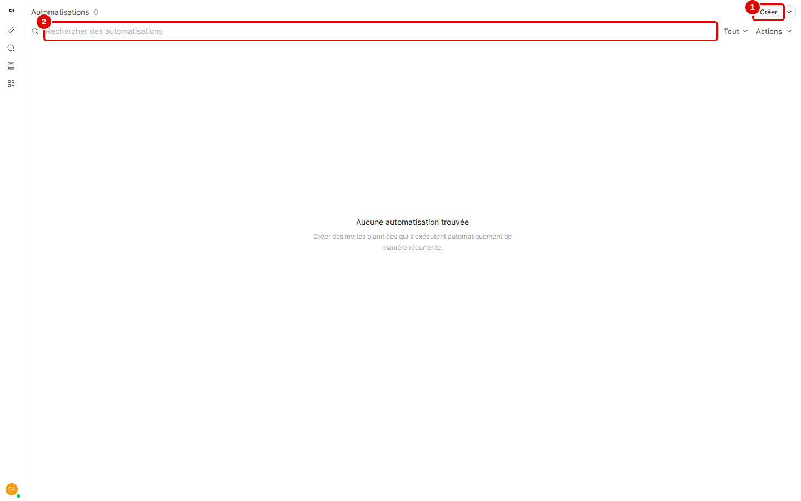
*Écran : page « Automatisations », vide.*

| N° | Élément | Rôle |
|---|---|---|
| 1 | « Créer » | ouvre la fenêtre de création |
| 2 | « Rechercher des automatisations » | filtre la liste par titre |

*Résultat* : une fenêtre de création s'ouvre.

**Étape 2. Écrire la question et choisir la fréquence**
*Où* : fenêtre de création.
Saisir le titre `Point qualité du lundi` (le titre est libre : il ne fixe pas la fréquence) et, dans « Instructions », la question à poser :

```text
Rappelle en cinq lignes les contrôles de sécurité des batteries à faire cette semaine dans le local B2 (inspection, extincteurs, formation), en français.
```

Cliquer ensuite sur « Daily » (pastille 1) : un panneau « Planifier » s'ouvre.

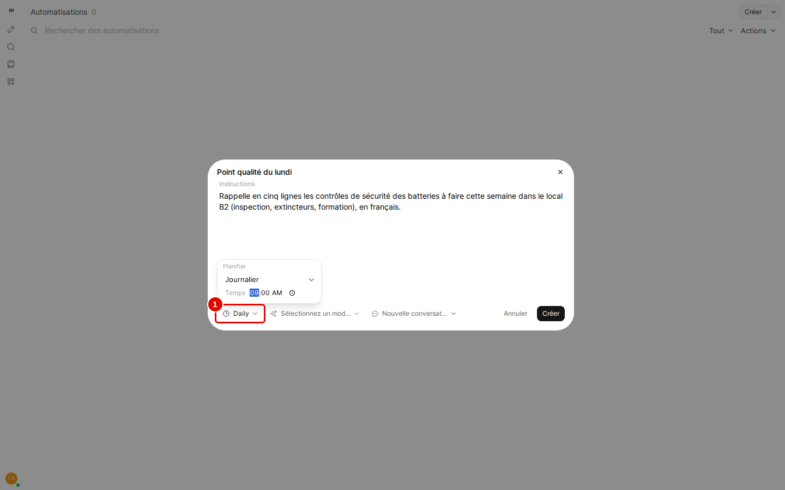
*Écran : fenêtre de création, panneau « Planifier » ouvert.*

| N° | Élément | Rôle |
|---|---|---|
| 1 | « Daily » | ouvre le panneau « Planifier » : liste de fréquence (« Une fois », « Par heure », « Journalier », « Hebdomadaire », « Mensuel », « Sur mesure ») et heure (« Temps ») |

L'heure est celle du poste ; l'exemple garde « Journalier » à 9 h 00.

*Résultat* : la fréquence est choisie ; cliquer ailleurs dans la fenêtre pour refermer le panneau.

**Étape 3. Choisir le modèle et la destination, puis créer**
*Où* : fenêtre de création, bas de la fenêtre.
Cliquer sur « Sélectionnez un modèle » et choisir `chat` (pastille 4), laisser « Nouvelle conversation » (pastille 5), puis cliquer sur « Créer » (pastille 6).

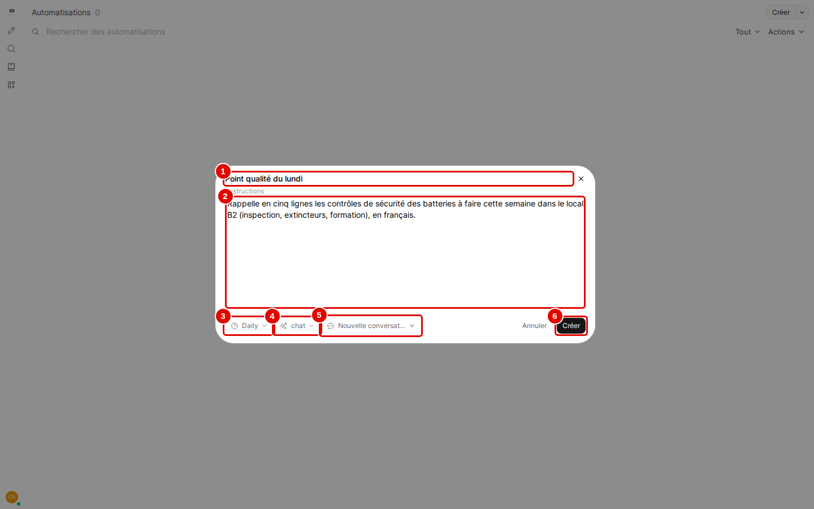
*Écran : fenêtre de création remplie.*

| N° | Élément | Rôle |
|---|---|---|
| 1 | titre | nom de l'automatisation dans la liste |
| 2 | « Instructions » | question envoyée au modèle à chaque exécution |
| 3 | fréquence | rappel de la fréquence choisie |
| 4 | modèle | modèle qui répond |
| 5 | destination | « Nouvelle conversation » (une conversation par exécution) ou une conversation, ou un canal |
| 6 | « Créer » | enregistre l'automatisation |

*Résultat* : la page de l'automatisation s'ouvre : « Statut : Actif », « Planifier : Quotidien à 9:00 », « Prochaine exécution » (le lendemain à 9 h), « Dernière exécution : Jamais », et la liste « Exécutions », vide.

**Étape 4. Retrouver l'automatisation**
*Où* : menu du compte › « Automatisations ».

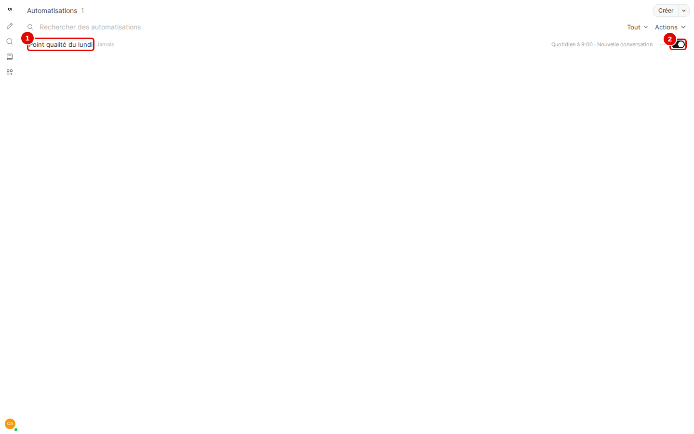
*Écran : page « Automatisations », une automatisation.*

| N° | Élément | Rôle |
|---|---|---|
| 1 | « Point qualité du lundi » | ouvre la page de l'automatisation (modifier, lancer tout de suite, voir les exécutions) |
| 2 | interrupteur | met l'automatisation en pause ou la réactive |

*Résultat* : l'automatisation est active. Pour l'essayer sans attendre, la lancer à la main (étape 5).

## Lancer et suspendre une automatisation

**Étape 5. Ouvrir la page de l'automatisation**
*Où* : menu du compte › « Automatisations » › « Point qualité du lundi ».

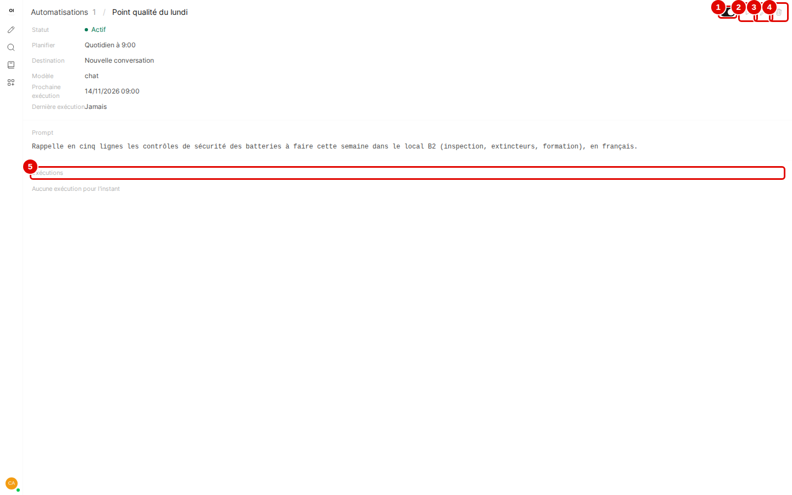
*Écran : page de l'automatisation « Point qualité du lundi ».*

| N° | Élément | Rôle |
|---|---|---|
| 1 | « Actif » (interrupteur, en haut à droite) | met l'automatisation en pause ou la réactive |
| 2 | « Exécuter maintenant » (triangle de lecture) | lance une exécution tout de suite, sans attendre l'heure prévue |
| 3 | « Modifier » (crayon) | rouvre la fenêtre de l'étape 2 |
| 4 | « Supprimer » (corbeille) | efface l'automatisation |
| 5 | « Exécutions » | historique des exécutions |

*Résultat* : la page donne le statut, la fréquence, la destination, le modèle, la prochaine et la dernière exécution, et le texte envoyé.

**Étape 6. Lancer une exécution à la main**
*Où* : page de l'automatisation.
Cliquer sur « Exécuter maintenant » (étape 5, pastille 2), puis recharger la page au bout d'une minute environ.

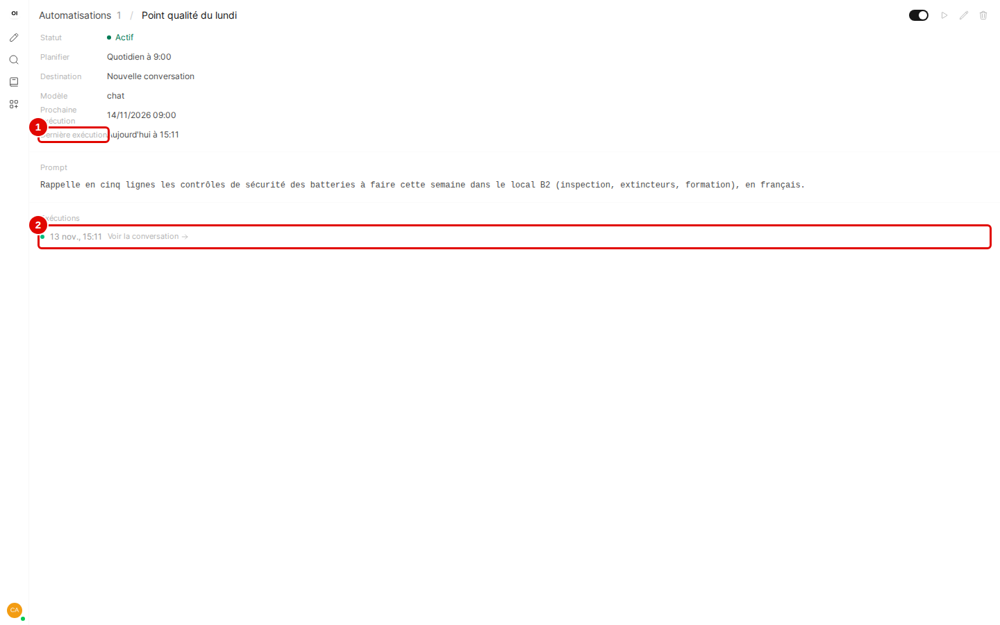
*Écran : page de l'automatisation après l'exécution.*

| N° | Élément | Rôle |
|---|---|---|
| 1 | « Dernière exécution » | date et heure de la dernière exécution |
| 2 | exécution | ligne de l'historique, avec « Voir la conversation » qui ouvre la réponse obtenue |

La réponse arrive dans une nouvelle conversation, titrée « Point qualité du lundi », dans la barre latérale. Avec le modèle `chat` seul, la réponse vient de la culture générale du modèle, pas des documents : à l'essai, elle citait des extincteurs CO₂ alors que la procédure de Vélanor prévoit des extincteurs de classe D. Pour une réponse tirée des documents, choisir comme modèle un assistant lié à une base (chapitre 07).

*Résultat* : l'automatisation a produit sa première réponse.

**Étape 7. Mettre l'automatisation en pause**
*Où* : page de l'automatisation.
Cliquer sur l'interrupteur « Actif » (pastille 1).

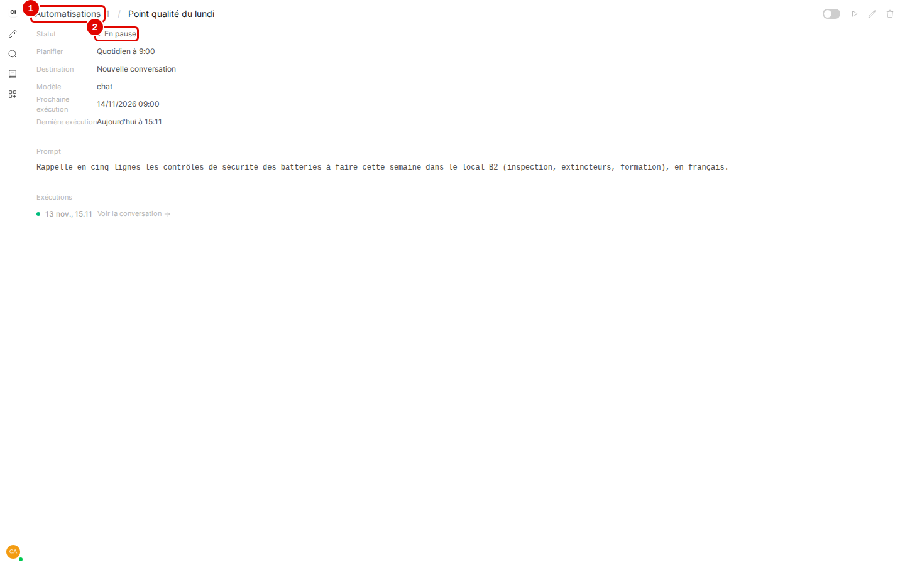
*Écran : page de l'automatisation, statut « En pause ».*

| N° | Élément | Rôle |
|---|---|---|
| 1 | interrupteur | désactivé : plus aucune exécution automatique |
| 2 | statut | « En pause » |

*Résultat* : l'automatisation ne tourne plus ; un nouveau clic la réactive.

## Ouvrir un canal d'équipe

**Étape 8. Activer les canaux**
*Où* : Réglages › groupe « Administrateur » › « Général », section « Fonctionnalités ».
Activer « Canaux » (pastille 1), puis cliquer sur « Enregistrer » (pastille 2).

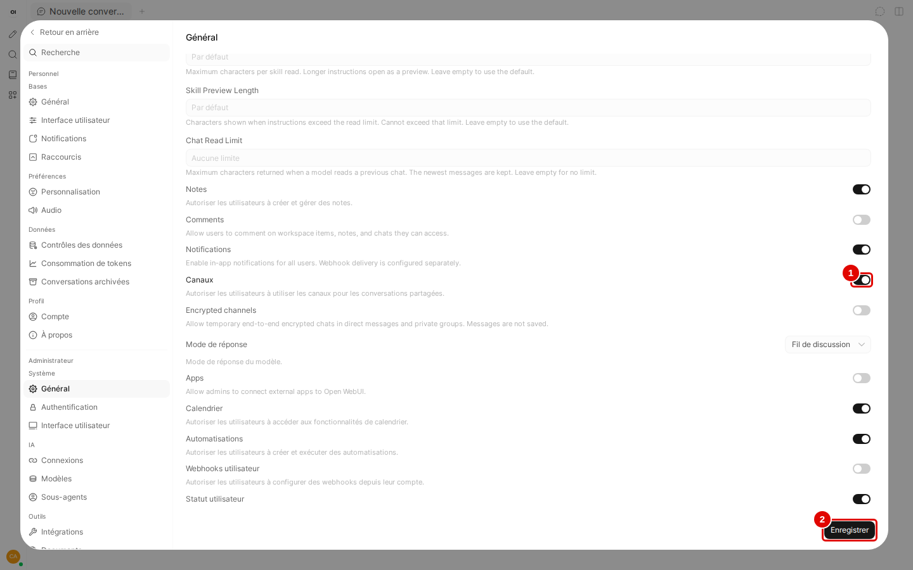
*Écran : onglet « Général » du groupe « Administrateur », « Canaux » activé.*

| N° | Élément | Rôle |
|---|---|---|
| 1 | « Canaux » | active les canaux pour l'instance |
| 2 | « Enregistrer » | garde le réglage |

*Résultat* : une rubrique « Canaux » apparaît dans la barre latérale.

**Étape 9. Créer un canal**
*Où* : barre latérale, rubrique « Canaux ».
Cliquer sur le « + » de « Canaux » (pastille 2).

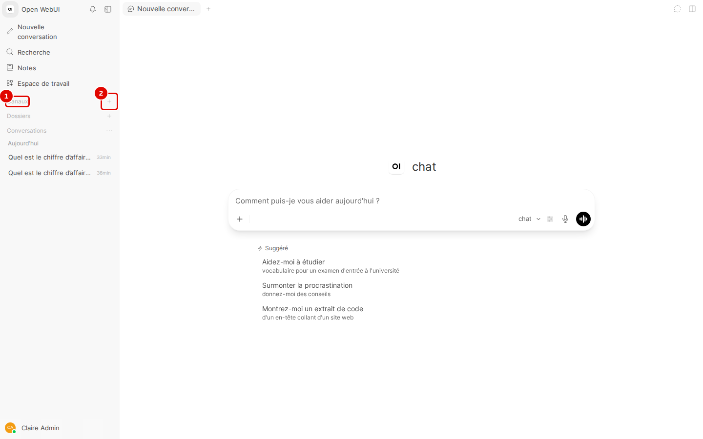
*Écran : barre latérale, rubrique « Canaux ».*

| N° | Élément | Rôle |
|---|---|---|
| 1 | « Canaux » | liste des canaux accessibles |
| 2 | « Créer un canal » (« + ») | ouvre la fenêtre « Créer un canal » |

*Résultat* : la fenêtre « Créer un canal » s'ouvre.

**Étape 10. Nommer le canal**
*Où* : fenêtre « Créer un canal ».
Saisir `atelier-nantes` (pastille 1) et cliquer sur « Créer » (pastille 2).

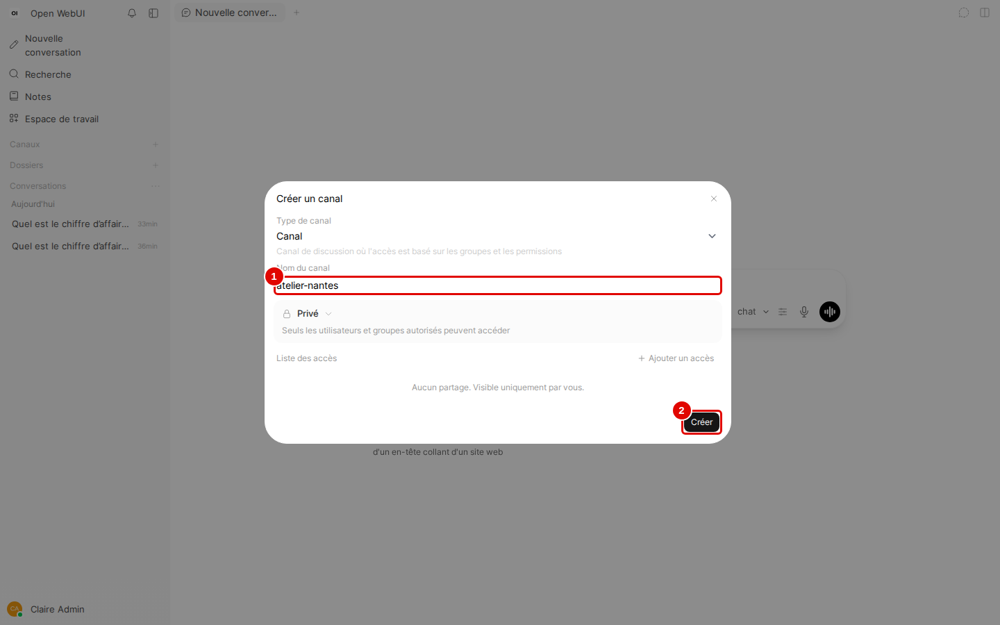
*Écran : fenêtre « Créer un canal ».*

| N° | Élément | Rôle |
|---|---|---|
| 1 | « Nom du canal » | nom affiché dans la barre latérale |
| 2 | « Créer » | crée le canal |

La fenêtre propose aussi le « Type de canal » (« Canal » ouvert selon les droits, « Canal de groupe », « Message direct ») et la « Visibilité » avec la « Liste des accès », comme pour une base (chapitre 14).

*Résultat* : le canal s'ouvre.

**Étape 11. Publier un message**
*Où* : canal « atelier-nantes », zone « Entrez votre message ici… ».
Taper le message et appuyer sur Entrée.

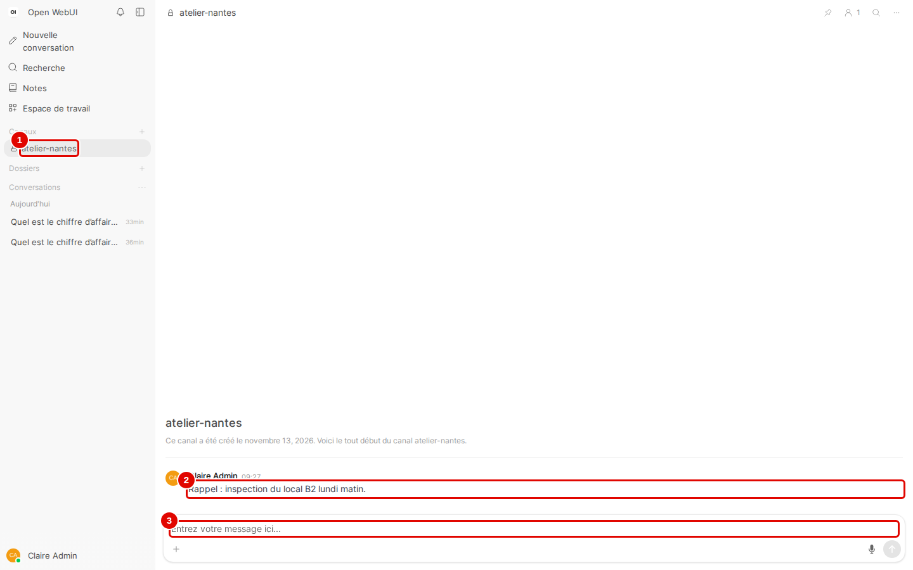
*Écran : canal « atelier-nantes ».*

| N° | Élément | Rôle |
|---|---|---|
| 1 | « atelier-nantes » | le canal dans la barre latérale ; le cadenas indique un canal privé |
| 2 | message publié | visible par tous les membres du canal, avec l'auteur et l'heure |
| 3 | zone de saisie | écrire un message ; « + » joint un fichier |

En haut à droite : épingler, voir les membres, chercher dans le canal, autres actions.

*Résultat* : le message est publié. Le canal est privé et sans accès ajouté : seul son créateur le voit. Pour l'ouvrir à une équipe, lui ajouter un accès (« Liste des accès » › « Ajouter un accès » › « Équipe production »), comme pour un modèle au chapitre 14 ; ce partage n'a pas été fait pendant les essais.

## Consulter le calendrier

**Étape 12. Ouvrir le calendrier**
*Où* : menu du compte › « Calendrier ».

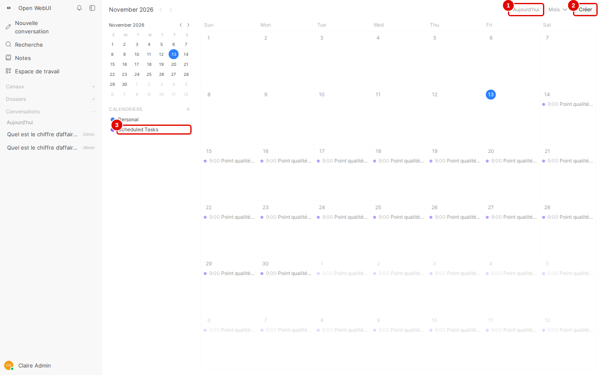
*Écran : page « Calendrier », vue du mois (capture prise avant la mise en pause de l'étape 7 : les exécutions prévues de l'automatisation apparaissent chaque jour).*

| N° | Élément | Rôle |
|---|---|---|
| 1 | « Aujourd'hui » | revient au mois en cours |
| 2 | « Créer » | ajoute un événement personnel |
| 3 | « Scheduled Tasks » | calendrier des exécutions prévues des automatisations |

« Précédent » et « Suivant » changent de mois ; « Mois » change d'affichage.

*Résultat* : les échéances sont visibles d'un coup d'œil.

## Bon à savoir

- Une automatisation n'est exécutée que si Open WebUI et le service de modèles tournent à l'heure prévue.
- Mettre en pause (interrupteur de l'étape 4) les automatisations inutiles : chaque exécution occupe le modèle une à deux minutes.
- Les automatisations des comptes « utilisateur » sont désactivées par défaut (permission « Automatisations », chapitre 14).

## En cas de problème

| Symptôme | Cause | Que faire |
|---|---|---|
| Pas de rubrique « Canaux » | canaux non activés | étape 8 |
| Une automatisation n'a jamais tourné | instance ou service de modèles arrêtés à l'heure prévue | vérifier « Dernière exécution » ; la lancer à la main |
| Un utilisateur ne voit pas « Automatisations » | permission désactivée pour son rôle ou son groupe | chapitre 14, étape 5 |

---
*Version décrite : Open WebUI 0.13.3, essais du 13 novembre 2026. Détails et preuves : [rapport d'essais](../annexes/A6-rapport-d-essais.md).*
