# 14. Comptes, groupes et permissions

> Ce chapitre apprend à créer des comptes pour d'autres personnes, à les réunir en groupes, à régler leurs droits et à partager avec eux un modèle et une base de connaissances.
> **Point de départ** : écran principal, connecté avec le compte administrateur (chapitre 03) ; base « Démo Vélanor » créée (chapitre 05).
> **Durée** : environ 20 minutes. **Avant** : chapitres 03 et 05.

**Attention** : un compte « administrateur » voit et règle tout, y compris les connexions aux modèles et les comptes des autres. Ne donner ce rôle qu'aux personnes qui gèrent l'instance.

## Ce qu'il faut savoir

Chaque compte a un **rôle** :

- « administrateur » : règle l'instance et voit tout ;
- « utilisateur » : converse, avec les droits que l'administrateur lui accorde ;
- « en attente » : compte créé mais bloqué tant qu'un administrateur ne l'a pas validé.

Un **groupe** réunit des comptes qui reçoivent les mêmes droits et les mêmes partages, par exemple « Équipe production ». Les **permissions** disent ce qu'un compte du rôle « utilisateur » peut faire (téléverser des fichiers, créer des bases, partager…).

Point important : dans Open WebUI, **tout est privé par défaut**, y compris les modèles. Un nouveau compte ne voit donc **aucun modèle** et aucune base tant que l'administrateur ne les a pas partagés avec lui ou avec son groupe. Ce chapitre le montre, puis fait le partage.

L'exemple crée le compte fictif « Julien Moreau » (directeur de production chez Vélanor) et le groupe « Équipe production ».

## Créer un compte

**Étape 1. Ouvrir la liste des comptes**
*Où* : menu du compte › « Panneau d'administration » › « Utilisateurs » › « Aperçu ».
Cliquer sur « Ajouter un utilisateur » (pastille 3, le « + » à droite).

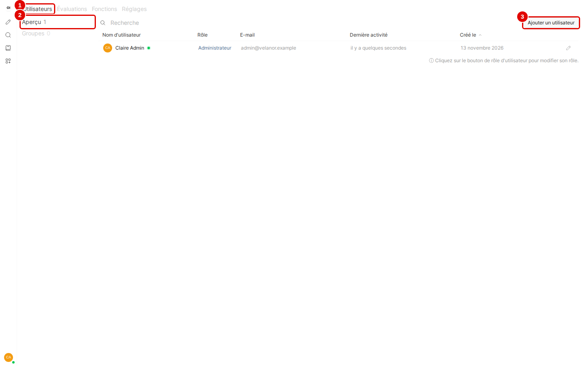
*Écran : Panneau d'administration, Utilisateurs, Aperçu.*

| N° | Élément | Rôle |
|---|---|---|
| 1 | « Utilisateurs » | gestion des comptes et des groupes |
| 2 | « Aperçu » | liste des comptes ; le chiffre en donne le nombre |
| 3 | « Ajouter un utilisateur » | ouvre la fenêtre de création d'un compte |

*Résultat* : la fenêtre « Ajouter un utilisateur » s'ouvre.

**Étape 2. Remplir la fiche du compte**
*Où* : fenêtre « Ajouter un utilisateur ».
Laisser l'onglet « Formulaire » (pastille 1), choisir le rôle « utilisateur » (pastille 2), saisir le nom, l'adresse e-mail et un mot de passe provisoire (pastilles 3 à 5), puis cliquer sur « Enregistrer » (pastille 6).

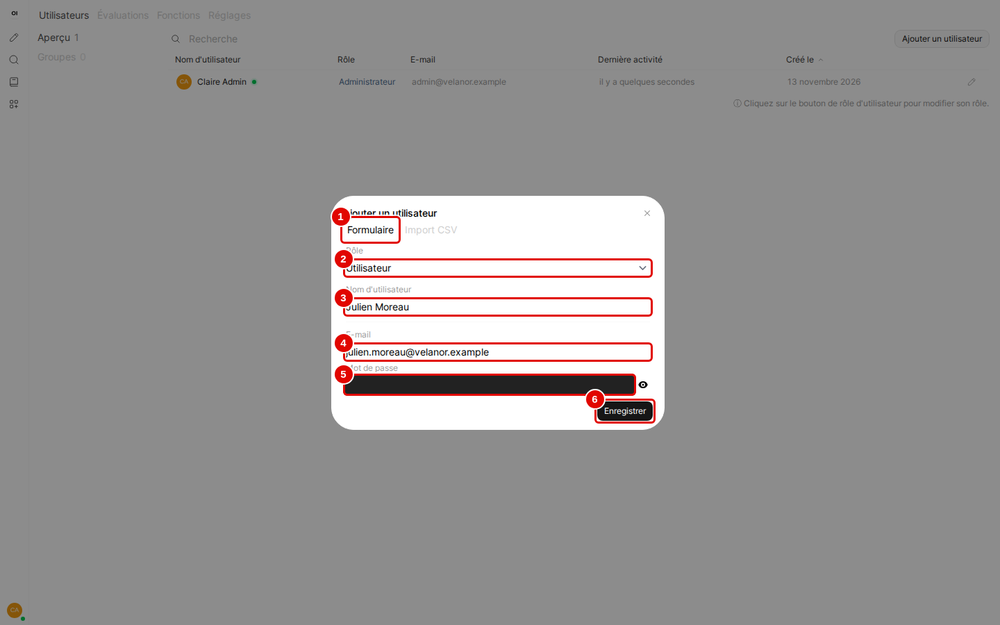
*Écran : fenêtre « Ajouter un utilisateur » (mot de passe masqué sur la capture).*

| N° | Élément | Rôle |
|---|---|---|
| 1 | « Formulaire » | création d'un compte à la main ; « Import CSV » crée plusieurs comptes d'un coup à partir d'un tableau |
| 2 | « Rôle » | « en attente », « utilisateur » ou « administrateur » |
| 3 | « Nom d'utilisateur » | nom affiché |
| 4 | « E-mail » | identifiant de connexion |
| 5 | « Mot de passe » | mot de passe à communiquer à la personne ; elle pourra le changer (Réglages › « Compte ») |
| 6 | « Enregistrer » | crée le compte |

*Résultat* : le compte apparaît dans la liste.

**Étape 3. Contrôler la liste**
*Où* : Panneau d'administration › « Utilisateurs » › « Aperçu ».

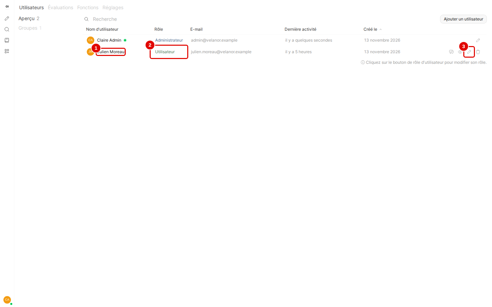
*Écran : liste des comptes, deux comptes.*

| N° | Élément | Rôle |
|---|---|---|
| 1 | « Julien Moreau » | nouveau compte ; sa ligne donne le rôle, l'e-mail, la dernière activité et la date de création |
| 2 | rôle (« Utilisateur ») | un clic change le rôle |
| 3 | « Modifier l'utilisateur » (crayon) | modifie le nom, l'e-mail ou le mot de passe du compte |

*Résultat* : le compte « Julien Moreau » existe, avec le rôle « Utilisateur ».

## Créer un groupe et régler ses droits

**Étape 4. Créer le groupe**
*Où* : Panneau d'administration › « Utilisateurs » › « Groupes » › « Nouveau groupe ».
Saisir le nom `Équipe production` (pastille 3) et une description, puis cliquer sur « Enregistrer » (pastille 5).

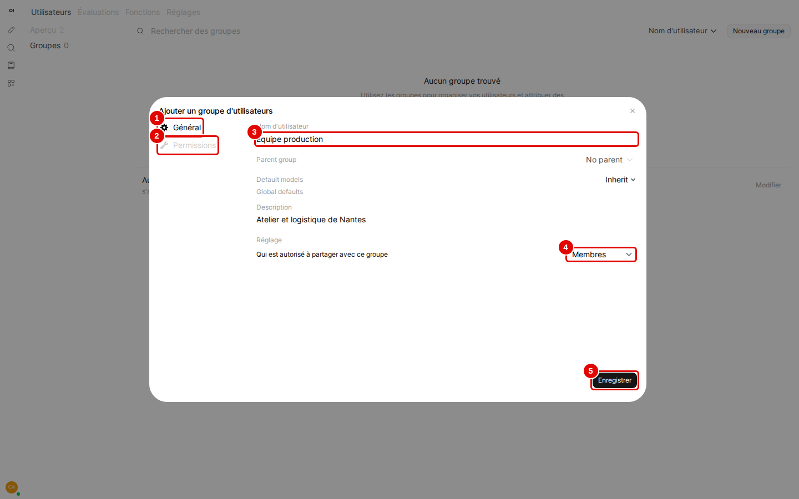
*Écran : fenêtre « Ajouter un groupe d'utilisateurs », onglet « Général ».*

| N° | Élément | Rôle |
|---|---|---|
| 1 | « Général » | nom, description, groupe parent, modèles par défaut |
| 2 | « Permissions » | droits des membres (étape 5) |
| 3 | « Nom d'utilisateur » (libellé affiché pour le nom du groupe) | nom du groupe, affiché dans les partages |
| 4 | « Qui est autorisé à partager avec ce groupe » | « Personne », « Membres » ou « Tout le monde » |
| 5 | « Enregistrer » | crée le groupe |

*Résultat* : le groupe apparaît dans la liste des groupes.

**Étape 5. Lire les permissions**
*Où* : fenêtre du groupe, onglet « Permissions ».

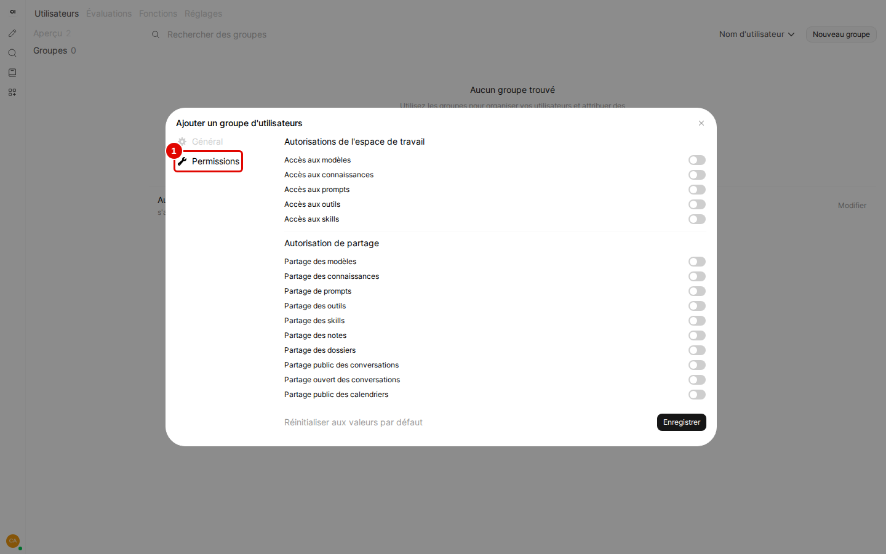
*Écran : fenêtre du groupe, onglet « Permissions ».*

| N° | Élément | Rôle |
|---|---|---|
| 1 | « Permissions » | liste des droits, chacun avec un interrupteur |

Les droits sont rangés en familles : « Autorisations de l'espace de travail » (accès aux modèles, aux connaissances, aux prompts, aux outils, aux skills), « Autorisation de partage » (partager modèles, bases, notes, conversations…), « Autorisations de la conversation » (téléverser des fichiers, régénérer, exporter, dicter, utiliser plusieurs modèles, conversation temporaire…), « Autorisations des fonctionnalités » (notes, dossiers, interpréteur de code, souvenirs, automatisations, calendrier) et « Autorisations des paramètres ». Un membre cumule les droits de tous ses groupes et des « Autorisations par défaut » (étape 7). « Réinitialiser aux valeurs par défaut » remet les valeurs d'origine.

*Résultat* : les droits du groupe sont réglés ; les valeurs par défaut ont été gardées pour l'essai.

**Étape 6. Ajouter un membre**
*Où* : Panneau d'administration › « Utilisateurs » › « Groupes » › clic sur « Équipe production » › onglet « Utilisateurs ».
Cocher la case « MEMBRE » de la ligne « Julien Moreau » (pastille 2). La case est enregistrée tout de suite. Le compte administrateur qui a créé le groupe en est membre d'office : sa case est déjà cochée.

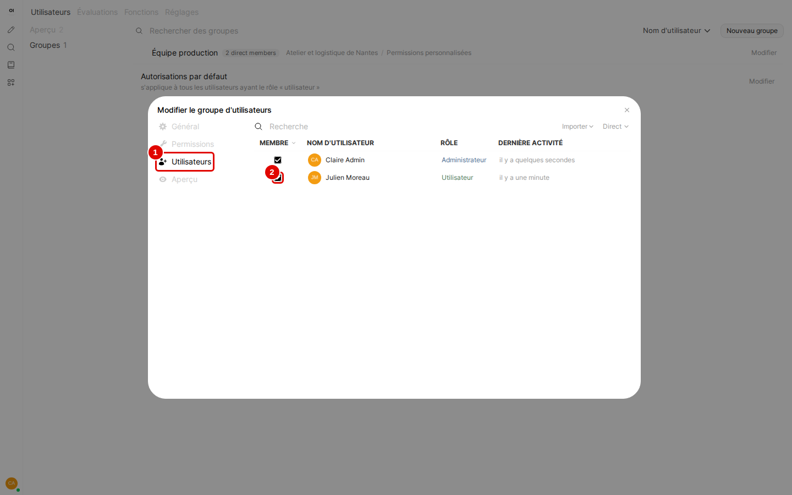
*Écran : fenêtre « Modifier le groupe d'utilisateurs », onglet « Utilisateurs ».*

| N° | Élément | Rôle |
|---|---|---|
| 1 | « Utilisateurs » | liste des comptes, avec une case « MEMBRE » |
| 2 | case « MEMBRE » de Julien Moreau | ajoute le compte au groupe, ou l'en retire |

« Importer » ajoute des membres à partir d'un fichier ; « Aperçu » résume le groupe. Fermer la fenêtre par la croix.

*Résultat* : le compte appartient au groupe.

**Étape 7. Contrôler la liste des groupes**
*Où* : Panneau d'administration › « Utilisateurs » › « Groupes ».

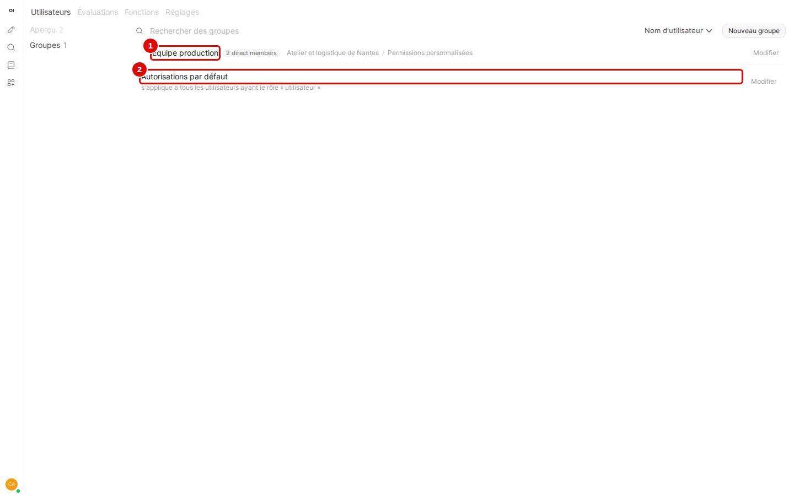
*Écran : liste des groupes.*

| N° | Élément | Rôle |
|---|---|---|
| 1 | « Équipe production » | le groupe, avec son nombre de membres (« 2 direct members » : l'administrateur et Julien Moreau) |
| 2 | « Autorisations par défaut » | droits de tous les comptes de rôle « utilisateur », groupe ou pas ; « Modifier » à droite les règle |

*Résultat* : le groupe compte ses membres.

## Régler l'inscription des nouveaux comptes

**Étape 8. Ouvrir les réglages d'authentification**
*Où* : menu du compte › « Réglages » › groupe « Administrateur » › « Authentification ».

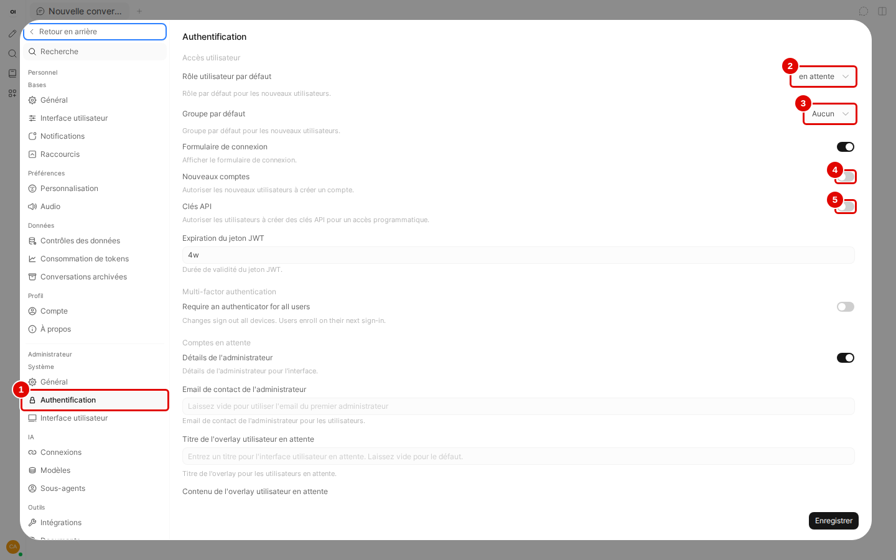
*Écran : fenêtre Réglages, onglet « Authentification ».*

| N° | Élément | Rôle |
|---|---|---|
| 1 | « Authentification » | onglet des réglages de connexion |
| 2 | « Rôle utilisateur par défaut » | rôle donné aux comptes qui s'inscrivent eux-mêmes (« en attente » conseillé) |
| 3 | « Groupe par défaut » | groupe où ils sont rangés d'office |
| 4 | « Nouveaux comptes » | autorise ou non l'inscription libre depuis l'écran de connexion (désactivé après le premier compte) |
| 5 | « Clés API » | autorise les comptes à créer des clés d'API (chapitre 15) |

Plus bas : « Expiration du jeton JWT » (durée d'une session), authentification à plusieurs facteurs (« Multi-factor authentication »), message affiché aux comptes en attente, connexion par annuaire « LDAP » ou par un fournisseur d'identité « OAuth/OIDC » (non essayés ici).

*Résultat* : les règles d'inscription sont connues. Les laisser telles quelles : l'administrateur crée lui-même les comptes (étape 2).

## Partager un modèle et une base

**Étape 9. Constater ce que voit un nouveau compte**
*Où* : autre navigateur (ou fenêtre de navigation privée), `http://127.0.0.1:3000`, connexion avec le compte de Julien Moreau.

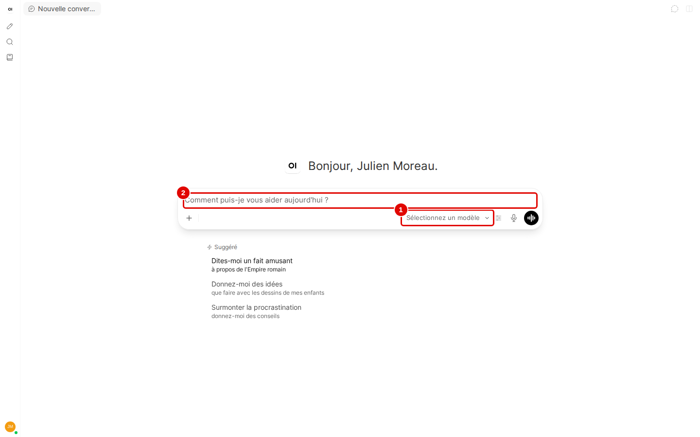
*Écran : écran principal du compte « Julien Moreau », avant tout partage.*

| N° | Élément | Rôle |
|---|---|---|
| 1 | « Sélectionnez un modèle » | aucun modèle n'est proposé : `chat` est privé |
| 2 | zone de saisie | une question ne peut pas partir sans modèle |

L'icône « Espace de travail » est aussi absente de la barre latérale : par défaut, un utilisateur n'a pas accès aux modèles personnalisés ni aux bases.

*Résultat* : le compte est inutilisable tant que rien n'est partagé. Revenir à la session de l'administrateur.

**Étape 10. Partager le modèle `chat` avec le groupe**
*Où* : Réglages › Administrateur › « Modèles » › crayon de la ligne `chat` › bouton « Accès » en haut à droite › « Ajouter un accès ».
Cocher « Équipe production » (pastille 2) et cliquer sur « Ajouter » (pastille 3).

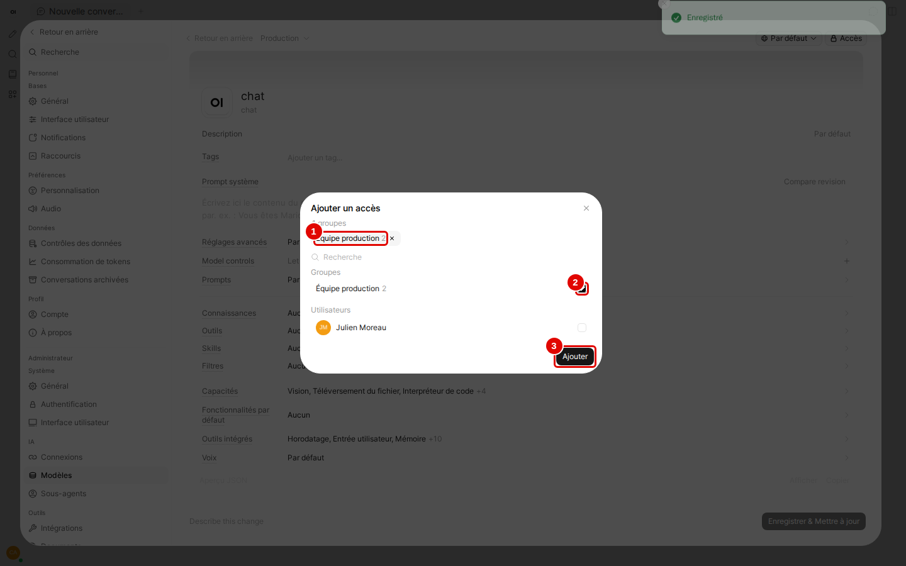
*Écran : fenêtre « Ajouter un accès » sur la fiche du modèle `chat`.*

| N° | Élément | Rôle |
|---|---|---|
| 1 | « Équipe production » | groupe à qui donner l'accès ; la liste « Utilisateurs » en dessous permet de choisir des comptes un par un |
| 2 | case à cocher | sélectionne le groupe |
| 3 | « Ajouter » | ajoute l'accès |

*Résultat* : la fenêtre « Contrôle d'accès » liste le groupe, et un message « Enregistré » s'affiche : le partage est enregistré tout de suite.

*Où* : fenêtre « Contrôle d'accès » du modèle `chat`, revenue au premier plan.

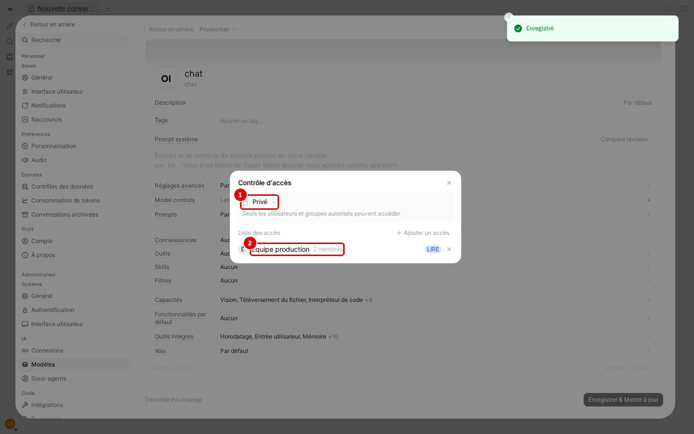
*Écran : fenêtre « Contrôle d'accès » du modèle `chat`.*

| N° | Élément | Rôle |
|---|---|---|
| 1 | « Privé » (Visibilité) | le modèle reste réservé aux accès listés ; « Public » l'ouvrirait à tous les comptes |
| 2 | « Équipe production » | accès accordé, en lecture (« LIRE ») ; la croix le retire |

*Où* : Réglages › Administrateur › « Modèles ».

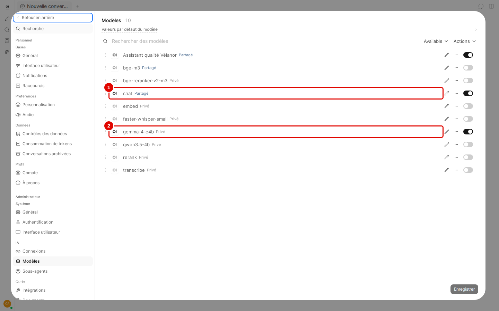
*Écran : onglet « Modèles », ligne `chat` partagée.*

| N° | Élément | Rôle |
|---|---|---|
| 1 | « chat Partagé » | la mention « Privé » est devenue « Partagé » |
| 2 | « gemma-4-e4b Privé » | modèle non partagé, réservé à l'administrateur |

**Étape 11. Partager la base avec le groupe**
*Où* : Espace de travail › « Connaissances » › « Démo Vélanor » › « Accès » (en haut à droite) › « Ajouter un accès ».
Cocher « Équipe production » (pastille 2) et cliquer sur « Ajouter » (pastille 3).

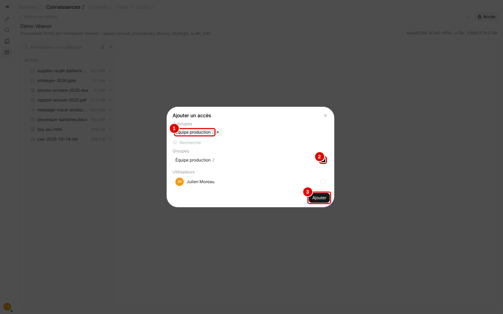
*Écran : fenêtre « Ajouter un accès » sur la base « Démo Vélanor ».*

| N° | Élément | Rôle |
|---|---|---|
| 1 | « Équipe production » | groupe à qui donner l'accès |
| 2 | case à cocher | sélectionne le groupe |
| 3 | « Ajouter » | ajoute l'accès |

*Où* : même fenêtre, après « Ajouter ».

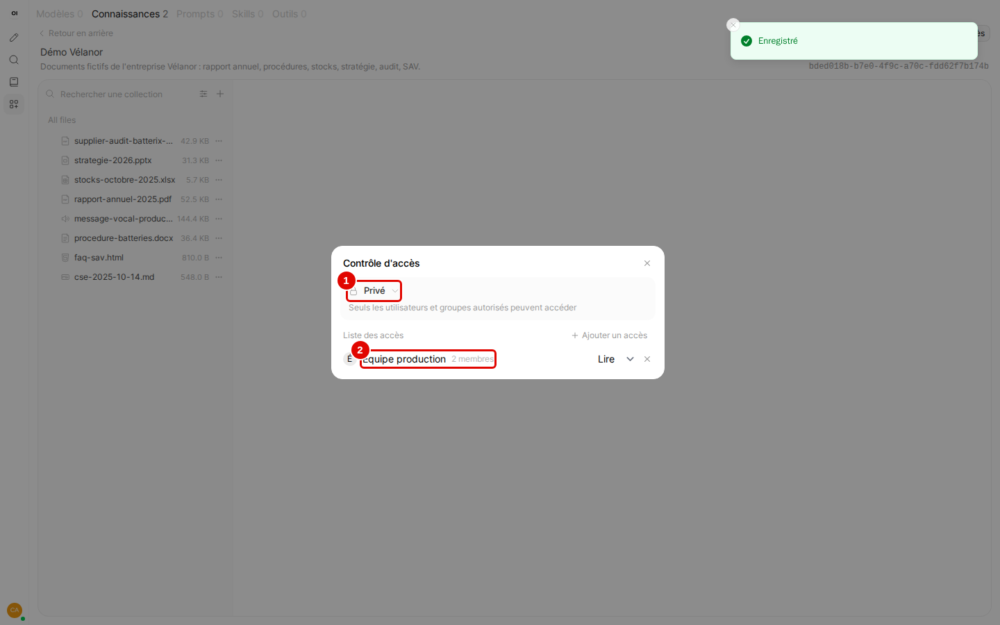
*Écran : fenêtre « Contrôle d'accès » de la base, message « Enregistré ».*

| N° | Élément | Rôle |
|---|---|---|
| 1 | « Privé » (Visibilité) | la base reste réservée aux accès listés |
| 2 | « Équipe production » | accès accordé ; la liste « Lire » à droite permet de passer en « Écrire » (ajouter et retirer des fichiers) |

*Résultat* : le groupe peut lire la base.

**Étape 12. Contrôler depuis le compte de l'utilisateur**
*Où* : session de Julien Moreau, écran principal (recharger la page). Taper `#` dans la zone de saisie.

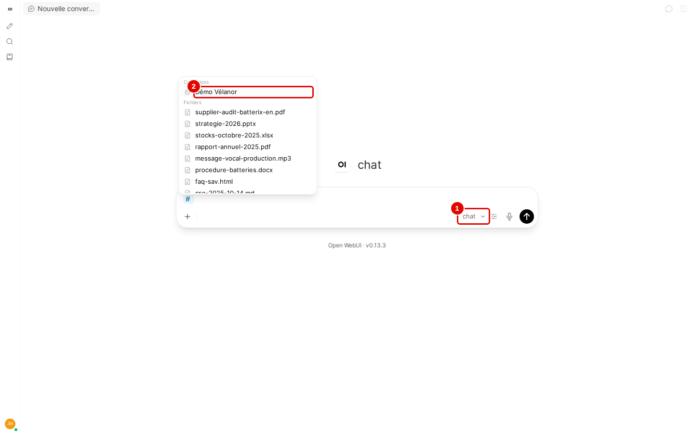
*Écran : écran principal du compte « Julien Moreau », après partage, liste ouverte par « # ».*

| N° | Élément | Rôle |
|---|---|---|
| 1 | « chat » | le modèle partagé est maintenant proposé |
| 2 | « Démo Vélanor » | la base partagée apparaît sous « Collections », suivie de ses fichiers |

*Résultat* : Julien Moreau peut interroger la base « Démo Vélanor » avec `chat` (chapitre 06), sans pouvoir la modifier.

## Bon à savoir

- Partager avec un groupe plutôt qu'avec chaque compte : un nouvel arrivant reçoit tout en entrant dans le groupe.
- `gemma-4-e4b` n'a pas été partagé : il reste réservé à l'administrateur.
- Les conversations de chaque compte sont privées.
- Aucun e-mail n'est envoyé dans cette installation : en cas d'oubli, l'administrateur ouvre la fiche du compte (crayon « Modifier l'utilisateur », étape 3) pour lui donner un nouveau mot de passe.

## En cas de problème

| Symptôme | Cause | Que faire |
|---|---|---|
| Un utilisateur voit « Sélectionnez un modèle » sans aucun choix | aucun modèle partagé avec lui | étape 10 |
| La base n'apparaît pas après « # » | base non partagée, ou page non rechargée | étape 11, puis recharger la page |
| Un compte reste bloqué sur un message d'attente | rôle « en attente » | changer son rôle (étape 3) |

---
*Version décrite : Open WebUI 0.13.3, essais du 13 novembre 2026. Détails et preuves : [rapport d'essais](../annexes/A6-rapport-d-essais.md).*
