# 15. Administrer l'instance

> Ce chapitre apprend à régler l'instance pour tous les comptes : fonctions proposées, clés d'API, modèle des tâches de fond, suivi de l'usage et des évaluations, sauvegarde de la configuration et de la base, version installée.
> **Point de départ** : écran principal, connecté avec le compte administrateur (chapitre 03).
> **Durée** : environ 20 minutes. **Avant** : chapitre 14.

**Attention** : une clé d'API donne les mêmes droits que le compte qui l'a créée. La garder secrète, ne jamais la coller dans un document partagé, et la supprimer quand elle ne sert plus.

## Ce qu'il faut savoir

Les réglages de l'instance sont dans la fenêtre « Réglages », groupe « Administrateur » (menu du compte › « Réglages »). Ils valent pour tous les comptes. Le « Panneau d'administration » (menu du compte) ajoute la gestion des comptes (chapitre 14), des évaluations et des fonctions (chapitre 11).

Une **clé d'API** est un mot de passe technique qui permet à un programme (un script, une autre application) d'utiliser Open WebUI à la place d'une personne. Son usage est décrit dans l'annexe A3.

Open WebUI fait faire au modèle des **tâches de fond** : écrire le titre d'une conversation, proposer des questions de suite, reformuler une question avant de chercher dans les documents. Ces tâches utilisent par défaut le modèle de la conversation (« Modèle actuel ») et ajoutent du temps d'attente.

## Choisir les fonctions proposées

**Étape 1. Ouvrir les réglages généraux**
*Où* : menu du compte › « Réglages » › groupe « Administrateur » › « Général ».

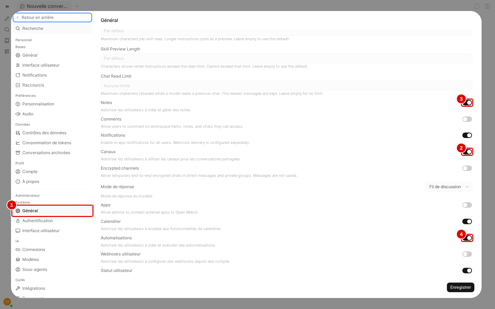
*Écran : fenêtre Réglages, onglet « Général » du groupe « Administrateur ».*

| N° | Élément | Rôle |
|---|---|---|
| 1 | « Général » | onglet des réglages généraux de l'instance |
| 2 | « Canaux » | active les canaux de discussion entre comptes (chapitre 13) ; désactivé par défaut |
| 3 | « Notes » | permet aux comptes de créer des notes (chapitre 10) |
| 4 | « Automatisations » | permet aux comptes de programmer des questions récurrentes (chapitre 13) |

En haut de l'onglet, « Vérifier les mises à jour disponibles » interroge le site d'Open WebUI pour connaître la dernière version (accès à Internet).

La section « Fonctionnalités » règle aussi : partage communautaire, évaluation des messages (pouces sous les réponses), dossiers, souvenirs, commentaires, notifications, « Apps », « Calendrier », webhooks et statut des utilisateurs, filigrane des réponses.

*Résultat* : les fonctions proposées aux comptes sont connues.

**Étape 2. Régler l'adresse et les bannières**
*Où* : même onglet, faire défiler vers le bas.

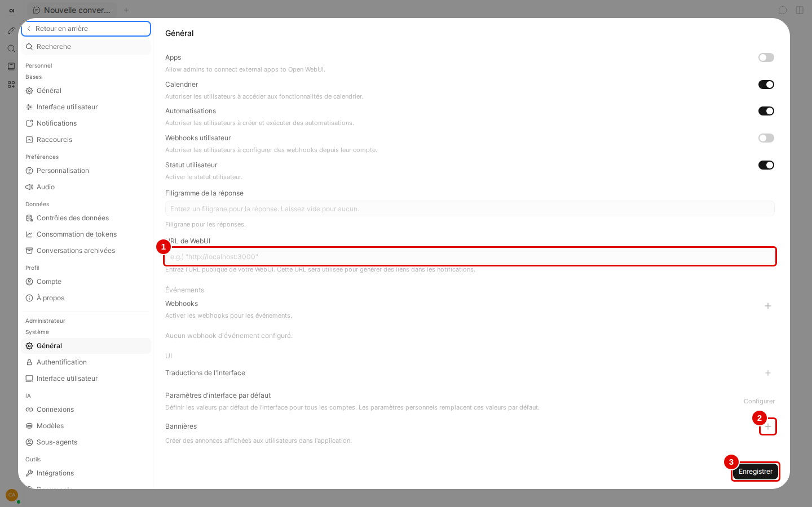
*Écran : onglet « Général », bas de la page.*

| N° | Élément | Rôle |
|---|---|---|
| 1 | « URL de WebUI » | adresse publique de l'instance, utilisée dans les liens envoyés (laisser vide en usage local) |
| 2 | « Ajouter une bannière » (« + » de « Bannières ») | message affiché en haut de l'écran de tous les comptes (maintenance, consignes) |
| 3 | « Enregistrer » | garde les réglages de l'onglet |

« Webhooks » envoie un avis à une autre application à chaque événement ; « Traductions de l'interface » et « Paramètres d'interface par défaut » adaptent l'interface pour tous.

*Résultat* : les réglages généraux sont enregistrés.

## Créer une clé d'API

**Étape 3. Autoriser les clés d'API**
*Où* : Réglages › Administrateur › « Authentification ».
Activer l'interrupteur « Clés API » (pastille 1), puis cliquer sur « Enregistrer » (pastille 2).

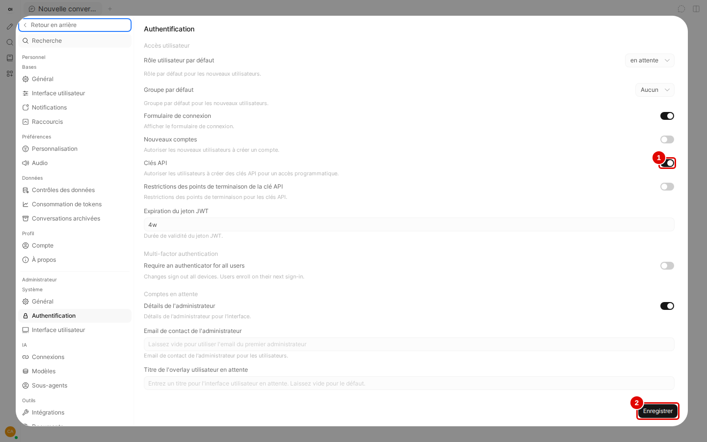
*Écran : onglet « Authentification », interrupteur « Clés API » activé.*

| N° | Élément | Rôle |
|---|---|---|
| 1 | « Clés API » | autorise les comptes à créer des clés d'API (désactivé par défaut) |
| 2 | « Enregistrer » | garde le réglage |

*Résultat* : les comptes peuvent créer une clé.

**Étape 4. Afficher la zone des clés**
*Où* : Réglages › groupe « Personnel » › « Compte », section « Clés API ».
Cliquer sur « Afficher » à droite de « Secrets » (pastille 3).

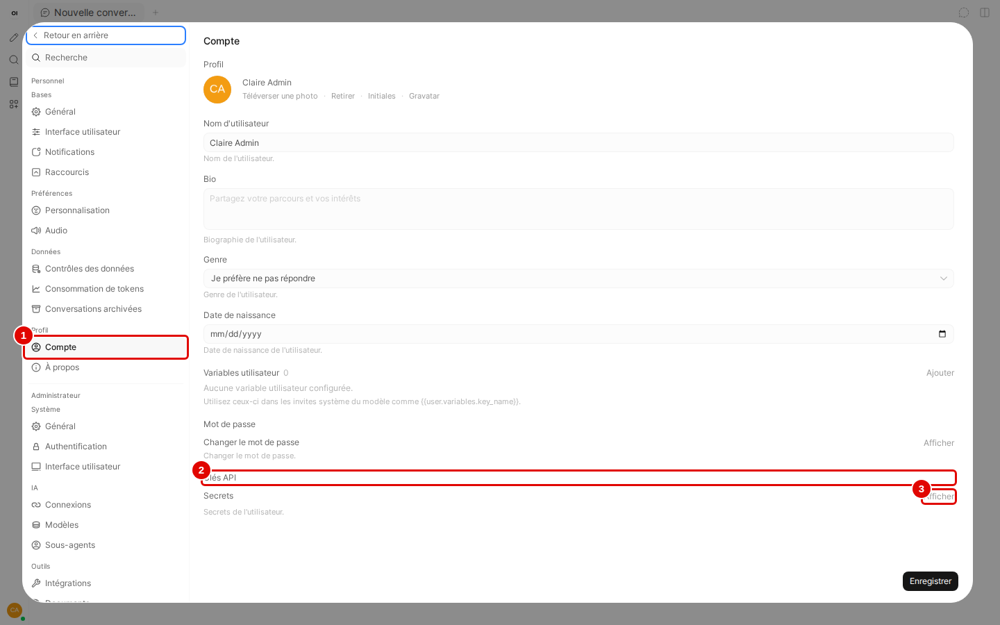
*Écran : onglet « Compte ».*

| N° | Élément | Rôle |
|---|---|---|
| 1 | « Compte » | onglet du profil : photo, nom, bio, mot de passe, clés |
| 2 | « Clés API » | section des clés du compte |
| 3 | « Afficher » | déplie le jeton de session et la clé d'API |

« Changer le mot de passe » › « Afficher » permet à chaque compte de changer son mot de passe.

*Résultat* : les champs « Jeton JWT » et « Clé API » apparaissent, avec un bouton « Créer une nouvelle clé secrète ».

**Étape 5. Créer et copier la clé**
*Où* : onglet « Compte », section « Clés API ».
Cliquer sur « Créer une nouvelle clé secrète ». Un message « Clé API générée. » s'affiche ; copier la clé avec l'icône de copie (pastille 3) et la ranger dans un endroit sûr.

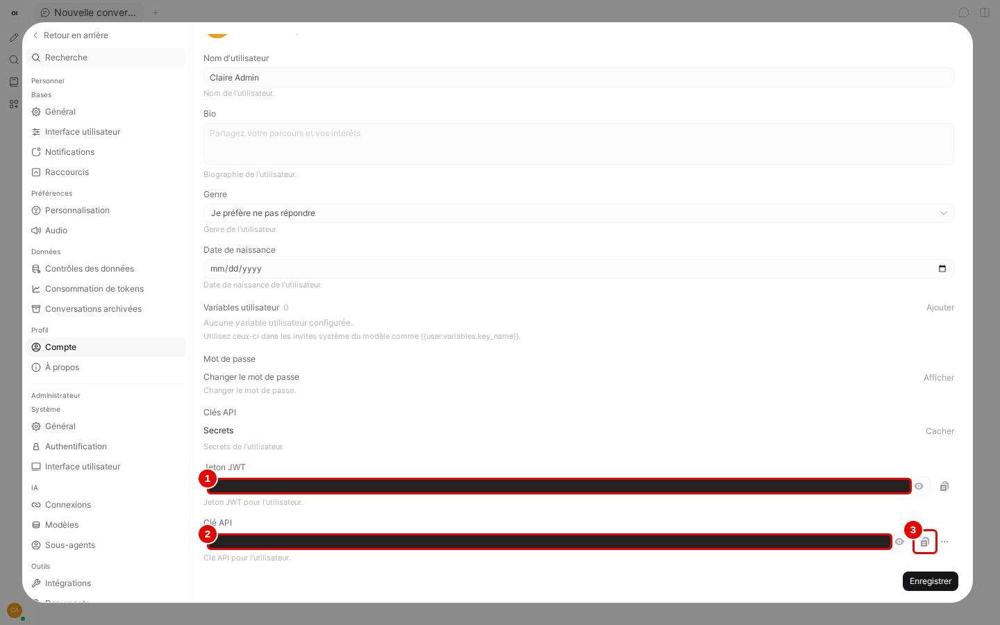
*Écran : onglet « Compte », clé créée (jeton et clé masqués sur la capture).*

| N° | Élément | Rôle |
|---|---|---|
| 1 | « Jeton JWT » | jeton de la session en cours ; il expire et ne doit pas servir aux programmes |
| 2 | « Clé API » | clé durable, qui commence par `sk-` ; l'œil l'affiche en clair |
| 3 | copier | copie la clé dans le presse-papiers |

Le « … » à droite de la clé propose « Créer une nouvelle clé » (l'ancienne cesse de fonctionner) et « Supprimer ». Un compte n'a qu'une clé à la fois.

*Résultat* : la clé est prête pour un script (annexe A3).

## Choisir le modèle des tâches de fond

**Étape 6. Ouvrir les réglages de l'interface**
*Où* : Réglages › Administrateur › « Interface utilisateur ».

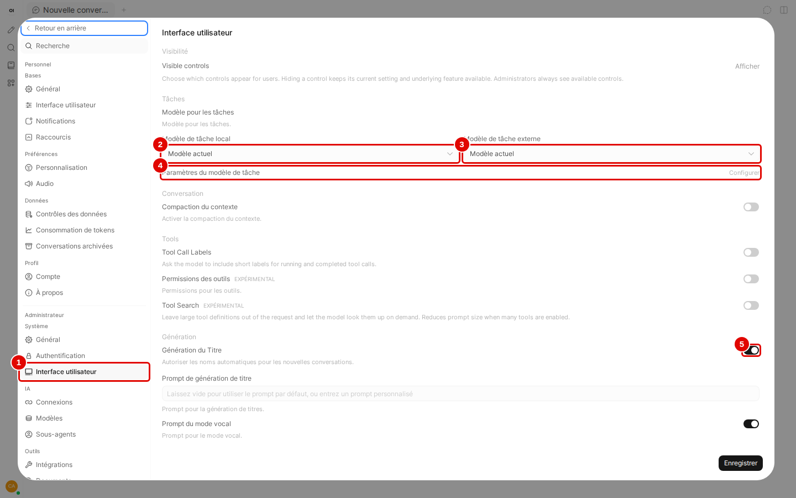
*Écran : onglet « Interface utilisateur » du groupe « Administrateur ».*

| N° | Élément | Rôle |
|---|---|---|
| 1 | « Interface utilisateur » | onglet des tâches de fond et des contrôles visibles |
| 2 | « Modèle de tâche local » | modèle qui fait les tâches de fond ; « Modèle actuel » = celui de la conversation |
| 3 | « Modèle de tâche externe » | même réglage pour les modèles venus d'une connexion OpenAI ; c'est lui qui s'applique à `chat` |
| 4 | « Configurer » (« Paramètres du modèle de tâche ») | paramètres envoyés au modèle pour ces tâches |
| 5 | « Génération du Titre » | titre automatique des conversations ; plus bas, mêmes interrupteurs pour les étiquettes, les questions de suite et la génération des requêtes de recherche |

Le chapitre 08 montre l'effet de ces tâches sur le temps d'attente des questions posées aux documents.

*Résultat* : les tâches de fond sont repérées.

## Suivre l'usage

**Étape 7. Consulter l'analytique**
*Où* : Réglages › Administrateur › « Analytique ».

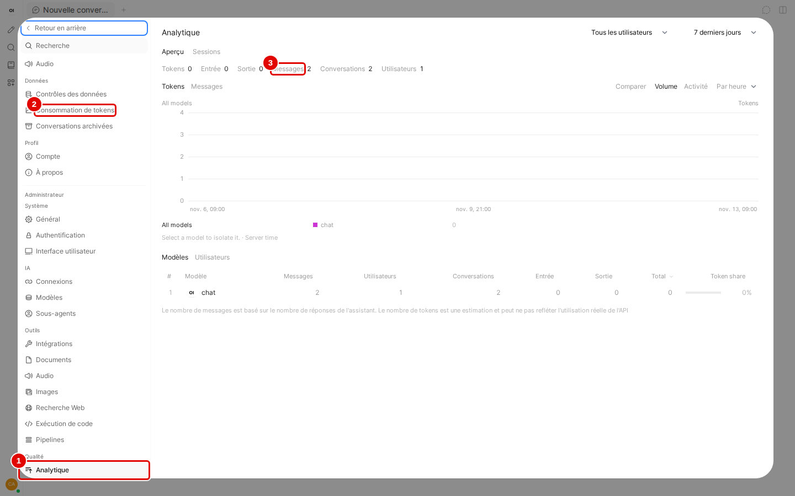
*Écran : onglet « Analytique ».*

| N° | Élément | Rôle |
|---|---|---|
| 1 | « Analytique » | onglet des statistiques d'usage de tous les comptes |
| 2 | « Tokens » | total des jetons de la période (« Entrée » et « Sortie » à côté) |
| 3 | « Messages » | nombre de réponses ; « Conversations » et « Utilisateurs » suivent sur la même ligne |

Sur l'instance d'essai, les compteurs de jetons restent à 0 alors que 16 réponses ont été produites : ce compteur n'est pas fiable avec ce service de modèles ; le nombre de messages l'est.

La liste en haut choisit la période (24 heures à toute la période) ; plus bas, des tableaux par modèle et par compte.

*Résultat* : l'activité de l'instance est visible.

**Étape 8. Consulter sa propre consommation**
*Où* : Réglages › groupe « Personnel » › « Consommation de tokens ».

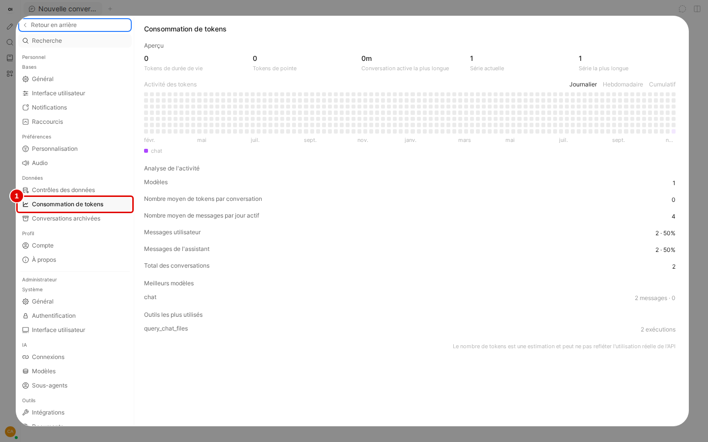
*Écran : onglet « Consommation de tokens ».*

| N° | Élément | Rôle |
|---|---|---|
| 1 | « Consommation de tokens » | jetons consommés par le compte, séries d'usage, activité par jour, semaine ou en cumul |

*Résultat* : chaque compte voit sa propre consommation.

## Suivre les évaluations des réponses

**Étape 9. Ouvrir le classement**
*Où* : menu du compte › « Panneau d'administration » › « Évaluations ».

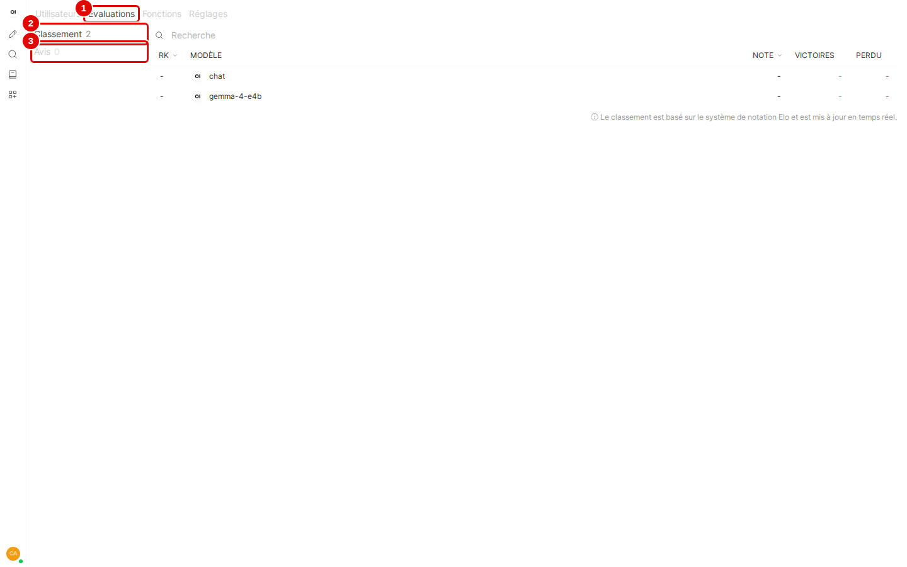
*Écran : Panneau d'administration, Évaluations, Classement (capture prise avant la note donnée au chapitre 06 : aucune note encore enregistrée, tirets à la place des notes et « Avis 0 »).*

| N° | Élément | Rôle |
|---|---|---|
| 1 | « Évaluations » | notes données aux réponses par les comptes |
| 2 | « Classement » | modèles classés d'après les pouces levés et baissés (note, victoires, défaites) |
| 3 | « Avis » | liste détaillée des avis donnés |

*Résultat* : le classement se remplit au fil des notes données sous les réponses (chapitre 06).

**Étape 10. Régler l'arène**
*Où* : Réglages › Administrateur › « Évaluations ».

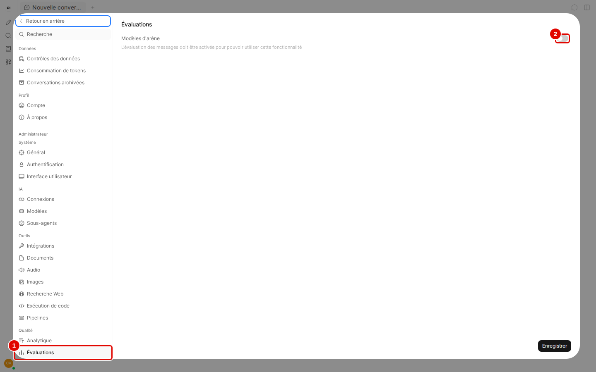
*Écran : onglet « Évaluations ».*

| N° | Élément | Rôle |
|---|---|---|
| 1 | « Évaluations » | onglet de l'arène |
| 2 | « Modèles d'arène » | active un modèle « arène » qui répond au hasard avec l'un des modèles, pour les comparer à l'aveugle |

*Résultat* : l'arène reste désactivée dans cette installation (un seul modèle partagé).

## Sauvegarder la configuration et les données

**Étape 11. Exporter la configuration**
*Où* : Réglages › Administrateur › « Base de données ».
Cliquer sur « Exporter » de la ligne « Exporter la configuration » (pastille 3).

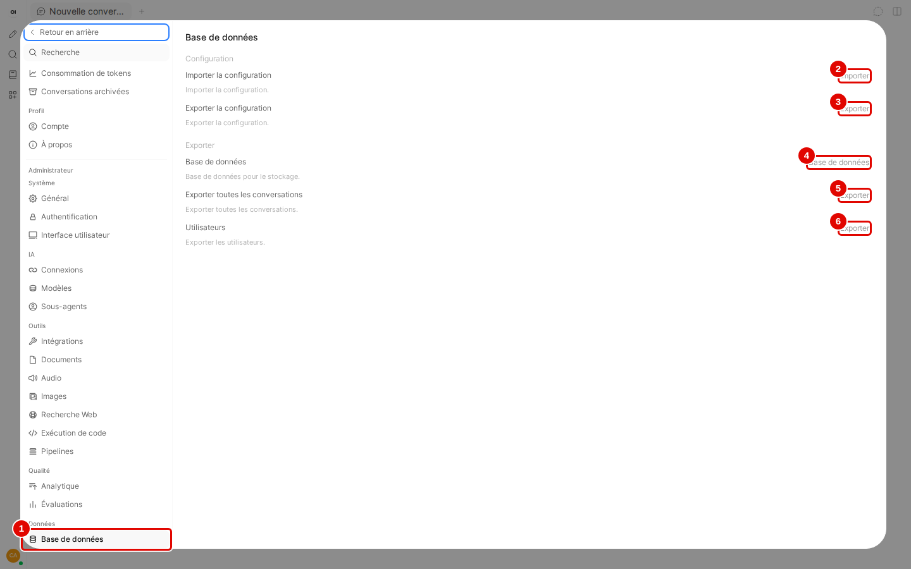
*Écran : onglet « Base de données ».*

| N° | Élément | Rôle |
|---|---|---|
| 1 | « Base de données » (onglet) | sauvegardes et exports |
| 2 | « Importer » | recharge une configuration exportée |
| 3 | « Exporter » (configuration) | télécharge tous les réglages de l'instance dans un fichier `config-….json` |
| 4 | « Base de données » | télécharge la base complète (comptes, conversations, réglages) |
| 5 | « Exporter » (conversations) | télécharge toutes les conversations de tous les comptes |
| 6 | « Exporter » (utilisateurs) | télécharge la liste des comptes |

*Résultat* : un fichier `config-….json` est téléchargé. Le fichier de configuration contient les clés des connexions : le ranger comme un mot de passe. La sauvegarde complète du dossier de données est décrite dans l'annexe A4.

## Connaître la version installée

**Étape 12. Ouvrir « À propos »**
*Où* : Réglages › groupe « Personnel » › « À propos ».

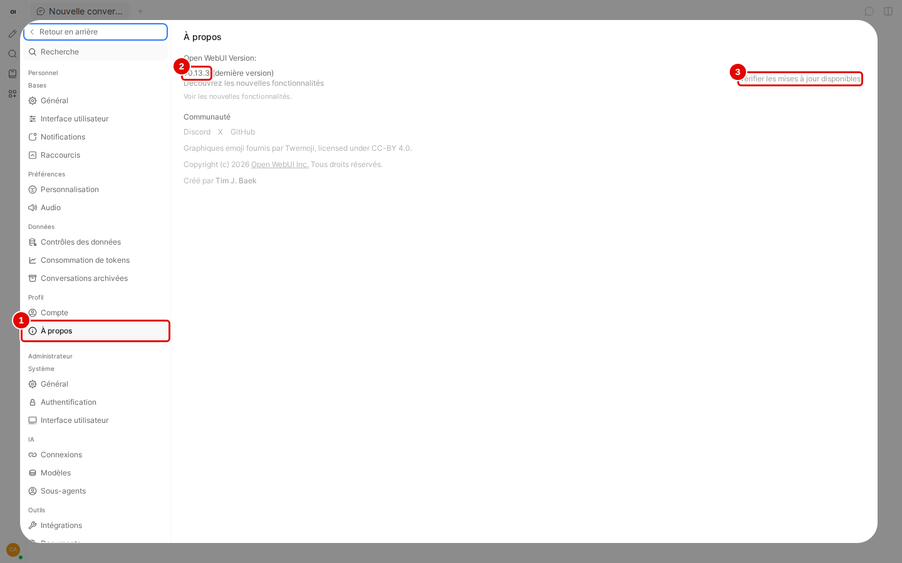
*Écran : onglet « À propos ».*

| N° | Élément | Rôle |
|---|---|---|
| 1 | « À propos » | version et liens du projet |
| 2 | « v0.13.3 » | version installée ; « (dernière version) » si elle est à jour |
| 3 | « Vérifier les mises à jour disponibles » | compare avec la dernière version publiée |

*Résultat* : la version est connue. Une mise à jour se fait en changeant l'image Docker (annexe A4), pas depuis l'interface.

## Aider un compte

**Étape 13. Modifier la fiche d'un compte**
*Où* : Panneau d'administration › « Utilisateurs » › « Aperçu » › crayon « Modifier l'utilisateur » d'un compte.
Saisir un nouveau mot de passe (pastille 1) et cliquer sur « Enregistrer » (pastille 2).

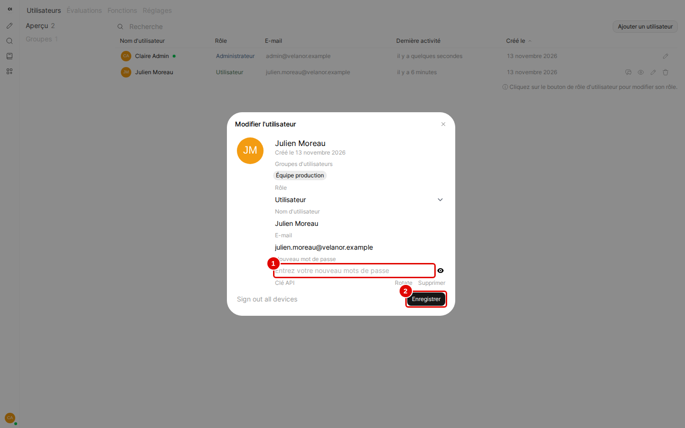
*Écran : fenêtre « Modifier l'utilisateur » du compte « Julien Moreau ».*

| N° | Élément | Rôle |
|---|---|---|
| 1 | « Nouveau mot de passe » | remplace le mot de passe du compte (oubli) |
| 2 | « Enregistrer » | garde les changements |

La fiche montre aussi les groupes du compte, son rôle, son nom, son e-mail, sa clé d'API (« Rotate » la remplace, « Supprimer » la retire) et « Sign out all devices » (ferme toutes ses sessions).

*Résultat* : la personne peut se connecter avec le nouveau mot de passe.

## Bon à savoir

- Le « Playground » (menu du compte) envoie des messages bruts au modèle, sans base ni outil : utile pour tester un modèle ou une consigne.
- Une configuration exportée se réimporte sur une autre instance pour copier les réglages.

## En cas de problème

| Symptôme | Cause | Que faire |
|---|---|---|
| Pas de bouton « Créer une nouvelle clé secrète » | « Clés API » désactivé dans « Authentification » | étape 3 |
| Un script reçoit « 401 » | clé fausse, supprimée ou régénérée | recréer la clé (étape 5) ; voir l'annexe A3 |
| L'administrateur a perdu son mot de passe | aucun autre administrateur pour le changer | prévenir ce cas en créant un second compte administrateur (chapitre 14) ; une réinitialisation sans administrateur n'a pas été essayée |

---
*Version décrite : Open WebUI 0.13.3, essais du 13 novembre 2026. Détails et preuves : [rapport d'essais](../annexes/A6-rapport-d-essais.md).*
