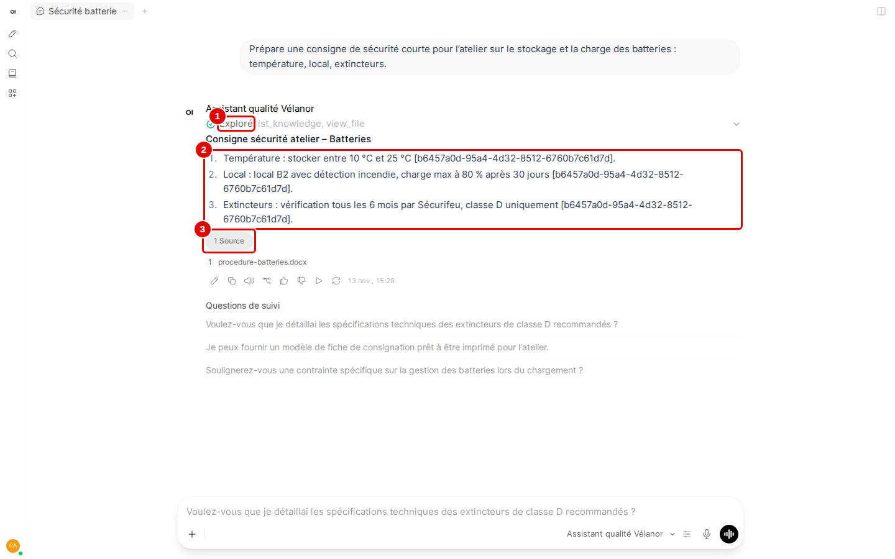
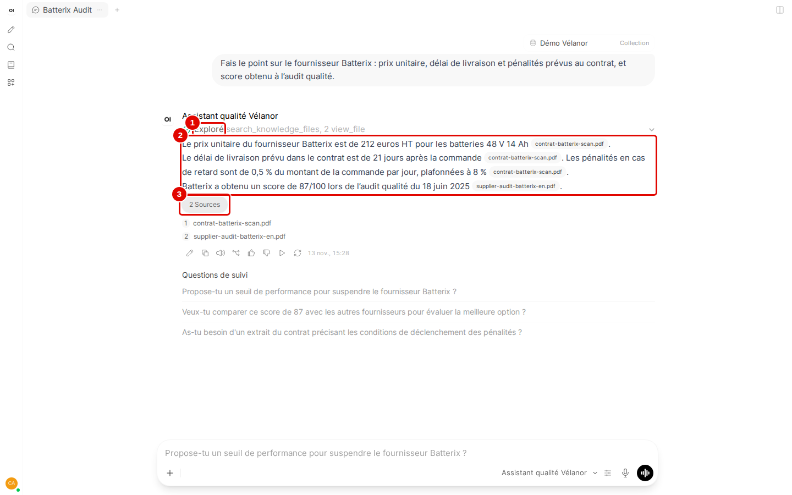
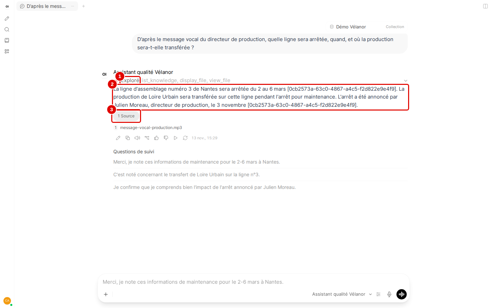

# 16. Cas pratiques

> Ce chapitre met en œuvre trois usages complets, de la question à la réponse vérifiée : rédiger une consigne de sécurité à partir d'une procédure, préparer un point fournisseur à partir de deux documents, exploiter un message vocal.
> **Point de départ** : écran principal, connecté avec le compte administrateur ; base « Démo Vélanor » remplie et lue par Docling (chapitres 05 et 08) ; « Assistant qualité Vélanor » créé (chapitre 07).
> **Durée** : environ 15 minutes. **Avant** : chapitres 05 à 08.

## Ce qu'il faut savoir

Les trois conversations de ce chapitre sont gardées dans l'instance comme jeu de démonstration : elles montrent le résultat attendu. Chaque cas suit la même méthode : choisir la source (assistant ou base jointe par « # »), poser une question précise, puis **vérifier** la réponse dans la liste des sources avant de l'utiliser.

Les réponses ont été obtenues avec les réglages du chapitre 08 (Docling, recherche hybride, tri par `rerank`, génération des requêtes coupée) et l'« Assistant qualité Vélanor » sans réflexion (chapitre 07, étape 12). Chacune est arrivée en une quinzaine de secondes au plus.

## Cas 1. Rédiger une consigne de sécurité pour l'atelier

But : obtenir une consigne courte, fidèle à la procédure `PR-SEC-04`, à afficher dans l'atelier.

**Étape 1. Interroger l'assistant**
*Où* : nouvelle conversation, sélecteur de modèle › « Assistant qualité Vélanor ».
Taper la demande suivante, puis appuyer sur Entrée :

```text
Prépare une consigne de sécurité courte pour l'atelier sur le stockage et la charge des batteries : température, local, extincteurs.
```


*Écran : réponse de l'assistant, liste des sources ouverte.*

| N° | Élément | Rôle |
|---|---|---|
| 1 | « Exploré » | l'assistant a consulté sa base |
| 2 | réponse | liste en trois points : température de 10 °C à 25 °C, local B2 avec détection incendie, extincteurs de classe D vérifiés tous les 6 mois |
| 3 | « 1 Source » | document utilisé : `procedure-batteries.docx` |

Dans le texte, les renvois s'affichent ici sous la forme d'un identifiant technique entre crochets (`[b6457a0d-…]`) au lieu du nom du fichier : la liste « 1 Source » donne le nom du document. Avant de diffuser la consigne, ouvrir la source (chapitre 06, étape 6) et vérifier chaque valeur.

*Résultat* : une consigne prête à relire, tirée de la procédure.

## Cas 2. Préparer un point fournisseur

But : réunir, avant une réunion, les clauses du contrat Batterix (un PDF scanné) et le résultat de son audit qualité (un PDF en anglais).

**Étape 2. Interroger la base**
*Où* : nouvelle conversation ; le sélecteur garde « Assistant qualité Vélanor » choisi au cas 1 ; base « Démo Vélanor » jointe en plus par « # » (chapitre 06, étape 1).
Taper la demande suivante, puis appuyer sur Entrée :

```text
Fais le point sur le fournisseur Batterix : prix unitaire, délai de livraison et pénalités prévus au contrat, et score obtenu à l'audit qualité.
```


*Écran : réponse citant le contrat et l'audit.*

| N° | Élément | Rôle |
|---|---|---|
| 1 | « Exploré » | recherche dans la base, puis lecture des deux documents |
| 2 | réponse | prix unitaire 212 euros HT, livraison sous 21 jours, pénalités de 0,5 % par jour plafonnées à 8 %, score d'audit 87/100 (audit du 18 juin 2025) |
| 3 | « 2 Sources » | `contrat-batterix-scan.pdf` et `supplier-audit-batterix-en.pdf` |

Chaque chiffre est suivi du document dont il vient. La réponse est en français alors que l'audit est en anglais.

*Résultat* : une fiche de préparation complète, chaque chiffre relié à son document.

## Cas 3. Exploiter un message vocal

But : retrouver ce que dit un message vocal sans l'écouter, et vérifier ce que la transcription a perdu.

**Étape 3. Interroger la base sur le message**
*Où* : nouvelle conversation, « Assistant qualité Vélanor », base « Démo Vélanor » jointe par « # ».
Taper la demande suivante, puis appuyer sur Entrée :

```text
D'après le message vocal du directeur de production, quelle ligne sera arrêtée, quand, et où la production sera-t-elle transférée ?
```


*Écran : réponse tirée du message vocal.*

| N° | Élément | Rôle |
|---|---|---|
| 1 | « Exploré » | lecture de la base et du fichier audio transcrit |
| 2 | réponse | ligne d'assemblage numéro 3 de Nantes, arrêtée du 2 au 6 mars pour maintenance, annoncée par Julien Moreau le 3 novembre |
| 3 | « 1 Source » | `message-vocal-production.mp3` |

La réponse dit que la production « sera transférée sur cette ligne », sans préciser laquelle : l'information manque. La cause se voit dans le texte que Open WebUI a tiré du fichier audio (Espace de travail › « Connaissances » › « Démo Vélanor » › `message-vocal-production.mp3` › « Indexed text », comme au chapitre 08, étape 7) : « Pendant cet arrêt, la production du loire urbain sera transférée sur la ligne. » La transcription a perdu le numéro de la ligne de destination, et déformé d'autres mots (« VVTSEC » pour l'année, « Réunion de l'Osement »).

**Étape 4. Compléter à la source**
Quand une réponse tirée d'un enregistrement est incomplète, réécouter l'enregistrement d'origine et noter l'information manquante dans une note (chapitre 10), jointe ensuite aux questions par « # ».

*Résultat* : l'essentiel du message est retrouvé en quelques secondes, et le manque est repéré.

## Bon à savoir

- Ces trois conversations restent dans la barre latérale du compte administrateur comme modèles de questions.
- Poser des questions précises (« prix, délai, pénalités, score ») plutôt que vagues (« que sait-on de Batterix ? ») : la réponse énumère alors exactement les points demandés.
- La qualité d'une réponse ne dépasse jamais celle du texte lu : un scan mal reconnu ou un audio mal transcrit se retrouvent dans la réponse.

---
*Version décrite : Open WebUI 0.13.3, essais du 13 novembre 2026. Détails et preuves : [rapport d'essais](../annexes/A6-rapport-d-essais.md).*
