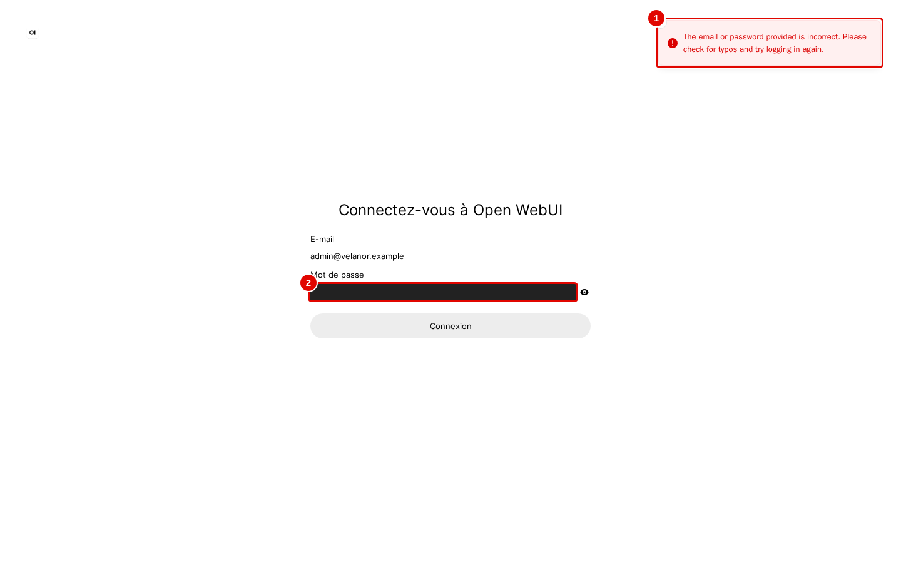
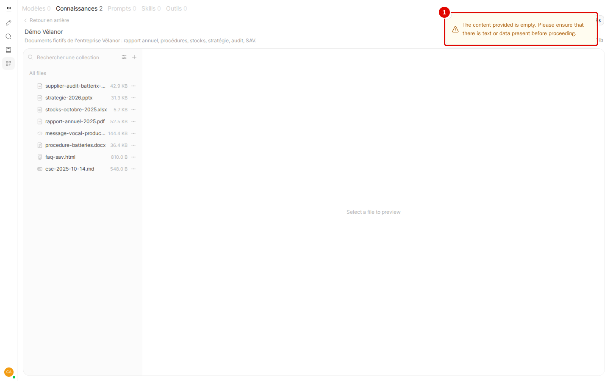
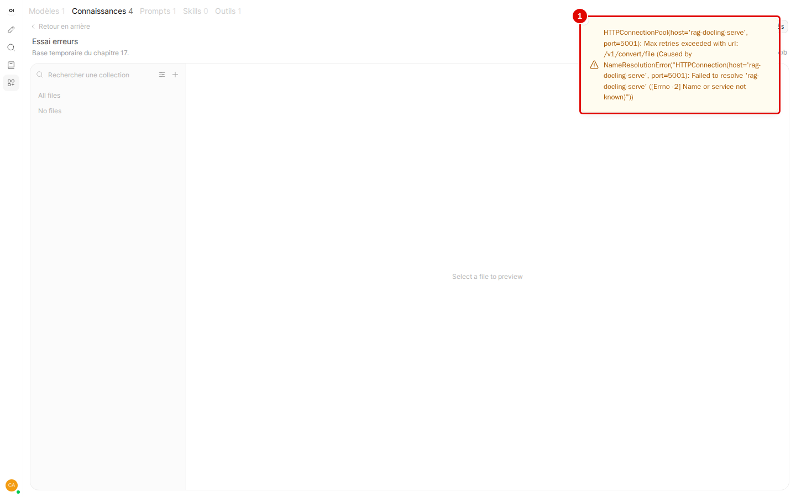
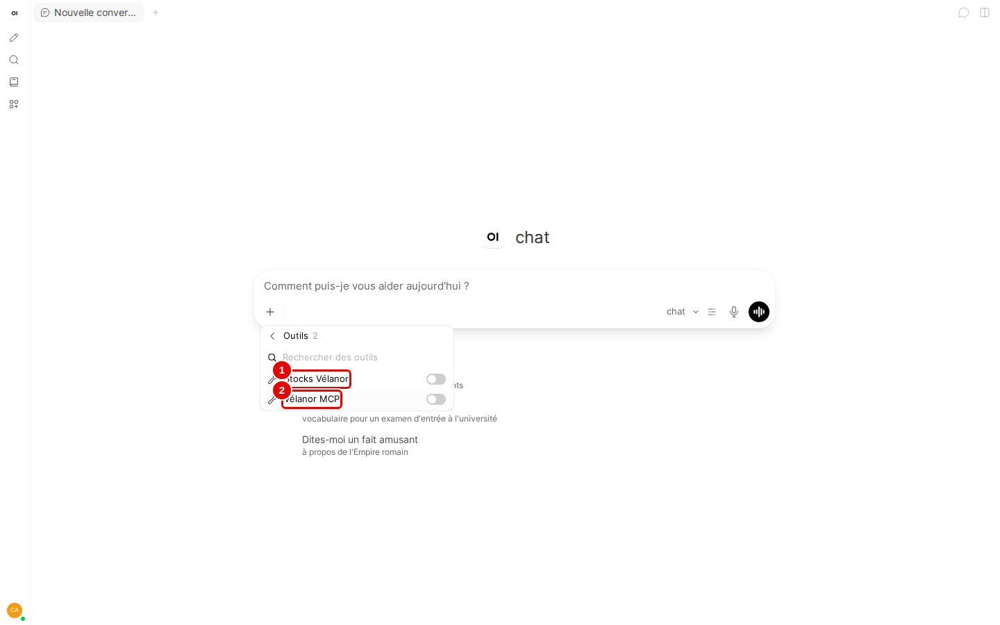
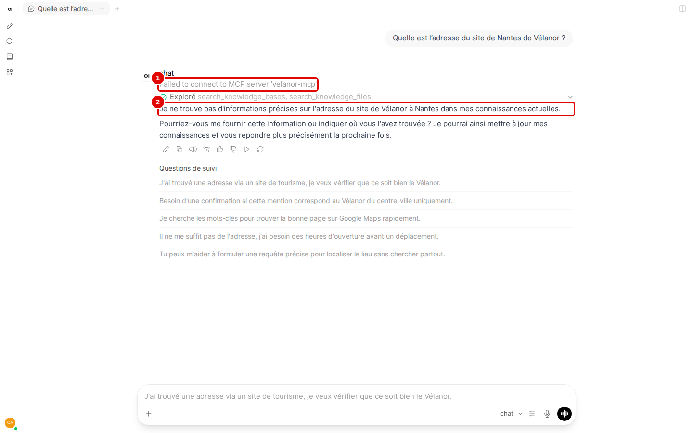
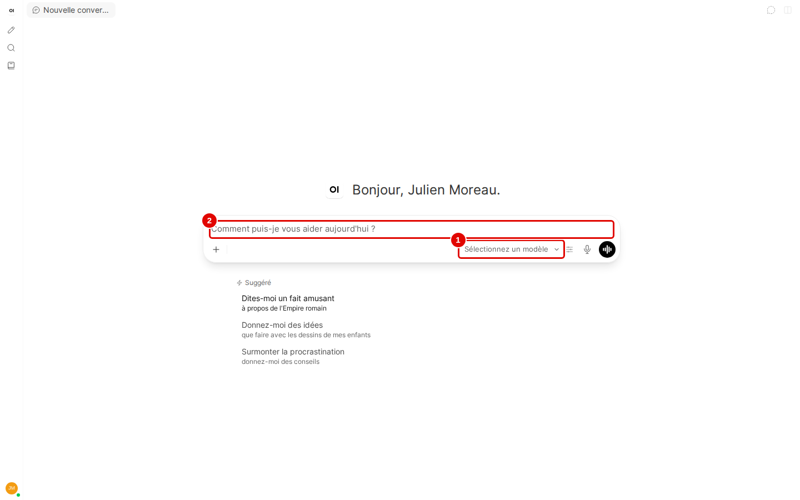

# 17. En cas de problème

> Ce chapitre apprend à reconnaître les erreurs réellement rencontrées pendant les essais, à en comprendre la cause et à les corriger. Chaque cas a été provoqué ou observé sur l'instance de test.
> **Point de départ** : une erreur ou un comportement inattendu dans Open WebUI.
> **Durée** : selon le cas. **Avant** : chapitres 02 à 08.

## Ce qu'il faut savoir

La plupart des erreurs viennent de trois endroits : un service arrêté (le service de modèles, Docling, un serveur MCP), un document que la lecture par défaut ne sait pas lire, ou un droit d'accès manquant. Avant toute chose, vérifier que les services tournent :

```bash
outils/open-webui/etat.sh
outils/communs/llm_central_sante.sh
```

Le premier affiche l'état des conteneurs d'Open WebUI (dont Docling), leur santé, leur mémoire et la santé du service de modèles ; le second interroge le service de modèles en détail.

## Connexion refusée

**Étape 1. Reconnaître l'erreur**
*Où* : page de connexion, `http://127.0.0.1:3000`.


*Écran : page de connexion, message d'erreur en haut à droite.*

| N° | Élément | Rôle |
|---|---|---|
| 1 | message d'erreur | « The email or password provided is incorrect. Please check for typos and try logging in again. » |
| 2 | « Mot de passe » | champ à ressaisir |

*Cause* : adresse e-mail ou mot de passe faux. *Que faire* : ressaisir ; l'œil du champ affiche le mot de passe en clair. Un compte « utilisateur » qui a oublié son mot de passe le fait changer par l'administrateur (chapitre 14, crayon « Modifier l'utilisateur »).

*Résultat* : la connexion aboutit avec les bons identifiants.

## Un document refusé

**Étape 2. Un PDF scanné est refusé**
*Où* : page d'une base, après l'ajout d'un fichier.


*Écran : page de la base, message d'erreur en haut à droite.*

| N° | Élément | Rôle |
|---|---|---|
| 1 | « The content provided is empty… » | aucun texte lisible : la page est une image |

*Cause* : la lecture « Par défaut » ne reconnaît pas le texte des images. *Que faire* : brancher Docling (chapitre 08, étapes 1 à 6), puis ajouter de nouveau le fichier.

*Résultat* : le scan est lu par Docling.

**Étape 3. Tout ajout de fichier échoue après le choix de Docling**
*Où* : page d'une base, après l'ajout d'un fichier.


*Écran : page d'une base, message d'erreur technique en haut à droite.*

| N° | Élément | Rôle |
|---|---|---|
| 1 | message d'erreur | « HTTPConnectionPool(host='rag-docling-serve', port=5001): Max retries exceeded… Failed to resolve 'rag-docling-serve'… » |

*Cause* : Docling est arrêté (par exemple après un redémarrage du poste) alors que la lecture est réglée sur Docling. *Que faire* : `outils/open-webui/docling.sh start`, attendre « Docling prêt », puis ajouter de nouveau le fichier. Pour se passer de Docling, revenir à la lecture « Par défaut » (chapitre 08, étape 3).

*Résultat* : les ajouts de fichiers fonctionnent de nouveau.

## Des outils qui ne répondent pas

**Étape 4. Le serveur MCP est arrêté**
*Où* : nouvelle conversation › « + » › « Outils » (chapitre 11, étape 14), serveur MCP arrêté, avant activation de « Vélanor MCP ».


*Écran : sous-menu « Outils », serveur MCP arrêté.*

| N° | Élément | Rôle |
|---|---|---|
| 1 | « Stocks Vélanor » | outil interne, toujours disponible |
| 2 | « Vélanor MCP » | toujours proposé, alors que son serveur est arrêté |

Rien n'avertit au moment de l'activation. L'erreur n'apparaît qu'à la réponse :

*Où* : réponse du modèle.


*Écran : réponse, ligne d'erreur au-dessus du texte.*

| N° | Élément | Rôle |
|---|---|---|
| 1 | « Failed to connect to MCP server 'velanor-mcp' » | le serveur n'a pas répondu |
| 2 | réponse sans l'outil | le modèle répond qu'il ne trouve pas l'information |

*Cause* : le conteneur du serveur MCP est arrêté. *Que faire* : `outils/open-webui/mcp.sh start`, puis « Regénérer ».

*Résultat* : l'outil répond de nouveau.

**Étape 5. Une réponse chiffrée sans appel d'outil**
*Où* : réponse du modèle, ligne « Exploré ».

Lors d'un essai, le modèle a prévu d'appeler les outils, puis a répondu sans les appeler, avec des chiffres faux (8 moteurs en stock au lieu de 238). Le seul indice : l'absence de ligne « Exploré stock_piece… » au-dessus de la réponse (comparer avec le chapitre 11, étape 16, capture « Réponse avec appels d'outils »).

*Cause* : le modèle décide seul d'appeler ou non un outil, et peut se tromper. *Que faire* : « Regénérer » ; au second essai, les deux outils ont été appelés et les chiffres étaient justes.

*Résultat* : seules les réponses précédées de la ligne « Exploré » qui nomme l'outil sont retenues.

## Des droits manquants

**Étape 6. Un compte ne voit aucun modèle**
*Où* : écran principal d'un compte « utilisateur » neuf.


*Écran : écran principal d'un compte « utilisateur », avant tout partage.*

| N° | Élément | Rôle |
|---|---|---|
| 1 | « Sélectionnez un modèle » | liste vide : aucun modèle partagé |
| 2 | zone de saisie | inutilisable sans modèle |

*Cause* : tout est privé par défaut, même les modèles du service. *Que faire* : partager `chat` (et les assistants utiles) avec le compte ou son groupe (chapitre 14, étape 10 ; chapitre 07, étape 6).

*Résultat* : le compte voit les modèles partagés.

## Récapitulatif

| Symptôme | Cause | Que faire |
|---|---|---|
| « The email or password provided is incorrect… » | identifiants faux | étape 1 |
| « The content provided is empty… » | PDF scanné, lecture par défaut | chapitre 08 (Docling) |
| « HTTPConnectionPool(host='rag-docling-serve'… » | Docling arrêté | `outils/open-webui/docling.sh start` |
| « Failed to connect to MCP server… » | serveur MCP arrêté | `outils/open-webui/mcp.sh start` |
| Réponse chiffrée sans ligne « Exploré » | outil non appelé | « Regénérer » |
| Liste des modèles vide | rien n'est partagé | chapitre 14, étape 10 |
| Une réponse prend une minute | réflexion du modèle et réécriture des requêtes | chapitre 08, étape 9 ; chapitre 07, étape 12 |
| « Accès au microphone refusé » | adresse non sûre | chapitre 12 |
| Pas de rubrique « Canaux » | canaux désactivés | chapitre 13, étape 8 |
| La page ne s'ouvre pas | conteneur arrêté | `outils/open-webui/demarrer.sh` (chapitre 02) |

## Bon à savoir

- Les journaux d'Open WebUI se lisent avec `docker logs --tail 50 rag-open-webui` ; ceux de Docling avec `docker logs --tail 50 rag-docling-serve`.
- Si le service de modèles ne répond pas, le démarrer avec le script `scripts/demarrer.sh` de LLM-Service (chapitre 02, étape 4).

---
*Version décrite : Open WebUI 0.13.3, essais du 13 novembre 2026. Détails et preuves : [rapport d'essais](../annexes/A6-rapport-d-essais.md).*
