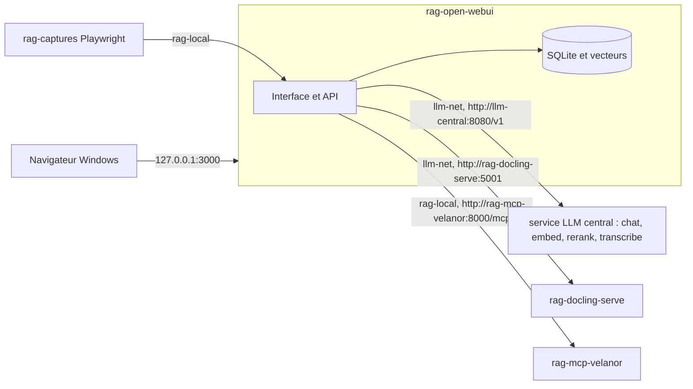

# Open WebUI : fiche technique

Architecture, réglages, API, versions et licences. Le guide d'utilisation est dans [le manuel](README.md).

## Sommaire

- [Architecture](#architecture)
- [Installation : prérequis et commandes](#installation--prérequis-et-commandes)
- [Configuration](#configuration)
- [API / Endpoints](#api--endpoints)
- [Tests](#tests)
- [Licences & composants](#licences--composants)
- [Données du banc](#données-du-banc)
- [Les pièges que ce banc documente](#les-pièges-que-ce-banc-documente)
- [Versions](#versions)
- [Ressources](#ressources)

## Architecture

Open WebUI ne contient aucun modèle : il appelle le service LLM central, partagé avec les autres applications et géré à part.

| Service | Conteneur | Image | Rôle |
|---|---|---|---|
| Open WebUI | `rag-open-webui` | `ghcr.io/open-webui/open-webui:v0.13.3` (figée par empreinte) | interface, API, lecture et découpage des documents, base SQLite, vecteurs, comptes |
| Docling (facultatif) | `rag-docling-serve` | `quay.io/docling-project/docling-serve-cpu:v1.38.2` (figée par empreinte) | lecteur de documents avec lecture optique (PDF scanné) ; profil compose `docling`, sans port publié |
| Serveur MCP d'essai (facultatif) | `rag-mcp-velanor` | image Open WebUI ci-dessus, lancée sur `service/extensions/serveur_mcp_velanor.py` | deux fonctions sur l'entreprise fictive, pour le chapitre 11 ; sans port publié |
| Modèles | `llm-central`, `llm-swap`, `llm-speaches` | LiteLLM v1.109.0, llama-swap v272 (llama.cpp b12282), speaches 0.8.3 | `chat`, `embed`, `rerank`, `transcribe` servis par [LLM-Service](https://github.com/floSa/llm-service) (dépôt séparé) |
| Captures | `rag-captures` (éphémère) | `mcr.microsoft.com/playwright/python:v1.65.1-noble` | scénarios Playwright du manuel |



Réseaux Docker externes : `llm-net` (créé par LLM-Service) relie Open WebUI au service de modèles et à Docling ; `rag-local` relie Open WebUI au serveur MCP d'essai, aux captures et au banc. Un seul port publié, `127.0.0.1:3000` (`banc-essai/resultats/open-webui/installation-2026-11-13.log`).

## Installation : prérequis et commandes

Prérequis : Windows 11 avec WSL2 et Docker Desktop ; [LLM-Service](https://github.com/floSa/llm-service) installé et démarré ; environ 5 Go de disque pour l'image d'Open WebUI (4,59 Go).

```bash
cp service/.env.example service/.env
~/mes_projets/Projet-IA/LLM-Service/service/scripts/cle.sh creer openwebui-test-bench --dans "$PWD/.env" --noms LLM_CENTRAL_URL,LLM_CENTRAL_KEY   # clé propre au banc, écrite sans affichage
banc-essai/communs/llm_central_sante.sh --essai   # le service répond-il, modèle par modèle ?
service/installer.sh                # image, secret de session, démarrage, contrôle des ports
```

| Service | URL | Note |
|---|---|---|
| Open WebUI | http://127.0.0.1:3000 | compte administrateur créé dans le navigateur au premier accès (chapitre 03) ; identifiants fictifs du jeu de démonstration dans `donnees/IDENTIFIANTS-LOCAUX.txt` |
| Service LLM central | http://127.0.0.1:8080/v1 | clé dans `service/.env` |

Ensuite : [chapitre 02](manuel/02-installer-open-webui.md) (installation pas à pas) et [chapitre 03](manuel/03-premiers-pas.md) (premier compte, connexion aux modèles). Options : `service/docling.sh start` (lecture des scans, chapitre 08) et `service/mcp.sh start` (serveur MCP d'essai, chapitre 11).

## Configuration

- **Variables générées** : `installer.sh` écrit `WEBUI_SECRET_KEY` (secret de session) dans `donnees/open-webui/options.env`, jamais versionné ni affiché.
- **Variables du compose** (`service/compose.yml`) : `DEFAULT_LOCALE=fr-FR` ; `ENABLE_OLLAMA_API=false`, `ENABLE_OPENAI_API=true` ; embeddings `RAG_EMBEDDING_ENGINE=openai`, `RAG_EMBEDDING_MODEL=embed`, `RAG_EMBEDDING_BATCH_SIZE=4` ; transcription `AUDIO_STT_ENGINE=openai`, `AUDIO_STT_MODEL=transcribe` ; télémétrie coupée (`SCARF_NO_ANALYTICS`, `DO_NOT_TRACK`, `ANONYMIZED_TELEMETRY`).
- **Écarts au compose officiel** : service `ollama` retiré ; image standard figée par étiquette et empreinte ; projet, conteneurs et réseaux préfixés `rag-` ; port publié sur `127.0.0.1` seulement ; données dans `donnees/open-webui/data` au lieu d'un volume nommé ; réseaux externes `llm-net` et `rag-local` ; Docling ajouté en service facultatif.
- **Branchement au service LLM central** : connexion compatible OpenAI vers `http://llm-central:8080/v1` (réseau `llm-net`), noms de modèles fixes `chat`, `embed`, `rerank`, `transcribe`. La clé `LLM_CENTRAL_KEY` reste dans `service/.env` (modèle : `service/.env.example`) ; `service/compose.sh` la transmet au compose sans l'afficher. Ces valeurs ne sont lues qu'au premier démarrage, puis gardées en base et modifiables dans « Paramètres d'administration ». Le tri par `rerank` se règle dans l'interface (moteur « Externe », `http://llm-central:8080/v1/rerank`), [chapitre 08](manuel/08-regler-la-lecture-des-documents.md).

## API / Endpoints

Routes de l'API d'Open WebUI utilisées par le banc et les essais (client minimal, bibliothèque standard seulement : [banc-essai/open-webui/client.py](../banc-essai/open-webui/client.py)) :

| Méthode | Route | Rôle |
|---|---|---|
| `GET` | `/health` | état de l'application, sans connexion |
| `POST` | `/api/v1/auths/signin` | connexion, renvoie un jeton |
| `POST` | `/api/v1/files/?process=true` | téléverser un fichier (lecture, découpage, vecteurs) |
| `GET` | `/api/v1/files/{id}/process/status` | suivre le traitement d'un fichier |
| `POST` | `/api/v1/knowledge/create`, `/api/v1/knowledge/{id}/file/add` | créer une base, y rattacher un fichier |
| `POST` | `/api/chat/completions` | poser une question (réponse et sources citées) |
| `GET`, `POST` | `/api/v1/retrieval/config`, `/api/v1/retrieval/config/update` | lire et écrire les réglages de recherche |
| `GET`, `POST` | `/api/v1/tasks/config`, `/api/v1/tasks/config/update` | lire et écrire les tâches du modèle (génération des requêtes de recherche) |
| `GET` | `/api/v1/configs/export` | exporter toute la configuration (contient la clé du service) |

Détail : [annexe A3](annexes/A3-automatiser-par-l-api.md).

## Tests

```bash
banc-essai/communs/llm_central_sante.sh --essai                    # santé du service LLM central, une requête par usage
banc-essai/open-webui/serie_banc.sh <étiquette> [options de banc.py]   # banc de 38 questions sur la base « Banc »
python3 banc-essai/communs/verifier_docs.py                        # documentation : liens, ancres, ton, captures, carte
```

Exemple de série : `banc-essai/open-webui/serie_banc.sh hybride-rerank --rerank` (recherche hybride et tri par `rerank`) ; `--taches '{"ENABLE_RETRIEVAL_QUERY_GENERATION": false}'` coupe la génération des requêtes de recherche.

Sortie du contrôle de santé en début de session (`banc-essai/resultats/open-webui/sante-llm-central-2026-11-13-debut.log`, extrait) :

```text
== embed
  dimensions : 1024
== rerank
  doc 0 score 9.05
  doc 1 score -8.63
```

Sortie de l'installation (`banc-essai/resultats/open-webui/installation-2026-11-13.log`, extrait) :

```text
Open WebUI prêt : http://127.0.0.1:3000 (24 s)
rag-open-webui 127.0.0.1:3000->8080/tcp
ports : tous liés à 127.0.0.1
{"version":"0.13.3","deployment_id":""}
```

## Licences & composants

| Composant | Licence |
|---|---|
| Open WebUI | Open WebUI License : BSD-3 avec clause de marque (la marque « Open WebUI » doit rester visible) |
| Docling | MIT |
| LiteLLM, llama.cpp, llama-swap, speaches | MIT |
| bge-m3 (`embed`), faster-whisper-small (`transcribe`) | MIT |
| Playwright | Apache 2.0 |

Ce projet : MIT — Copyright (c) 2026 floSa (fichier [LICENSE](../LICENSE)).

## Données du banc

Corpus fictif (entreprise Vélanor, vélos électriques) : 9 documents (`banc-essai/corpus/MANIFEST.json`) et 38 questions (`banc-essai/corpus/questions.json`), repris tels quels des bancs précédents.

```text
rapport-annuel-2025.pdf          contrat-batterix-scan.pdf (scan, image seule)
procedure-batteries.docx         strategie-2026.pptx
stocks-octobre-2025.xlsx         faq-sav.html, cse-2025-10-14.md
supplier-audit-batterix-en.pdf   message-vocal-production.mp3
```

Questions : 13 faits simples, 10 tableaux, 4 sur le scan, 3 multi-documents, 2 en anglais, 2 sur l'audio, et 4 pièges dont la réponse n'est pas dans les documents.

## Les pièges que ce banc documente

1. Les réglages passés par variables d'environnement ne sont lus qu'au premier démarrage, puis gardés en base : changer le compose ensuite n'a plus d'effet ([annexe A5](annexes/A5-fonctionnement-interne.md)).
2. Le reranker externe `rerank` n'agit que si « Recherche hybride » est activée ([chapitre 08](manuel/08-regler-la-lecture-des-documents.md)).
3. PDF scanné refusé à l'ajout dans une base avec la lecture par défaut : « The content provided is empty ». Seul Docling le lit (chapitre 08).
4. La génération des requêtes de recherche, active par défaut, lance trois recherches par question et un appel de plus au modèle : la médiane passe de 58 s à 24 s quand elle est coupée (chapitre 08).
5. Tout est privé par défaut, modèles compris : un nouveau compte ne voit aucun modèle tant que l'administrateur ne l'a pas partagé ([chapitre 14](manuel/14-comptes-groupes-permissions.md)).
6. L'export de la configuration contient la clé du service de modèles (`banc-essai/resultats/open-webui/essai-export-config-2026-11-13.txt`, [chapitre 15](manuel/15-administrer.md)).
7. L'export d'une base donne le texte extrait de chaque fichier, pas les fichiers d'origine (`essai-export-base-2026-11-13.txt`, [chapitre 05](manuel/05-bases-de-connaissances.md)).
8. L'identifiant d'un modèle personnalisé est généré sans les lettres accentuées : « Assistant qualité Vélanor » devient `assistant-qualit-vlanor` ([chapitre 07](manuel/07-assistant-lie-a-une-base.md)).

## Versions

| Composant | Version |
|---|---|
| Open WebUI | 0.13.3 (8 novembre 2026), image `ghcr.io/open-webui/open-webui:v0.13.3@sha256:46b59158e6558eeb980bc828e0f1b30238ad24d82ed84d5e5eda1dab2a082f14` |
| docling-serve | v1.38.2 (27 octobre 2026), image `docling-serve-cpu` |
| Playwright | 1.65.1 |
| Service central | LiteLLM v1.109.0, llama-swap v272, llama.cpp b12282, speaches 0.8.3 |
| Docker / Compose | 29.9.3 / 5.7.0 |
| WSL / Ubuntu | 3.0.5.0 / 24.04.5 |

Relevés : `banc-essai/resultats/open-webui/versions-2026-11-13.json` et `banc-essai/resultats/machine/diagnostic-2026-11-13.json`. La version est figée par étiquette et empreinte dans `service/compose.yml`.

## Ressources

- Open WebUI : https://github.com/open-webui/open-webui, site https://openwebui.com
- LLM-Service : https://github.com/floSa/llm-service
- Bancs précédents : https://github.com/floSa/Open-Notebook-Test-Bench, https://github.com/floSa/RAGFlow-Test-Bench, https://github.com/floSa/AnythingLLM-Test-Bench, https://github.com/floSa/Kotaemon-Test-Bench
