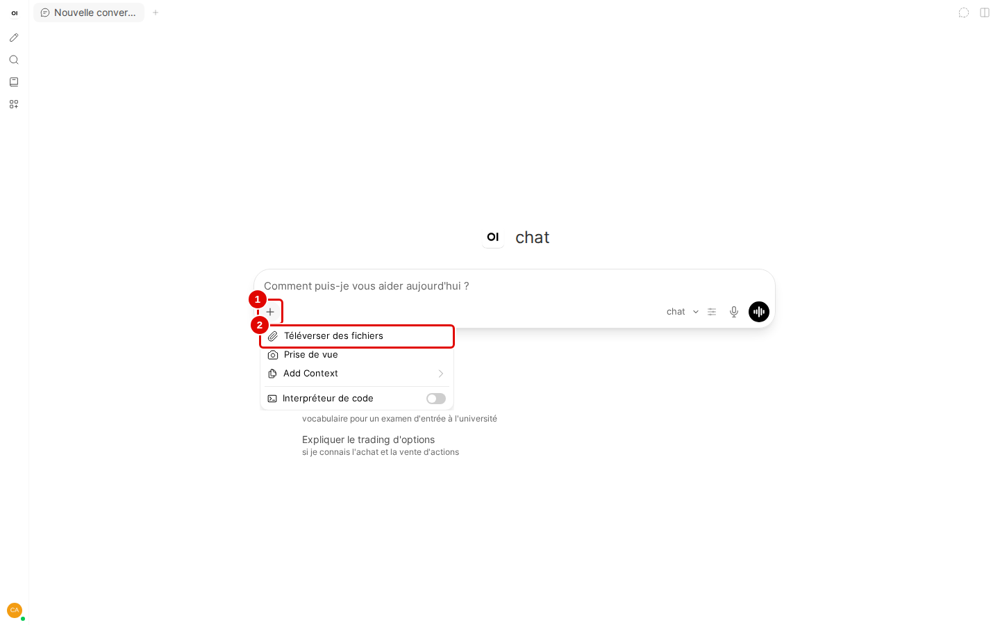
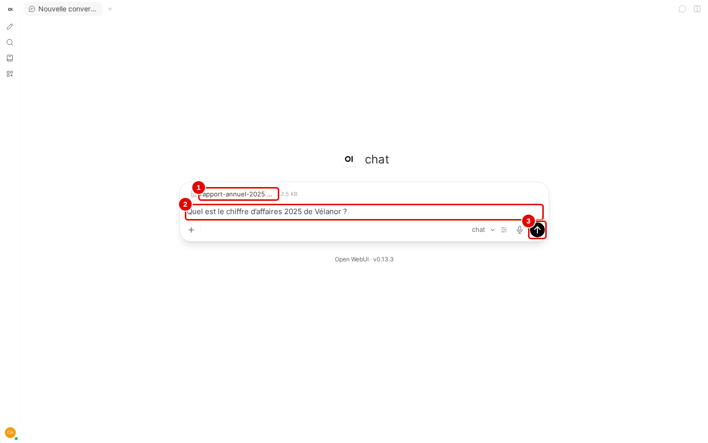
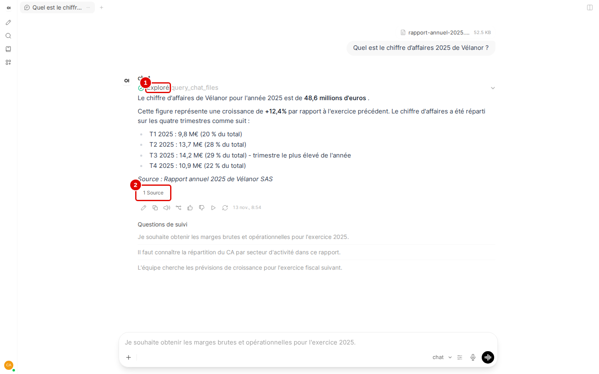
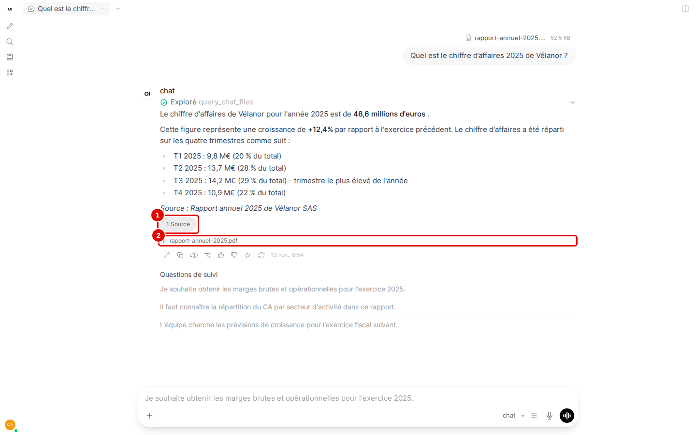
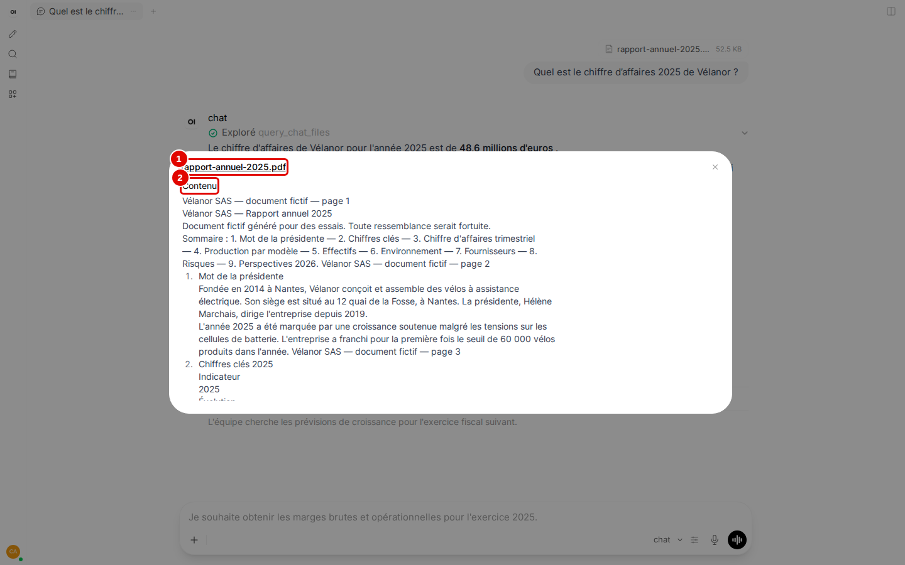

# 04. Première question en dix minutes

> Ce chapitre apprend le parcours le plus court : joindre un document à une conversation, poser une question et vérifier la source de la réponse.
> **Point de départ** : écran principal, connecté avec le compte administrateur (chapitre 03).
> **Durée** : environ 10 minutes. **Avant** : chapitre 03.

## Ce qu'il faut savoir

Le moyen le plus simple d'interroger un document est de le **joindre à une conversation**, comme une pièce jointe dans une messagerie. Open WebUI lit le fichier, le découpe en passages et calcule leur représentation (leurs embeddings, voir le [glossaire](18-glossaire.md)) ; le modèle cherche ensuite dans ce document pour répondre. Le document ne sert qu'à cette conversation. Pour interroger souvent les mêmes documents, mieux vaut les ranger dans une base de connaissances (chapitre 05).

Le modèle `chat` **réfléchit avant de répondre** : il écrit d'abord un raisonnement (caché par défaut), puis la réponse. Il **choisit lui-même** de chercher dans le document : la ligne « Exploré query_chat_files » au-dessus de la réponse indique qu'il l'a fait. Compter environ une minute pour une réponse.

L'exemple utilise le rapport annuel 2025 de Vélanor, entreprise fictive du jeu d'essai (`banc-essai/corpus/documents/rapport-annuel-2025.pdf` dans le dépôt).

## Joindre un document

**Étape 1. Ouvrir le menu d'ajout**
*Où* : barre latérale › « Nouvelle conversation », zone de saisie.
Cliquer sur « + » (pastille 1), à gauche sous la zone de saisie, puis sur « Téléverser des fichiers » (pastille 2).

*Écran : nouvelle conversation, menu « + » ouvert.*

| N° | Élément | Rôle |
|---|---|---|
| 1 | « + » | ouvre le menu d'ajout |
| 2 | « Téléverser des fichiers » | ouvre la fenêtre de choix de fichiers de Windows |

Les autres entrées du menu : « Prise de vue » (photo par la webcam), « Add Context » (joindre une base de connaissances, une note ou une conversation, chapitre 06) et « Interpréteur de code » (exécution de code par le modèle, non traitée dans ce manuel).

*Résultat* : la fenêtre « Ouvrir » de Windows s'affiche.

**Étape 2. Choisir le fichier et écrire la question**
*Où* : fenêtre « Ouvrir » de Windows, puis zone de saisie.
Choisir `rapport-annuel-2025.pdf` et cliquer sur « Ouvrir ». Le dossier du dépôt se trouve dans WSL : dans la barre d'adresse de la fenêtre « Ouvrir », taper `\\wsl.localhost\` suivi du nom de la distribution Ubuntu (sur le poste d'essai `Ubuntu-24.04`) et du chemin du dépôt, puis ouvrir `corpus\documents` ; le nom de la distribution s'affiche dans le terminal avec `echo $WSL_DISTRO_NAME`. Attendre que la vignette du fichier apparaisse au-dessus de la zone de saisie (pastille 1), puis taper la question : `Quel est le chiffre d'affaires 2025 de Vélanor ?` (pastille 2).

*Écran : nouvelle conversation, document joint, question saisie (la taille affichée sur la vignette, 2.5 KB, est provisoire : elle se met à jour une fois le fichier traité).*

| N° | Élément | Rôle |
|---|---|---|
| 1 | « rapport-annuel-2025.pdf » | document joint ; la croix qui apparaît au survol le retire |
| 2 | zone de saisie | question posée au modèle |
| 3 | flèche « Envoyer » | envoie la question (ou touche Entrée) |

*Résultat* : le document est joint, la question est prête.

## Poser la question et lire la réponse

**Étape 3. Envoyer et attendre la réponse**
*Où* : zone de saisie.
Cliquer sur la flèche « Envoyer » (pastille 3 de l'étape 2). La réponse s'écrit progressivement ; attendre qu'elle soit complète (environ une minute).

*Écran : conversation, réponse de `chat` avec sa source.*

| N° | Élément | Rôle |
|---|---|---|
| 1 | « Exploré query_chat_files » | le modèle a cherché dans le document joint ; un clic déplie le détail de la recherche |
| 2 | « 1 Source » | nombre de documents utilisés ; un clic les liste |

La réponse donne 48,6 M€, avec le détail par trimestre. Sous la réponse, une rangée d'icônes permet de la modifier, la copier, la lire à haute voix, dupliquer la conversation, la noter (pouce levé ou baissé), la poursuivre ou la régénérer (chapitre 06, étape 7). Plus bas, « Questions de suivi » propose des questions à poser ensuite, rédigées par le modèle.

*Résultat* : la réponse est affichée, avec le nombre de sources.

## Vérifier la source

**Étape 4. Ouvrir la liste des sources**
*Où* : sous la réponse, « 1 Source ».
Cliquer sur « 1 Source » (pastille 1).

*Écran : conversation, liste des sources dépliée.*

| N° | Élément | Rôle |
|---|---|---|
| 1 | « 1 Source » | déplie ou replie la liste |
| 2 | « rapport-annuel-2025.pdf » | document utilisé ; un clic ouvre son contenu |

Selon les réponses, le modèle insère aussi le nom du document en petite étiquette grise dans le texte, juste après l'information qu'il en tire : un clic sur l'étiquette ouvre la même fenêtre qu'à l'étape suivante.

*Résultat* : le document utilisé est listé.

**Étape 5. Lire le passage utilisé**
*Où* : liste des sources, « rapport-annuel-2025.pdf ».
Cliquer sur le nom du document (pastille 2 de l'étape 4).

*Écran : fenêtre de la source « rapport-annuel-2025.pdf ».*

| N° | Élément | Rôle |
|---|---|---|
| 1 | « rapport-annuel-2025.pdf » | nom du document utilisé |
| 2 | « Contenu » | texte transmis au modèle ; faire défiler pour trouver la page 3 et le tableau « Chiffres clés 2025 » |

Un document joint de petite taille (moins de 50 000 caractères, soit une vingtaine de pages) est transmis en entier : la fenêtre montre alors tout le texte, page par page. Pour un gros document, elle montre seulement les passages retrouvés.

*Résultat* : le chiffre de 48,6 M€ se retrouve dans le tableau « Chiffres clés 2025 » de la page 3. La réponse est vérifiée. Fermer la fenêtre par la croix.

## Bon à savoir

- Le document joint reste affiché au-dessus de la question dans la conversation ; il n'est pas ajouté aux bases de connaissances.
- Les formats lus sans réglage : PDF avec texte, Word, PowerPoint, Excel, HTML, Markdown, texte, audio (transcrit). Un PDF scanné (pages en image) n'est pas lu sans le lecteur Docling (chapitre 08).
- Le temps d'attente vient surtout de la réflexion du modèle et de la réécriture de la question avant la recherche : le chapitre 08 (étape 9) et le chapitre 07 (étape 12) montrent comment le réduire.

## En cas de problème

| Symptôme | Cause | Que faire |
|---|---|---|
| La réponse dit que l'information n'est pas disponible | le fichier n'était pas fini de traiter au moment de l'envoi, ou c'est un scan | attendre la vignette du fichier avant d'envoyer ; pour un scan, voir le chapitre 08 |
| Pas de ligne « Exploré » ni de source | le modèle a répondu sans chercher dans le document | reformuler en citant le document (« d'après le rapport joint… ») ; voir le [chapitre 17](17-en-cas-de-probleme.md) |
| La réponse ne vient pas | service de modèles arrêté | voir le [chapitre 17](17-en-cas-de-probleme.md) |

---
*Version décrite : Open WebUI 0.13.3, essais du 13 novembre 2026. Détails et preuves : [rapport d'essais](../annexes/A6-rapport-d-essais.md).*
